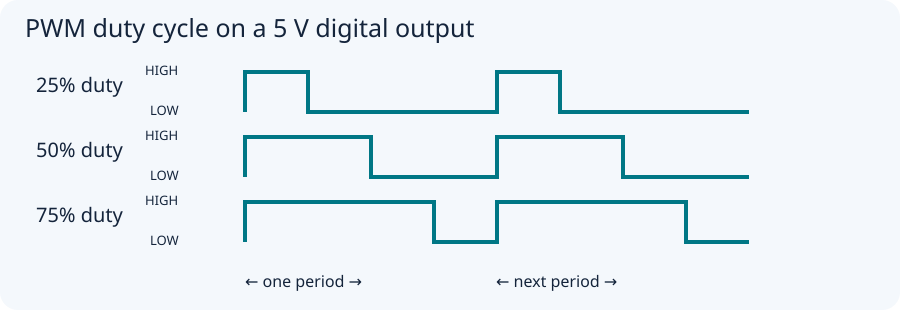
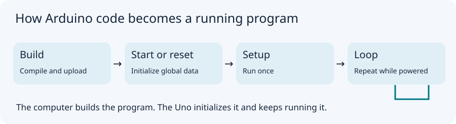

# Section 00 — Introduction to Robotics, Microcontrollers, Arduino & Electronics

[Start Learning](../../student-course/README.md) · [Glossary](../../resources/glossary.md)

Start here before the LED projects. You need an Arduino Uno R3 and a USB data cable for the connection test in 00.12. Keep the board headers empty until you reach the Class 1 wiring instructions.

| First understand | Then work with |
| --- | --- |
| [00.1 Computers](#computers) · [00.2 Microcontrollers](#microcontrollers) · [00.3 Embedded systems](#embedded) · [00.4 Robots](#robots) | [00.5 Arduino](#arduino) · [00.6 Uno hardware](#anatomy) · [00.7 Signals](#signals) · [00.8 Breadboards](breadboards.md) |
| [00.9 IDE](#ide) · [00.10 IDE interface](#interface) · [00.11 Code structure](#structure) | [00.12 Serial connection test](#connection) · [00.13 Assessment](#assessment) |

<a id="computers"></a>

## 00.1 What Is a Computer?

A computer receives **input**, processes it by following instructions, produces **output**, and uses **memory** to hold instructions and data. When you use a calculator, the keys are inputs. Its processor follows arithmetic instructions and the screen displays the result. A thermostat reads a temperature, compares it with a setting, and decides when to request heating or cooling.

**Hardware** is the physical equipment. **Software** is the program and its data. Changing a thermostat’s setpoint changes data without changing the hardware. Computers carry out instructions as written, which is why a wrong threshold can produce a repeatable wrong result.

<a id="microcontrollers"></a>

## 00.2 What Is a Microcontroller?

A microcontroller is a small computer on a chip. An **ATmega328P** on the Uno R3 contains a CPU that executes instructions, flash for the program, RAM for changing data, GPIO pins for signals, an ADC to measure voltage, and peripherals such as timers and serial interfaces.

A general-purpose computer can run many unrelated applications and usually has much more memory. A microcontroller typically starts a dedicated program when powered and repeatedly controls a device. Examples include a washing machine controller, a door sensor, and a small robot’s motor controller.

<a id="embedded"></a>

## 00.3 What Is an Embedded System?

An embedded system combines hardware and firmware inside a product to do a defined job. **Firmware** is the software running on the embedded controller. In the school’s night light, a light sensor supplies an input, the firmware compares the reading with a threshold, and an LED shows the result.

```text
Input                  Processing                   Output
Light sensor   ───►    Compare with threshold  ───►  LED on or off
```

Ground and power make the circuit work. The arrows in this diagram show how information moves.

<a id="robots"></a>

## 00.4 What Is a Robot?

A robot combines sensing, control, and physical action. **Sensors** report a condition. A **controller** runs code that decides what to do. **Actuators** create motion or another physical effect. The **mechanical structure** holds and transfers loads. The **power system** feeds the controller and the actuators. **Control logic** connects measurements with actions. A rover can sense an obstacle, decide how to steer, and change wheel motion.

Use the [NASA photograph of Sojourner on Mars](https://commons.wikimedia.org/wiki/File:Sojourner_on_Mars_PIA01122.jpg) and the [NASA rover subsystem illustration](https://commons.wikimedia.org/wiki/File:Sojourner_rover_scheme.jpg). Find the wheels and chassis in the photo, then use the labeled drawing to locate the cameras and power equipment. Explain why you cannot determine the rover’s control algorithm from the photo.

**Sense → Process → Act.** Class 1 starts with the output. Class 2 adds inputs and decisions. The capstone combines them.

<a id="arduino"></a>

## 00.5 What Is Arduino?

Arduino is an ecosystem of boards, software tools, and libraries. The **Uno R3** is the course’s 5 V board. Its labeled headers and built-in L LED make it easy to identify pins and verify a program. Nano and Mega boards are future Arduino options. **ESP32** and **ESP32-S3** are Espressif microcontroller families. Third-party boards using those chips can often be programmed with Arduino IDE after installing their board platform. Pin labels, pin capabilities, and voltage limits can differ. Keep the Uno R3 throughout the beginner path.

<a id="anatomy"></a>

## 00.6 Arduino Uno R3 Hardware Anatomy

The original numbered Uno photograph is pending. This guide uses the requested numbering. Compare it with your board using the [official Uno R3 pinout and board photo](https://docs.arduino.cc/hardware/uno-rev3/).

| Region | Find it on the board | What it does |
| --- | --- | --- |
| 1 | Digital D0–D13 | Configure each pin as input or output. Tildes identify PWM pins D3, D5, D6, D9, D10 and D11. D0/D1 carry hardware serial and should stay free during these lessons. |
| 2 | Analog A0–A5 | Measure voltage with a 10-bit ADC. A4/A5 also provide SDA/SCL for I²C. |
| 3 | POWER header | 5V and 3.3V supply suitable low-current components. GND is the shared reference. VIN is an input to the regulator. RESET restarts the controller when pulled low. IOREF indicates the board’s I/O reference voltage. |
| 4 | DC jack | Accepts an appropriate external DC supply. Use USB in the introductory lessons. Check the official voltage, polarity and current requirements before using the jack. |
| 5 | USB-B connector | Carries code uploads and serial data through the USB interface. Also supplies power to the board. Use a data cable. |
| 6 | RESET button | Restarts the sketch from initialization and setup. It does not erase the program. |

Locate the **ATmega328P**, the USB-to-serial interface near the USB connector, and the onboard **L** LED connected to D13. The separate TX/RX indicators show serial activity. The SPI signals are available on the ICSP header and on D10–D13 in the usual Uno mapping. Keep Uno signal voltages between GND and the board’s 5 V logic rail. Arduino lists 20 mA as the maximum per I/O pin in its pinout. Use a resistor for each LED and a suitable driver and supply for motors.

<a id="signals"></a>

## 00.7 Digital, Analog, and PWM

A **digital input** reads a logic state. A **digital output** drives HIGH or LOW. A normal Uno pin is configured for one direction at a time. An **analog input** uses the ADC to report a level from 0 to 1023 using the default reference. Near half of the reference voltage produces a reading near 512.

**PWM** switches a digital output rapidly. A 25% duty cycle spends one quarter of each period HIGH. At 5 V, the ideal time-average values at 25%, 50%, and 75% are about 1.25 V, 2.5 V, and 3.75 V respectively. An oscilloscope still shows pulses between LOW and HIGH. The Uno R3 has no built-in true DAC. With an LED and resistor, increasing duty cycle generally increases perceived brightness.



[Arduino PWM reference](https://docs.arduino.cc/language-reference/en/functions/analog-io/analogWrite/)

## 00.8 Introduction to Breadboards

<a id="exercise--blink-an-external-led"></a>

[Read the breadboard chapter](breadboards.md) before connecting external components. Use an unpowered breadboard to identify contact groups, split rails, and the center gap. Then return here for the IDE and upload instructions.

<a id="ide"></a>

## 00.9 What Is Arduino IDE?

Arduino IDE is the editor and upload tool. [Install Arduino IDE 2](https://www.arduino.cc/en/software), then open **Boards Manager** and install **Arduino AVR Boards**. Board platforms describe how to build and upload to supported boards. Libraries contain reusable code and are installed separately through **Library Manager**.

Plug in the Uno with a USB data cable. Select **Arduino Uno** and the port that appears when you plug it in. Windows names these ports COM followed by a number. Other operating systems use different names. If the port is missing, try a cable and USB port that you know carry data.

<a id="interface"></a>

## 00.10 Arduino IDE Interface

The original numbered Arduino IDE screenshot is pending. The table preserves the requested numbering. The [official IDE 2 guide](https://docs.arduino.cc/software/ide-v2/tutorials/getting-started/ide-v2-downloading-and-installing/) shows the current controls.

| Number | Editor area or control | Purpose |
| --- | --- | --- |
| 1 | Before `setup()` | Include headers and declare constants or global variables. |
| 2 | `void setup()` | Runs once after reset to configure pins, serial and other peripherals. |
| 3 | `void loop()` | Runs repeatedly after setup returns. |
| 4 | Boards Manager | Install and update board platforms. |
| 5 | Library Manager | Install reusable software libraries. |
| 6 | Verify and Upload | Verify compiles. Upload compiles and then transfers the result to the selected board. |
| 7 | Serial Monitor | Displays text from the running sketch and can send text back. Match the selected baud rate to the sketch. |

<a id="structure"></a>

## 00.11 Arduino Programming Structure

A sketch is an Arduino program. `#include` makes declarations from a header available at compile time. A variable is a named value. `const` marks a value that code cannot later modify. Examples include `int` for whole numbers, `bool` for true or false, and `float` for measurements with fractional values. A **function** groups statements and can take arguments. Braces enclose a block, semicolons end most statements, and `//` marks a line comment.

The compiler reads declarations while building a program. When the board starts, global values initialize before your `setup()` runs. Then the Arduino runtime calls `loop()` repeatedly. Global declarations do not run on each pass through loop.



| Instruction | What happens when it runs |
| --- | --- |
| `pinMode(13, OUTPUT)` | Configures D13 to drive a signal. |
| `digitalWrite(13, HIGH)` | Drives the configured output to HIGH. |
| `delay(500)` | Pauses the current program for 500 ms. |
| `Serial.begin(9600)` | Sets the serial data rate to 9600 baud. |
| `Serial.print(value)` | Writes text without ending the line. |
| `Serial.println(value)` | Writes text followed by a line ending. |

<a id="connection"></a>

## 00.12 Arduino First Connection Test

Leave the headers empty. Open [Serial Connection](serial_connection/serial_connection.ino) in Arduino IDE and read the [connection test notes](serial_connection/NOTES.md). Predict the first two lines after startup. Select the board and port, Verify, Upload, then open Serial Monitor at **9600 baud**. If you missed the startup message, press RESET. Expect `Uno ready` followed by numbered ticks once per second.

Close Serial Monitor and pause for several seconds. Reopen it and see whether opening your port also resets the Uno. The program runs on the microcontroller. Serial Monitor is a display on the computer. It does not need to stay open for the program to execute, and opening it can reset the Uno.

<a id="assessment"></a>

## 00.13 Beginner Assessment

- Describe input, processing, and output in a thermostat or rover.
- Point to the Uno’s D13, A0, 5V, and GND. Explain why PWM and analog input do different jobs.
- With power disconnected, find two connected breadboard holes and two separated by the central gap. Check a rail for a split.
- Identify `setup()` and `loop()` in the serial sketch. Explain which prints the startup message.
- Show two consecutive tick messages at 9600 baud, then explain what to check if the IDE has no port.

You are ready for Class 1 when you can identify the pins, explain one breadboard connection, and upload and observe the serial sketch independently.

**Next** · [Start Your First Arduino Project — Built-in LED Blink](../../student-course/02-leds-and-sound.md#builtin_blink).

[Teaching references](../../resources/teaching-references.md) · [Image sources](../../IMAGE-SOURCES.md)
