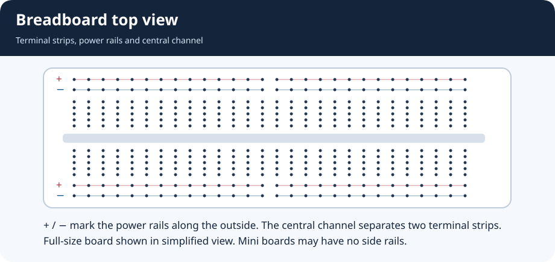
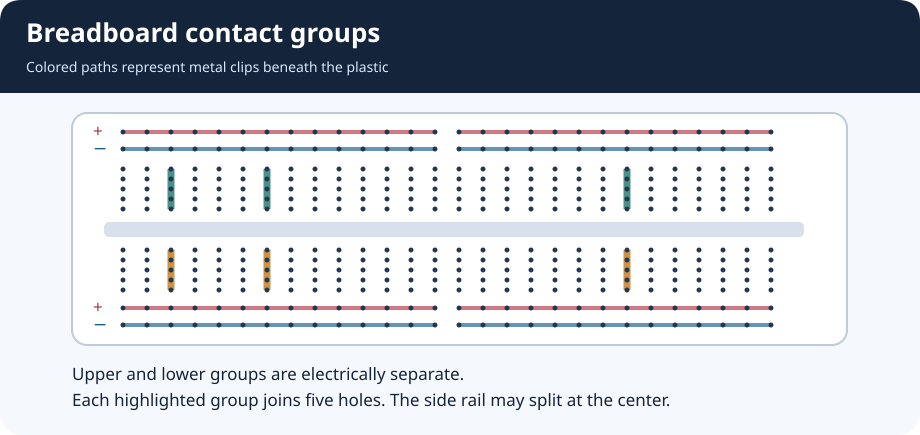
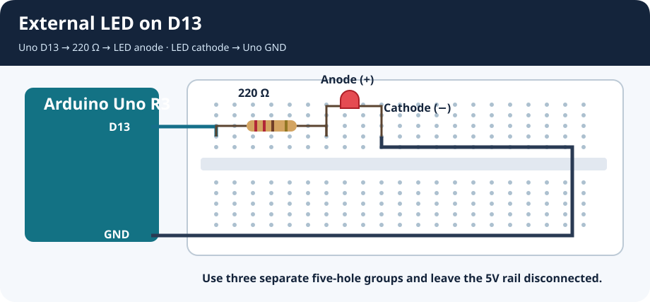

# What Is a Breadboard and How Does It Work?

[Start Learning](../../student-course/README.md) · [Previous · Built-in Blink](../../student-course/02-leds-and-sound.md#builtin_blink) · [Next · External LED](../../student-course/02-leds-and-sound.md#external_led)

A solderless breadboard is a reusable board for building a circuit without soldering. Spring contacts grip component leads and jumpers. You can test one circuit, disconnect power, then change it. This is useful for learning electronics, trying Arduino sensors and prototyping a robot’s control circuit.

## Recognize the board

*Solderless breadboard with terminal holes and side power rails · Evan-Amos · Public domain.*

A full-size board has room for several circuits and separate supply rails. A half-size board fits smaller experiments. A mini board may have only terminal strips. Check the layout of your own board before assuming the printed pattern matches this example.

*The side rails run along the two edges. The central channel separates the terminal strips. The printed + and − signs are labels. They do not supply voltage.*

## See which holes are connected

*A typical terminal group has five connected holes on one side of the channel. Across the gap is a different group. Adjacent groups down the strip are separate. The side rails may split near the center.*

With USB and all other supplies disconnected, use a multimeter in continuity mode. Check two holes in one five-hole group. Then check two holes across the channel and the two ends of each power rail. If a rail is split, bridge the matching halves only if both halves need the same voltage. Never bridge + to −.

## Make connections to the Uno

*Arduino Uno with a breadboard, jumper wires and resistors · Thctamm · [CC BY-SA 3.0](https://creativecommons.org/licenses/by-sa/3.0/).*

*This separate prototype shows the Uno and breadboard joined by jumpers. Use the pin map below for this exercise.*

1. Disconnect USB and external power. Find **5V** and **GND** in the Uno power header. Use the [Uno R3 board and downloadable pinout](https://docs.arduino.cc/hardware/uno-rev3/) if needed.
2. Connect Uno **GND** to the negative rail when the circuit has several return wires. Connect Uno **5V** to the positive rail only when the circuit needs a 5 V feed. This LED exercise uses D13 and GND, so leave the 5V rail disconnected.
3. Choose one electrical group for each junction. Put component legs that should meet into the same group. Keep separate nodes in separate groups.
4. Inspect the wiring. Verify continuity only with power disconnected. Check for a short across supply and ground before connecting USB.

### Series and parallel

In series, the same current passes through each part along one path. The LED and its resistor are in series. In parallel, two branches share the same two nodes and each has its own current path. If two LEDs are in parallel, use a series resistor in each LED branch. For a red LED with about 2 V across it, a 220 Ω resistor gives an estimate of (5 − 2) / 220 ≈ 14 mA. The exact current varies with the LED and pin voltage.

## Choose jumper ends

| Jumper | What the ends look like | When to use it | Photo |
| --- | --- | --- | --- |
| Male-to-male | Metal pin at each end | Uno socket to a breadboard hole | [Male-to-male jumper photos](https://www.adafruit.com/product/758) |
| Male-to-female | One metal pin and one socket | Module male pin to a breadboard or Uno socket | [Male-to-female jumper photos](https://www.adafruit.com/product/825) |
| Female-to-female | Socket at each end | Join two exposed male header pins | [Female-to-female jumper photos](https://www.adafruit.com/product/266) |

## Exercise · Blink an external LED

Parts: Arduino Uno R3, USB data cable, breadboard, two jumpers, red indicator LED, and a 220 Ω resistor. [Uno R3 board and downloadable pinout](https://docs.arduino.cc/hardware/uno-rev3/) identifies D13 and GND.

*D13 reaches the anode through 220 Ω. The cathode returns to GND. The three connection points occupy separate five-hole groups.*

1. Disconnect USB. Insert the LED with its two legs in separate groups. The long leg usually identifies the anode, and the flat edge usually marks the cathode. Check the part if the leads were cut.
2. Put one resistor lead in the LED anode group. Put the other lead in a third group and connect a jumper from that group to **D13**.
3. Connect a jumper between the cathode group and Uno **GND**. Trace the path D13 → resistor → anode → cathode → GND.
4. Reconnect USB. Open [external_led.ino](../../student-course/sketches/external_led/external_led.ino), select Arduino Uno, Verify and Upload.
5. The external LED and onboard L indicator should blink for about half a second on and half a second off. If the onboard LED blinks alone, disconnect USB and recheck the external path.

## Troubleshoot the breadboard

| What you see | What to check with power disconnected |
| --- | --- |
| Neither LED blinks | Confirm the upload, board, port and USB data cable |
| Onboard L blinks but external LED stays dark | Check LED polarity, the D13 jumper and the GND return |
| Both LED legs share one five-hole group | Move one leg to a different group so there is voltage across the LED |
| A sensor works on only one half of the breadboard | Check for a split rail and verify that its ground and supply reach the sensor |
| A wire looks one hole off | Check whether it shares the correct junction with continuity mode |
| Resistor is missing or shorted by a jumper | Restore the series resistor before applying power |

## Think Like an Engineer

Predict what the LED will do if you reverse it or if the wire moves to D8 while the code still uses D13. Explain why removing the resistor risks both the LED and the pin. Keep the resistor in place and test only one safe change at a time.

**Next** · [External LED project](../../student-course/02-leds-and-sound.md#external_led). For the full explanation, open [External LED notes](../../student-course/sketches/external_led/NOTES.md).

[Breadboard guide](https://learn.sparkfun.com/tutorials/how-to-use-a-breadboard/all) · [Image credits](../../IMAGE-SOURCES.md)
