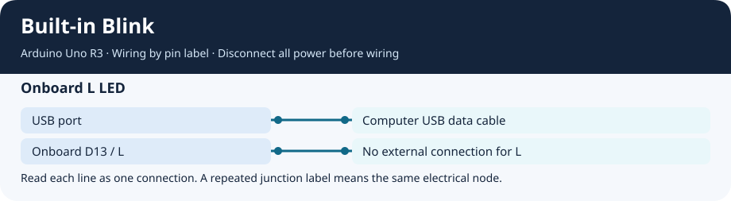

# Arduino, IDE and Blink

[School roadmap](../../README.md) · [Class 1](../README.md)

> **Optional hardware variation.** Follow this page with its own sketch and pin map. [Section 00](../../Class-01-Arduino-Fundamentals/00-Introduction/README.md) applies to both kits.

### Learning Objectives

Prerequisite: complete Section 00 and the previous linked lesson. In this lesson, explain and demonstrate microcontroller heartbeat indicators.

### Predict

Predict the period after doubling just the on time. Before uploading, record the expected outcome and the reason or line of code for your prediction.

| Condition or input | Prediction | Evidence in code | Observation after Run |
| --- | --- | --- | --- |
| First test | | | |
| Second test | | | |

### See the components and circuit

[Uno R3 board and downloadable pinout](https://docs.arduino.cc/hardware/uno-rev3/) · Use the source to identify the part and then follow the wiring map below.

Connection map for Built-in Blink on the Uno R3. Follow connector labels. A repeated junction label is one shared electrical node.

[Wiring diagram](../../lesson-visuals/alternate-blink.svg) · [Arduino sketch](blink/blink.ino) · [Detailed notes and engineering questions](blink/NOTES.md)

### Run

Using the matching sketch above, select **Arduino Uno**, Verify, then Upload. Check for this behavior: Onboard L LED blinks 500 ms on and 500 ms off.

Use an Arduino Uno R3, a USB **data** cable, and a computer. Leave every header empty.

- Find the USB connector, reset button, onboard **L** LED, digital header (D0–D13), analog header (A0–A5), and power header (5V and GND). The ATmega328P runs the sketch. The USB connection powers the board and lets the IDE upload code.
- Install [Arduino IDE 2](https://www.arduino.cc/en/software). In Boards Manager install **Arduino AVR Boards**. Connect the board, select **Arduino Uno** and its detected port, then open `blink.ino`. Keep the sketch folder name intact.
- Click **Verify** to compile, then **Upload** to transfer the sketch. Watch the **L** LED for a half-second on and half-second off.

`setup()` runs once after reset. `loop()` repeats. `pinMode()` sets the pin's role, `digitalWrite()` drives HIGH or LOW, and `delay()` pauses in milliseconds. The named constant `LED_BUILTIN` selects the onboard LED. A semicolon ends a statement, braces group statements, and `//` starts a comment.

**Try it.** Make a short 100 ms flash followed by 900 ms off. Predict the period before upload. Reset the board and confirm that the pattern restarts.

**If it fails.** If the port is missing, try a data cable and a direct USB port. If Verify succeeds but Upload fails, recheck the board and port, close any other serial monitor, and reconnect. If the board has several status LEDs, observe the one labeled **L**.

[Arduino Uno R3 pinout and documentation](https://docs.arduino.cc/hardware/uno-rev3/)

### Investigate

Trace one input or timing value from the source to an output. Use the [matching code walkthrough](blink/NOTES.md) to check your explanation and the pin map. Write one thing your observation confirms and one thing you still need to measure.

### Modify

Make two brief flashes then one longer dark gap.

### Make

Preserve the cadence with millis() and track timing error. Define what success will look like and keep the circuit within its original ratings.

### Troubleshoot

Use the symptom-specific checks in the [sketch notes](blink/NOTES.md#common-errors-and-troubleshooting). If the kit differs, check the parts and sketch together before moving any wires. Change one variable at a time.

### Knowledge Check

1. Which statements run once and which repeat?
2. Which two values determine the blink period?
3. How can you distinguish the L indicator from the power LED?

You should be able to explain the signal or timing, identify the line that controls it, and justify a troubleshooting measurement.

### Practical Checkpoint

Demonstrate the expected behavior above. Capture one timed, measured, or serial observation, and explain which line or connection caused it.

### Continue Learning

Next · [Breadboard LED](../../class-1/02-breadboard-led/README.md)
