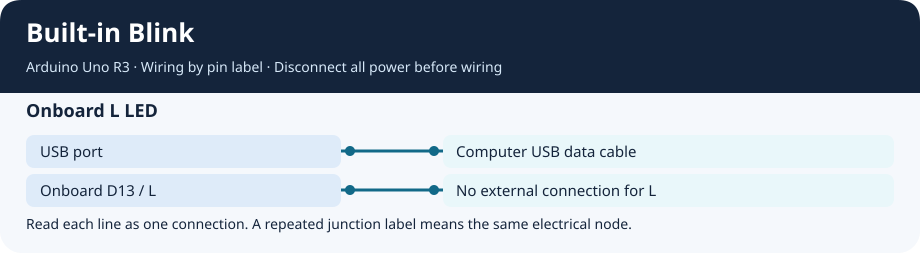

# Built-in Blink notes

[Project lesson](../README.md) · [Open Arduino sketch](blink.ino) · [Image credits](../../../IMAGE-SOURCES.md)

## What does this program do?

Onboard L LED blinks 500 ms on and 500 ms off.

## Components and their functions

Arduino Uno R3 runs the sketch. A USB data cable supplies logic power and transfers the sketch. Use a breadboard and jumpers for external low-current connections.

### Onboard L LED

The built-in L indicator is connected to digital pin 13 on the Uno. The board already provides its LED circuit.

[Uno R3 board and downloadable pinout](https://docs.arduino.cc/hardware/uno-rev3/) · Use the source to identify the part and then follow the wiring map below.

## Wiring explanation

Disconnect USB and any external motor supply before changing a wire. Inspect wiring against the labeled module before applying power.

| Start | End | What this connection does |
| --- | --- | --- |
| USB port | Computer USB data cable | Powers and programs the Uno |
| Onboard D13 / L | No external connection for L | The LED and its current limit are built in. |

Connection map for Built-in Blink on the Uno R3. Follow connector labels. A repeated junction label is one shared electrical node. [Open diagram](../../../lesson-visuals/alternate-blink.svg).

## Complete code walkthrough

LED_PIN uses LED_BUILTIN. setup marks that pin OUTPUT once. Each loop drives HIGH for 500 ms, then LOW for 500 ms. Each delay keeps the existing state until it ends.

## Program execution sequence

Reset → setup runs once → loop runs the logic described above → repeat from the top of loop.

## Variables and functions

- `LED_PIN` (`uint8_t`) starts at `LED_BUILTIN`. Check the pin map and move the wire only with power off if you change a pin.

- `pinMode(pin, mode)` · Configures a GPIO as output, input or input with an internal pull-up. It does not turn an LED on.
- `digitalWrite(pin, value)` · On an output, HIGH drives near 5 V and LOW near ground. The value is held until changed.
- `delay(milliseconds)` · Pauses the sketch in milliseconds. A value of 500 is half a second.

## Expected output

Onboard L LED blinks 500 ms on and 500 ms off.

## Common errors and troubleshooting

- Check the selected Uno board, USB data cable and port. The L indicator is different from the power LED.

## Real-world applications

This pattern can help explain microcontroller heartbeat indicators. A classroom prototype is useful for learning how the signal is produced and tested.

[See an Arduino wired to a breadboard](https://commons.wikimedia.org/wiki/File:Arduino_Uno_with_breadboard.jpg) for a comparable bench setup.

## Student challenges

1. **Beginner** · Predict the period after doubling just the on time.
2. **Intermediate** · Make two brief flashes then one longer dark gap.
3. **Optional advanced** · Preserve the cadence with millis() and track timing error.

## Think Like an Engineer

Before changing the code, make a prediction. Predict the period after doubling just the on time. Explain how to tell a timing change from a board or upload problem.

Write down one prediction, the single variable you changed, and the result. If they differ, propose a measurement that would distinguish two possible causes.
