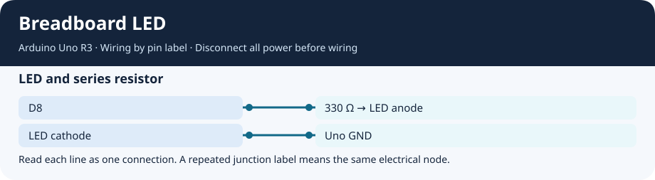

# Breadboard LED

[School roadmap](../../README.md) · [Class 1](../README.md)

> **Optional hardware variation.** Follow this page with its own sketch and pin map. [Section 00](../../Class-01-Arduino-Fundamentals/00-Introduction/README.md) applies to both kits.

### Learning Objectives

Prerequisite: complete Section 00 and the previous linked lesson. In this lesson, explain and demonstrate status indicators.

### Predict

Predict the brightness effect of a 1 kΩ resistor. Before uploading, record the expected outcome and the reason or line of code for your prediction.

| Condition or input | Prediction | Evidence in code | Observation after Run |
| --- | --- | --- | --- |
| First test | | | |
| Second test | | | |

### See the components and circuit

<a href="https://commons.wikimedia.org/wiki/File:Electronic-Component-Red-LED.jpg"></a>

*Two-lead through-hole red LED · Evan-Amos · Public domain.*

<a href="https://commons.wikimedia.org/wiki/File:Electronic-Axial-Lead-Resistors-Array.jpg"></a>

*Axial resistors with colored bands · Evan-Amos · Public domain.*

Use the resistance specified in the wiring table. Verify unfamiliar color bands with a multimeter before wiring.



Connection map for Breadboard LED on the Uno R3. Follow connector labels. A repeated junction label is one shared electrical node.

[Wiring diagram](../../lesson-visuals/alternate-breadboard_led.svg) · [Arduino sketch](breadboard_led/breadboard_led.ino) · [Detailed notes and engineering questions](breadboard_led/NOTES.md)

### Run

Using the matching sketch above, select **Arduino Uno**, Verify, then Upload. Check for this behavior: 750 ms on, 250 ms off

Disconnect USB and any external supply before changing wires. Reconnect power after checking the circuit.

Use a breadboard, one standard indicator LED, one 330 Ω resistor, and jumpers. In a typical solderless breadboard, each strip of five holes is connected within one side of the center gap. Power rails can break in the middle. Check with continuity mode while power is disconnected.

```text
D8 ── 330 Ω ── LED anode (+) → LED cathode (−) ── GND
```

Put the LED legs in separate electrical rows. Run D8 to one resistor lead. Join the other resistor lead to the anode row, then connect the cathode row to Arduino GND. The longer leg is usually the anode and the flat rim usually marks the cathode. Verify against the part if its legs have been trimmed. The resistor can go on either side of the LED in series. For a red LED with about 2 V forward drop, current is roughly (5 − 2) / 330 ≈ 9 mA.

Upload and check for 750 ms on and 250 ms off. Trace the complete current path while the pin is HIGH.

**Try it.** Predict the brightness change with 1 kΩ in place of 330 Ω. Power down before swapping the resistor, then compare.

**If it fails.** Power off and check polarity, rail continuity, separate LED rows, and the D8 jumper. An LED directly across D8 and GND needs its series resistor before power is restored.


### Investigate

Trace one input or timing value from the source to an output. Use the [matching code walkthrough](breadboard_led/NOTES.md) to check your explanation and the pin map. Write one thing your observation confirms and one thing you still need to measure.

### Modify

Change both delays to give equal on/off time at the same period.

### Make

Calculate current for two resistor values and compare the visible brightness. Define what success will look like and keep the circuit within its original ratings.

### Troubleshoot

Use the symptom-specific checks in the [sketch notes](breadboard_led/NOTES.md#common-errors-and-troubleshooting). If the kit differs, check the parts and sketch together before moving any wires. Change one variable at a time.

### Knowledge Check

1. Where does the current enter and leave the LED?
2. What changes when HIGH lasts longer?
3. Why must the resistor remain in series?

You should be able to explain the signal or timing, identify the line that controls it, and justify a troubleshooting measurement.

### Practical Checkpoint

Demonstrate the expected behavior above. Capture one timed, measured, or serial observation, and explain which line or connection caused it.

### Continue Learning

Previous · [Arduino, IDE and Blink](../../class-1/01-arduino-and-blink/README.md)

Next · [Traffic light model](../../class-1/03-traffic-lights/README.md)
