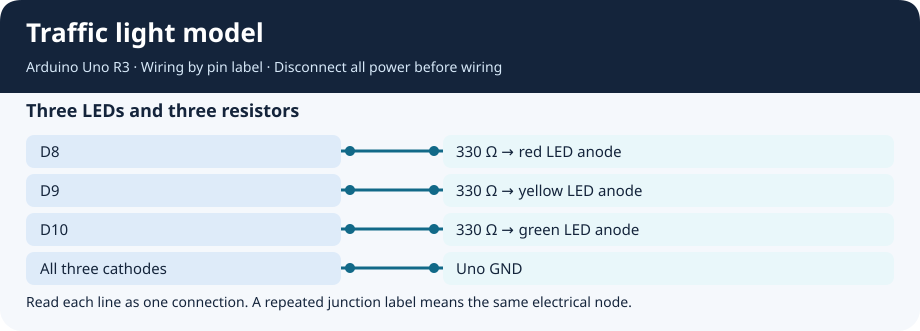

# Traffic light model

[School roadmap](../../README.md) · [Class 1](../README.md)

> **Optional hardware variation.** Follow this page with its own sketch and pin map. [Section 00](../../Class-01-Arduino-Fundamentals/00-Introduction/README.md) applies to both kits.

### Learning Objectives

Prerequisite: complete Section 00 and the previous linked lesson. In this lesson, explain and demonstrate sequenced signalling.

### Predict

Change the yellow time and compute the new cycle. Before uploading, record the expected outcome and the reason or line of code for your prediction.

| Condition or input | Prediction | Evidence in code | Observation after Run |
| --- | --- | --- | --- |
| First test | | | |
| Second test | | | |

### See the components and circuit

<a href="https://commons.wikimedia.org/wiki/File:Electronic-Component-Red-LED.jpg"></a>

*Two-lead through-hole red LED · Evan-Amos · Public domain.*

<a href="https://commons.wikimedia.org/wiki/File:Electronic-Axial-Lead-Resistors-Array.jpg"></a>

*Axial resistors with colored bands · Evan-Amos · Public domain.*

Use the resistance specified in the wiring table. Verify unfamiliar color bands with a multimeter before wiring.



Connection map for Traffic light model on the Uno R3. Follow connector labels. A repeated junction label is one shared electrical node.

[Wiring diagram](../../lesson-visuals/alternate-traffic_lights.svg) · [Arduino sketch](traffic_lights/traffic_lights.ino) · [Detailed notes and engineering questions](traffic_lights/NOTES.md)

### Run

Using the matching sketch above, select **Arduino Uno**, Verify, then Upload. Check for this behavior: Red 3 s, green 3 s, yellow 1 s

Disconnect USB and any external supply before changing wires. Reconnect power after checking the circuit.

Use red, yellow, and green LEDs, three 330 Ω resistors, and a common ground rail. Give each LED its own series resistor. All cathodes connect to the rail, and the rail connects to Uno GND.

```text
D8  ── 330 Ω ── red LED    ──┐
D9  ── 330 Ω ── yellow LED ──┼── Uno GND
D10 ── 330 Ω ── green LED  ──┘
          Current enters each LED's anode.
```

Upload and time the phases. Red lasts 3 s, green lasts 3 s, and yellow lasts 1 s before the cycle repeats. The helper `showLight()` turns every output off before it enables the requested color. Its two inputs select the pin and the phase length.

**Try it.** Write the phases in a table with pin and duration, then add two brief yellow flashes before returning to red. Verify that only one color is ever lit.

**If it fails.** If a color is wrong, trace its wire back to the pin labels. If two LEDs light together, look for an accidental shared anode row or a missing LOW write.


### Investigate

Trace one input or timing value from the source to an output. Use the [matching code walkthrough](traffic_lights/NOTES.md) to check your explanation and the pin map. Write one thing your observation confirms and one thing you still need to measure.

### Modify

Add a short dark gap and record what happens when showLight clears the outputs.

### Make

Replace the wait-based cycle with a three-phase state machine. Define what success will look like and keep the circuit within its original ratings.

### Troubleshoot

Use the symptom-specific checks in the [sketch notes](traffic_lights/NOTES.md#common-errors-and-troubleshooting). If the kit differs, check the parts and sketch together before moving any wires. Change one variable at a time.

### Knowledge Check

1. Why does each LED have its own resistor?
2. How would you check that only one lamp is active?
3. Which line controls the phase duration?

You should be able to explain the signal or timing, identify the line that controls it, and justify a troubleshooting measurement.

### Practical Checkpoint

Demonstrate the expected behavior above. Capture one timed, measured, or serial observation, and explain which line or connection caused it.

### Continue Learning

Previous · [Breadboard LED](../../class-1/02-breadboard-led/README.md)

Next · [Passive piezo buzzer](../../class-1/04-piezo-buzzer/README.md)
