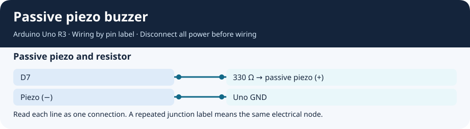

# Passive piezo buzzer

[School roadmap](../../README.md) · [Class 1](../README.md)

> **Optional hardware variation.** Follow this page with its own sketch and pin map. [Section 00](../../Class-01-Arduino-Fundamentals/00-Introduction/README.md) applies to both kits.

### Learning Objectives

Prerequisite: complete Section 00 and the previous linked lesson. In this lesson, explain and demonstrate electronic user feedback.

### Predict

Change 880 to 440 and predict the pitch. Before uploading, record the expected outcome and the reason or line of code for your prediction.

| Condition or input | Prediction | Evidence in code | Observation after Run |
| --- | --- | --- | --- |
| First test | | | |
| Second test | | | |

### See the components and circuit

[Passive piezo transducer product photos](https://www.adafruit.com/product/160) · Use the source to identify the part and then follow the wiring map below.



Connection map for Passive piezo buzzer on the Uno R3. Follow connector labels. A repeated junction label is one shared electrical node.

[Wiring diagram](../../lesson-visuals/alternate-piezo_beep.svg) · [Arduino sketch](piezo_beep/piezo_beep.ino) · [Detailed notes and engineering questions](piezo_beep/NOTES.md)

### Run

Using the matching sketch above, select **Arduino Uno**, Verify, then Upload. Check for this behavior: 880 Hz beep lasting 180 ms once a second

Disconnect USB and any external supply before changing wires. Reconnect power after checking the circuit.

Choose a small, high-impedance passive piezo transducer rated for a 5 V drive signal, a 330 Ω resistor, and jumpers. Some kits use the same buzzer label for active modules, magnetic sounders, and passive piezos. Check the part documentation before wiring. Use this circuit only with a passive piezo. Speakers and magnetic buzzers require a suitable driver.

```text
D7 ── 330 Ω ── piezo (+)      piezo (−) ── GND
```

Upload. Expect a short 880 Hz beep once per second. `tone(pin, frequency, duration)` starts a square wave and returns while the wave plays. Frequency in hertz controls pitch. The third argument sets how long the wave plays, in milliseconds. The resistor also limits the transient current as the piezo charges.

**Try it.** Change 880 Hz to 440 Hz and listen. Change the duration to 400 ms and describe what changed in the pitch and in the rhythm.

**If it fails.** Check D7, GND, and the part type. If the sound is very faint, confirm the rated resonant frequency and try a tone near it while keeping the same wiring.

[Arduino tone reference](https://docs.arduino.cc/language-reference/en/functions/advanced-io/tone/)


### Investigate

Trace one input or timing value from the source to an output. Use the [matching code walkthrough](piezo_beep/NOTES.md) to check your explanation and the pin map. Write one thing your observation confirms and one thing you still need to measure.

### Modify

Change the beep length without changing the repeat period.

### Make

Write a two-tone confirmation pattern using a table. Define what success will look like and keep the circuit within its original ratings.

### Troubleshoot

Use the symptom-specific checks in the [sketch notes](piezo_beep/NOTES.md#common-errors-and-troubleshooting). If the kit differs, check the parts and sketch together before moving any wires. Change one variable at a time.

### Knowledge Check

1. What unit is frequency specified in?
2. Which argument or wait sets duration?
3. How can you deliberately produce silence?

You should be able to explain the signal or timing, identify the line that controls it, and justify a troubleshooting measurement.

### Practical Checkpoint

Demonstrate the expected behavior above. Capture one timed, measured, or serial observation, and explain which line or connection caused it.

### Continue Learning

Previous · [Traffic light model](../../class-1/03-traffic-lights/README.md)

Next · [Compose a melody with AI](../../class-1/05-ai-melody/README.md)
