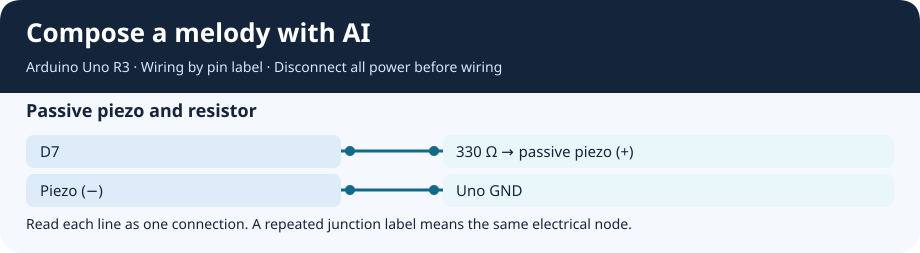

# Compose a melody with AI

[School roadmap](../../README.md) · [Class 1](../README.md)

> **Optional hardware variation.** Follow this page with its own sketch and pin map. [Section 00](../../Class-01-Arduino-Fundamentals/00-Introduction/README.md) applies to both kits.

### Learning Objectives

Prerequisite: complete Section 00 and the previous linked lesson. In this lesson, explain and demonstrate audible status sequences.

### Predict

Turn one note into a rest and predict the rhythm. Before uploading, record the expected outcome and the reason or line of code for your prediction.

| Condition or input | Prediction | Evidence in code | Observation after Run |
| --- | --- | --- | --- |
| First test | | | |
| Second test | | | |

### See the components and circuit

[Passive piezo transducer product photos](https://www.adafruit.com/product/160) · Use the source to identify the part and then follow the wiring map below.

Connection map for Compose a melody with AI on the Uno R3. Follow connector labels. A repeated junction label is one shared electrical node.

[Wiring diagram](../../lesson-visuals/alternate-ai_melody.svg) · [Arduino sketch](ai_melody/ai_melody.ino) · [Detailed notes and engineering questions](ai_melody/NOTES.md)

### Run

Using the matching sketch above, select **Arduino Uno**, Verify, then Upload. Check for this behavior: One six-event phrase on reset, then silence

Disconnect USB and any external supply before changing wires. Reconnect power after checking the circuit.

Keep the previous lesson's passive piezo and 330 Ω resistor on D7. The provided sketch plays an original six-event phrase once when the board resets. Press **RESET** to replay. A `Note` groups frequency and duration. The loop in `setup()` walks through those notes, adds a 40 ms gap, and treats 0 Hz as a rest.

1. Verify and upload the supplied sketch before editing.
2. Use the prompt below or write the phrase yourself.
3. Replace only the `melody[]` initializer. Check every pair against the limits in the prompt. Sketches generated elsewhere may target different pins or hardware.
4. Verify and upload again. Compare the rhythm you hear with the durations in your table.

> Give me an original six-event melody for a passive piezo. Return only a C++ initializer like {{262, 200}, {0, 120}}. Each pair is frequency in Hz and duration in ms. Use 220–2000 Hz for notes, 0 Hz for exactly one rest, and 100–500 ms for each event. Use no existing song.

**Try it.** Hum the same melody after doubling the duration of the final note. Record the original and edited note tables and explain which change you prefer.

**If it fails.** Check braces, commas, and the closing semicolon. If it plays once then goes quiet, press RESET. If rests beep, use the supplied `if` block that calls `noTone()`.

### Investigate

Trace one input or timing value from the source to an output. Use the [matching code walkthrough](ai_melody/NOTES.md) to check your explanation and the pin map. Write one thing your observation confirms and one thing you still need to measure.

### Modify

Ask AI for an original frequency-duration table and validate every value before editing the array.

### Make

Create two phrases and select one with a small function. Define what success will look like and keep the circuit within its original ratings.

### Troubleshoot

Use the symptom-specific checks in the [sketch notes](ai_melody/NOTES.md#common-errors-and-troubleshooting). If the kit differs, check the parts and sketch together before moving any wires. Change one variable at a time.

### Knowledge Check

1. What unit is frequency specified in?
2. Which argument or wait sets duration?
3. How can you deliberately produce silence?

You should be able to explain the signal or timing, identify the line that controls it, and justify a troubleshooting measurement.

### Practical Checkpoint

Demonstrate the expected behavior above. Capture one timed, measured, or serial observation, and explain which line or connection caused it.

### Continue Learning

Previous · [Passive piezo buzzer](../../class-1/04-piezo-buzzer/README.md)

Next · [Digital and analog I/O](../../class-2/01-digital-analog-io/README.md)
