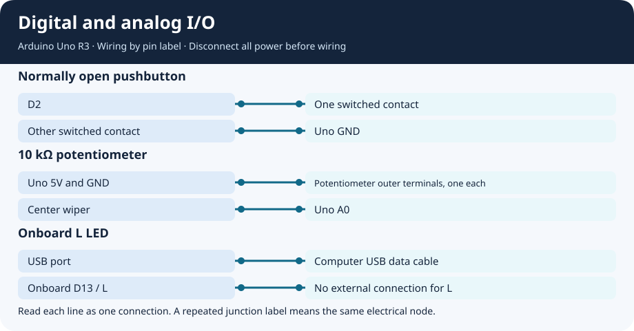

# Digital and analog I/O

[School roadmap](../../README.md) · [Class 2](../README.md)

### See the components and circuit

[Tactile switch photos](https://www.adafruit.com/product/367) · Use the source to identify the part and then follow the wiring map below.

Connection map for Digital and analog I/O on the Uno R3. Follow connector labels. A repeated junction label is one shared electrical node.

[Wiring diagram](../../lesson-visuals/alternate-digital_analog_io.svg) · [Arduino sketch](digital_analog_io/digital_analog_io.ino) · [Detailed notes and engineering questions](digital_analog_io/NOTES.md)

Disconnect USB and any external supply before changing wires. Reconnect power after checking the circuit.

Use a normally open pushbutton, a 10 kΩ linear potentiometer, and jumpers.

| Part | Uno connection |
| --- | --- |
| Button contacts | One switched side to D2, the other to GND |
| Potentiometer outer legs | One to 5V, the other to GND |
| Potentiometer center wiper | A0 |
| Output | Onboard L LED |

For a four-leg button, find the two switched sides with a continuity meter while unpowered. Each pair on the same side is typically already joined. Place the switch across the breadboard gap when its footprint permits.

Upload and open Serial Monitor at **9600 baud**. Released reads HIGH at D2 because of the internal pull-up. Pressed reads LOW and the sketch prints `button_pressed=1` and lights the LED. Turn the knob and look for readings near 0 and 1023 at the ends. The default analog reference on this Uno is the board's supply. Keep analog inputs between GND and 5V.

**Try it.** Record the switch states and three pot readings. Predict the effect of reversing the outer potentiometer leads, then power off and test it.

**If it fails.** A button that always reads pressed may be wired across a permanently joined pair. A pot reading stuck near an endpoint usually means A0 is on an outer leg or the wiper is shorted.

Previous · [Compose a melody with AI](../../class-1/05-ai-melody/README.md)

Next · [PWM LED dimmer](../../class-2/02-pwm-dimmer/README.md)
