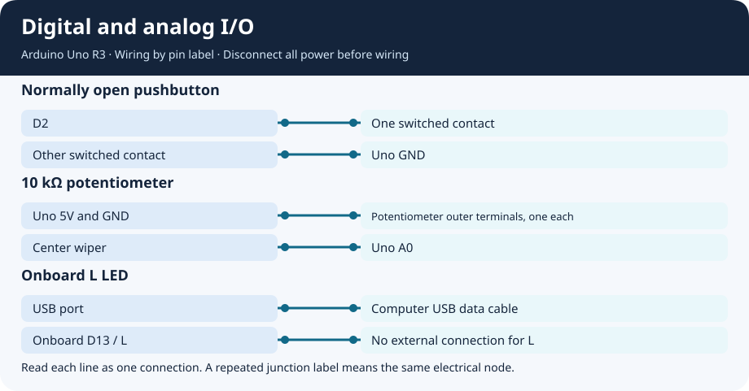

# Digital and analog I/O notes

[Project lesson](../README.md) · [Open Arduino sketch](digital_analog_io.ino) · [Image credits](../../../IMAGE-SOURCES.md)

## What does this program do?

9600 baud. button_pressed=1 pot=512 is an example for a pressed button and centered knob.

## Components and their functions

Arduino Uno R3 runs the sketch. A USB data cable supplies logic power and transfers the sketch. Use a breadboard and jumpers for external low-current connections.

### Normally open pushbutton

The switch joins two normally separate contacts when pressed. The internal pull-up gives the input a known state when released.

[Tactile switch photos](https://www.adafruit.com/product/367) · Use the source to identify the part and then follow the wiring map below.

### 10 kΩ potentiometer

Turning the knob moves an internal contact along a resistive track. Its wiper provides a voltage between ground and 5 V.

[Three-terminal potentiometer photos](https://www.adafruit.com/product/562) · Use the source to identify the part and then follow the wiring map below.

### Onboard L LED

The built-in L indicator is connected to digital pin 13 on the Uno. The board already provides its LED circuit.

[Uno R3 board and downloadable pinout](https://docs.arduino.cc/hardware/uno-rev3/) · Use the source to identify the part and then follow the wiring map below.

## Wiring explanation

Disconnect USB and any external motor supply before changing a wire. Inspect wiring against the labeled module before applying power.

| Start | End | What this connection does |
| --- | --- | --- |
| D2 | One switched contact | Reads LOW only while button is pressed |
| Other switched contact | Uno GND | Ground reference for active-low button |
| Uno 5V and GND | Potentiometer outer terminals, one each | Sets the two end voltages |
| Center wiper | Uno A0 | Feeds the adjustable input voltage |
| USB port | Computer USB data cable | Powers and programs the Uno |
| Onboard D13 / L | No external connection for L | The LED and its current limit are built in. |

Connection map for Digital and analog I/O on the Uno R3. Follow connector labels. A repeated junction label is one shared electrical node. [Open diagram](../../../lesson-visuals/alternate-digital_analog_io.svg).

## Complete code walkthrough

INPUT_PULLUP keeps D2 HIGH while open. Pressing the switch shorts D2 to GND, giving LOW. A boolean reverses this active-low input into a readable pressed state. analogRead captures the knob value separately. loop prints both and waits 50 ms.

## Program execution sequence

Reset → setup runs once → loop runs the logic described above → repeat from the top of loop.

## Variables and functions

- `BUTTON_PIN` (`uint8_t`) starts at `2`. Check the pin map and move the wire only with power off if you change a pin.
- `POT_PIN` (`uint8_t`) starts at `A0`. Check the pin map and move the wire only with power off if you change a pin.

- `pinMode(pin, mode)` · Configures a GPIO as output, input or input with an internal pull-up. It does not turn an LED on.
- `digitalWrite(pin, value)` · On an output, HIGH drives near 5 V and LOW near ground. The value is held until changed.
- `digitalRead(pin)` · Returns HIGH or LOW. A pull-up button goes LOW when pressed.
- `delay(milliseconds)` · Pauses the sketch in milliseconds. A value of 500 is half a second.
- `analogRead(pin)` · Returns 0–1023 on the Uno with its default reference. Record baselines before choosing a threshold.
- `Serial.begin(9600)` · Sets the serial connection rate. Choose 9600 baud in Serial Monitor if this sketch prints.

## Expected output

9600 baud. button_pressed=1 pot=512 is an example for a pressed button and centered knob.

## Common errors and troubleshooting

- Use continuity mode with USB disconnected to identify which contacts close on press. Check D2 and ground.
- Confirm the middle wiper goes to A0. Outer terminals go to 5V and GND, so swapping those outer leads with power off reverses direction.
- Check the selected Uno board, USB data cable and port. The L indicator is different from the power LED.

## Real-world applications

This pattern can help explain control panels with discrete and continuous inputs. A classroom prototype is useful for learning how the signal is produced and tested.

[See an Arduino wired to a breadboard](https://commons.wikimedia.org/wiki/File:Arduino_Uno_with_breadboard.jpg) for a comparable bench setup.

## Student challenges

1. **Beginner** · Make a table of pressed and released readings.
2. **Intermediate** · Turn the knob while pressing the button and explain why only one input changes.
3. **Optional advanced** · Add software debouncing and measure how it affects response.

## Think Like an Engineer

Why is a released input HIGH? Predict what happens if you remove INPUT_PULLUP and leave the switch open. What separate observation would distinguish a loose ground from a bad switch?

Write down one prediction, the single variable you changed, and the result. If they differ, propose a measurement that would distinguish two possible causes.
