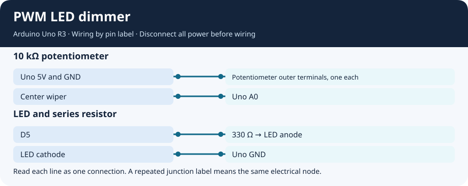

# PWM LED dimmer

[School roadmap](../../README.md) · [Class 2](../README.md)

### See the components and circuit

<a href="https://commons.wikimedia.org/wiki/File:Electronic-Component-Red-LED.jpg"></a>

*Two-lead through-hole red LED · Evan-Amos · Public domain.*

<a href="https://commons.wikimedia.org/wiki/File:Electronic-Axial-Lead-Resistors-Array.jpg"></a>

*Axial resistors with colored bands · Evan-Amos · Public domain.*

Use the resistance specified in the wiring table. Verify unfamiliar color bands with a multimeter before wiring.



Connection map for PWM LED dimmer on the Uno R3. Follow connector labels. A repeated junction label is one shared electrical node.

[Wiring diagram](../../lesson-visuals/alternate-pwm_dimmer.svg) · [Arduino sketch](pwm_dimmer/pwm_dimmer.ino) · [Detailed notes and engineering questions](pwm_dimmer/NOTES.md)

Disconnect USB and any external supply before changing wires. Reconnect power after checking the circuit.

Keep the potentiometer wired as in [Digital and analog I/O](../01-digital-analog-io/README.md). Add one indicator LED with a 330 Ω series resistor.

```text
5V ── potentiometer outer legs ── GND
                     wiper ────── A0

D5 (~) ── 330 Ω ── LED anode → cathode ── GND
```

Upload and sweep the knob. `map()` converts the analog input range of 0–1023 to a duty command of 0–255. The output pulses between LOW and HIGH. Higher duty means it spends more time HIGH, making the LED appear brighter. Compare 0, about 128, and 255. PWM on the Uno R3 is available on pins 3, 5, 6, 9, 10, and 11, marked with a tilde on the board.

**Try it.** Temporarily replace the mapped duty with 64, then 192. Predict the approximate duty percentages and compare visually.

**If it fails.** Check D5 and LED polarity. A non-PWM digital output can switch abruptly instead of dimming. Unstable brightness can come from a loose wiper wire.

[Arduino analogWrite reference](https://docs.arduino.cc/language-reference/en/functions/analog-io/analogWrite/)

Previous · [Digital and analog I/O](../../class-2/01-digital-analog-io/README.md)

Next · [LDR voltage divider and night light](../../class-2/03-ldr-night-light/README.md)
