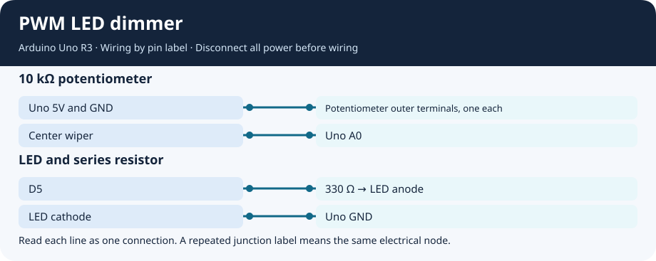

# PWM LED dimmer notes

[Project lesson](../README.md) · [Open Arduino sketch](pwm_dimmer.ino) · [Image credits](../../../IMAGE-SOURCES.md)

## What does this program do?

Brightness follows the knob from dark to bright

## Components and their functions

Arduino Uno R3 runs the sketch. A USB data cable supplies logic power and transfers the sketch. Use a breadboard and jumpers for external low-current connections.

### 10 kΩ potentiometer

Turning the knob moves an internal contact along a resistive track. Its wiper provides a voltage between ground and 5 V.

[Three-terminal potentiometer photos](https://www.adafruit.com/product/562) · Use the source to identify the part and then follow the wiring map below.

### LED and series resistor

The indicator LED emits light when current flows from anode to cathode. The 330 Ω resistor limits current in the same path.

*Two-lead through-hole red LED · Evan-Amos · Public domain.*

*Axial resistors with colored bands · Evan-Amos · Public domain.*

Use the resistance specified in the wiring table. Verify unfamiliar color bands with a multimeter before wiring.

## Wiring explanation

Disconnect USB and any external motor supply before changing a wire. Inspect wiring against the labeled module before applying power.

| Start | End | What this connection does |
| --- | --- | --- |
| Uno 5V and GND | Potentiometer outer terminals, one each | Sets the two end voltages |
| Center wiper | Uno A0 | Feeds the adjustable input voltage |
| D5 | 330 Ω → LED anode | Output signal or PWM as configured in the sketch |
| LED cathode | Uno GND | Completes the current path |

Connection map for PWM LED dimmer on the Uno R3. Follow connector labels. A repeated junction label is one shared electrical node. [Open diagram](../../../lesson-visuals/alternate-pwm_dimmer.svg).

## Complete code walkthrough

The pot wiper produces 0–1023 at A0. map scales it to 0–255. analogWrite changes the D5 duty cycle. A 20 ms pause limits update rate. The pin remains a digital PWM signal.

## Program execution sequence

Reset → setup runs once → loop runs the logic described above → repeat from the top of loop.

## Variables and functions

- `POT_PIN` (`uint8_t`) starts at `A0`. Check the pin map and move the wire only with power off if you change a pin.
- `PWM_LED_PIN` (`uint8_t`) starts at `5`. Check the pin map and move the wire only with power off if you change a pin.

- `pinMode(pin, mode)` · Configures a GPIO as output, input or input with an internal pull-up. It does not turn an LED on.
- `delay(milliseconds)` · Pauses the sketch in milliseconds. A value of 500 is half a second.
- `analogRead(pin)` · Returns 0–1023 on the Uno with its default reference. Record baselines before choosing a threshold.
- `map(value, low, high, outLow, outHigh)` · Rescales integer values. The two pairs are the input and output ranges.
- `analogWrite(pin, duty)` · On an Uno PWM pin, duty 0 is continuously off and 255 is continuously on. Intermediate values vary the on-time.

## Expected output

Brightness follows the knob from dark to bright

## Common errors and troubleshooting

- Confirm the middle wiper goes to A0. Outer terminals go to 5V and GND, so swapping those outer leads with power off reverses direction.
- With power off, check the anode, cathode, series resistor and separate breadboard groups. Verify the Arduino pin in the sketch.

## Real-world applications

This pattern can help explain knob-controlled lighting. A classroom prototype is useful for learning how the signal is produced and tested.

[See an Arduino wired to a breadboard](https://commons.wikimedia.org/wiki/File:Arduino_Uno_with_breadboard.jpg) for a comparable bench setup.

## Student challenges

1. **Beginner** · Predict duty at both ends and around halfway.
2. **Intermediate** · Try a fixed duty of 64 and then 192 and compare.
3. **Optional advanced** · Change the mapping to make low-light adjustments easier.

## Think Like an Engineer

The pin drives a series current path. What would happen if the resistor were omitted, the wire moved to a different pin without changing the code, or the LED reversed? Explain each outcome from current, pin selection and polarity. Draw the unsafe case on paper and never power an LED without its resistor.

Write down one prediction, the single variable you changed, and the result. If they differ, propose a measurement that would distinguish two possible causes.
