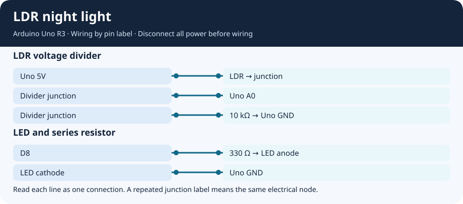

# LDR voltage divider and night light

[School roadmap](../../README.md) · [Class 2](../README.md)

> **Optional hardware variation.** Follow this page with its own sketch and pin map. [Section 00](../../Class-01-Arduino-Fundamentals/00-Introduction/README.md) applies to both kits.

### Learning Objectives

Prerequisite: complete Section 00 and the previous linked lesson. In this lesson, explain and demonstrate lighting with hysteresis.

### Predict

Predict the outcome at ADC 400 from each prior state. Before uploading, record the expected outcome and the reason or line of code for your prediction.

| Condition or input | Prediction | Evidence in code | Observation after Run |
| --- | --- | --- | --- |
| First test | | | |
| Second test | | | |

### See the components and circuit

<a href="https://commons.wikimedia.org/wiki/File:Electronic-Component-Red-LED.jpg"></a>

*Two-lead through-hole red LED · Evan-Amos · Public domain.*

<a href="https://commons.wikimedia.org/wiki/File:Electronic-Axial-Lead-Resistors-Array.jpg"></a>

*Axial resistors with colored bands · Evan-Amos · Public domain.*

Use the resistance specified in the wiring table. Verify unfamiliar color bands with a multimeter before wiring.



Connection map for LDR night light on the Uno R3. Follow connector labels. A repeated junction label is one shared electrical node.

[Wiring diagram](../../lesson-visuals/alternate-ldr_night_light.svg) · [Arduino sketch](ldr_night_light/ldr_night_light.ino) · [Detailed notes and engineering questions](ldr_night_light/NOTES.md)

### Run

Using the matching sketch above, select **Arduino Uno**, Verify, then Upload. Check for this behavior: 9600 baud. ADC readings decrease when covered. Lamp switches on at ≤350 and off at ≥450.

Disconnect USB and any external supply before changing wires. Reconnect power after checking the circuit.

Use a loose two-lead photoresistor (LDR), a 10 kΩ resistor, an LED, and a 330 Ω resistor. Remove the potentiometer from A0.

```text
5V ─── LDR ───●─── 10 kΩ ─── GND
              └─── A0

D8 ── 330 Ω ── LED anode → cathode ── GND
```

The LDR resistance drops with more light. With the LDR at the top of this divider, the junction voltage rises as it gets brighter. The junction voltage is approximately `5 V × 10 kΩ / (LDR resistance + 10 kΩ)`. The ADC turns that voltage into a number.

At **9600 baud**, record the dark and bright values with the light in its intended position. Adjust `DARK_ON` and `BRIGHT_OFF` to sit between those readings with `DARK_ON < BRIGHT_OFF`. The `if` switches on the LED in darkness and the `else if` switches it off in brightness. Between thresholds the sketch retains the old state. This dead band is hysteresis.

**Try it.** Collect six readings in each lighting condition. Choose thresholds and demonstrate that brief variations inside the band leave the LED unchanged.

**If it fails.** If covering the sensor raises the reading, check the order of the LDR and fixed resistor. If numbers stay fixed, make sure A0 shares only the divider's midpoint and that both rails reach the Uno. Move the lamp LED away from the LDR if it causes feedback.


### Investigate

Trace one input or timing value from the source to an output. Use the [matching code walkthrough](ldr_night_light/NOTES.md) to check your explanation and the pin map. Write one thing your observation confirms and one thing you still need to measure.

### Modify

Record bright and dark values and choose thresholds between them.

### Make

Log transitions separately and compare a single threshold against hysteresis. Define what success will look like and keep the circuit within its original ratings.

### Troubleshoot

Use the symptom-specific checks in the [sketch notes](ldr_night_light/NOTES.md#common-errors-and-troubleshooting). If the kit differs, check the parts and sketch together before moving any wires. Change one variable at a time.

### Knowledge Check

1. Which node connects to the ADC?
2. Why can light change the ADC value?
3. What evidence would justify moving the threshold?

You should be able to explain the signal or timing, identify the line that controls it, and justify a troubleshooting measurement.

### Practical Checkpoint

Demonstrate the expected behavior above. Capture one timed, measured, or serial observation, and explain which line or connection caused it.

### Continue Learning

Previous · [PWM LED dimmer](../../class-2/02-pwm-dimmer/README.md)

Next · [DHT22 temperature and humidity alarm](../../class-2/04-dht-alarm/README.md)
