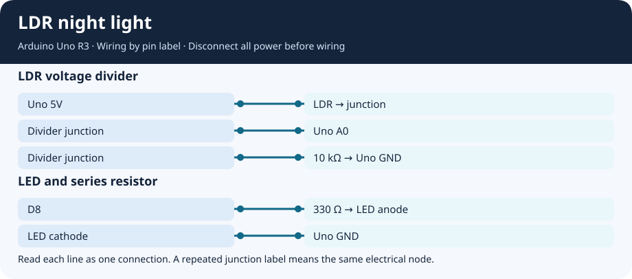

# LDR night light notes

[Project lesson](../README.md) · [Open Arduino sketch](ldr_night_light.ino) · [Image credits](../../../IMAGE-SOURCES.md)

## What does this program do?

9600 baud. ADC readings decrease when covered. Lamp switches on at ≤350 and off at ≥450.

## Components and their functions

Arduino Uno R3 runs the sketch. A USB data cable supplies logic power and transfers the sketch. Use a breadboard and jumpers for external low-current connections.

### LDR voltage divider

The photoresistor decreases in resistance under brighter light. A 10 kΩ resistor makes a divider so the Uno can measure the changing junction voltage.

[Photoresistor product photos](https://www.adafruit.com/product/161) · Use the source to identify the part and then follow the wiring map below.

### LED and series resistor

The indicator LED emits light when current flows from anode to cathode. The 330 Ω resistor limits current in the same path.

*Two-lead through-hole red LED · Evan-Amos · Public domain.*

*Axial resistors with colored bands · Evan-Amos · Public domain.*

Use the resistance specified in the wiring table. Verify unfamiliar color bands with a multimeter before wiring.

## Wiring explanation

Disconnect USB and any external motor supply before changing a wire. Inspect wiring against the labeled module before applying power.

| Start | End | What this connection does |
| --- | --- | --- |
| Uno 5V | LDR → junction | Upper leg of voltage divider |
| Divider junction | Uno A0 | Analog input taps the same electrical node |
| Divider junction | 10 kΩ → Uno GND | Lower leg of voltage divider |
| D8 | 330 Ω → LED anode | Output signal or PWM as configured in the sketch |
| LED cathode | Uno GND | Completes the current path |

Connection map for LDR night light on the Uno R3. Follow connector labels. A repeated junction label is one shared electrical node. [Open diagram](../../../lesson-visuals/alternate-ldr_night_light.svg).

## Complete code walkthrough

The ADC reads the voltage divider. The two threshold comparisons change lampOn only outside the band. digitalWrite uses the remembered state so readings between thresholds do not make the lamp flicker.

## Program execution sequence

Reset → setup runs once → loop runs the logic described above → repeat from the top of loop.

## Variables and functions

- `LDR_PIN` (`uint8_t`) starts at `A0`. Check the pin map and move the wire only with power off if you change a pin.
- `LED_PIN` (`uint8_t`) starts at `8`. Check the pin map and move the wire only with power off if you change a pin.
- `DARK_ON` (`int`) starts at `350`. Predict what changes in the walkthrough before editing this value.
- `BRIGHT_OFF` (`int`) starts at `450`. Predict what changes in the walkthrough before editing this value.

- `pinMode(pin, mode)` · Configures a GPIO as output, input or input with an internal pull-up. It does not turn an LED on.
- `digitalWrite(pin, value)` · On an output, HIGH drives near 5 V and LOW near ground. The value is held until changed.
- `delay(milliseconds)` · Pauses the sketch in milliseconds. A value of 500 is half a second.
- `analogRead(pin)` · Returns 0–1023 on the Uno with its default reference. Record baselines before choosing a threshold.
- `Serial.begin(9600)` · Sets the serial connection rate. Choose 9600 baud in Serial Monitor if this sketch prints.

## Expected output

9600 baud. ADC readings decrease when covered. Lamp switches on at ≤350 and off at ≥450.

## Common errors and troubleshooting

- If the readings run backward, check the LDR is on the 5V side of the divider. If readings are fixed, check the A0 junction and both supply rails.
- With power off, check the anode, cathode, series resistor and separate breadboard groups. Verify the Arduino pin in the sketch.

## Real-world applications

This pattern can help explain lighting with hysteresis. A classroom prototype is useful for learning how the signal is produced and tested.

[See an Arduino wired to a breadboard](https://commons.wikimedia.org/wiki/File:Arduino_Uno_with_breadboard.jpg) for a comparable bench setup.

## Student challenges

1. **Beginner** · Predict the outcome at ADC 400 from each prior state.
2. **Intermediate** · Record bright and dark values and choose thresholds between them.
3. **Optional advanced** · Log transitions separately and compare a single threshold against hysteresis.

## Think Like an Engineer

The pin drives a series current path. What would happen if the resistor were omitted, the wire moved to a different pin without changing the code, or the LED reversed? Explain each outcome from current, pin selection and polarity. Draw the unsafe case on paper and never power an LED without its resistor.

Write down one prediction, the single variable you changed, and the result. If they differ, propose a measurement that would distinguish two possible causes.
