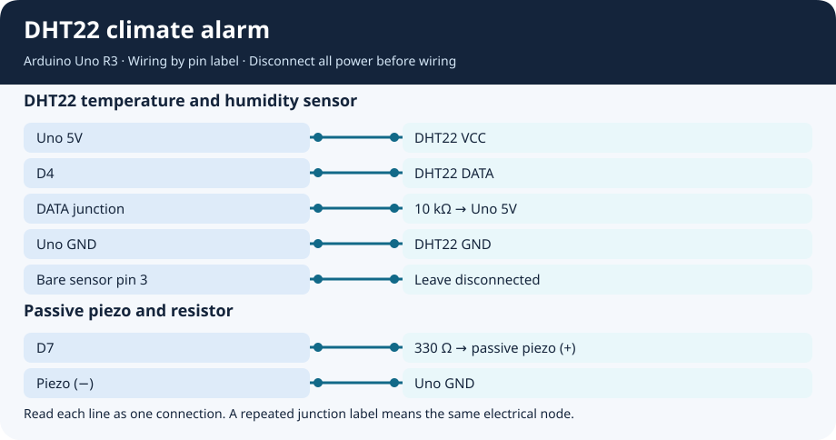

# DHT22 temperature and humidity alarm

[School roadmap](../../README.md) · [Class 2](../README.md)

> **Optional hardware variation.** Follow this page with its own sketch and pin map. [Section 00](../../Class-01-Arduino-Fundamentals/00-Introduction/README.md) applies to both kits.

### Learning Objectives

Prerequisite: complete Section 00 and the previous linked lesson. In this lesson, explain and demonstrate environmental trend and threshold indicators.

### Predict

Predict the alarm at 30 °C and 50% RH. Before uploading, record the expected outcome and the reason or line of code for your prediction.

| Condition or input | Prediction | Evidence in code | Observation after Run |
| --- | --- | --- | --- |
| First test | | | |
| Second test | | | |

### See the components and circuit

[DHT22 and DHT11 package examples](https://learn.adafruit.com/dht/overview) · Use the source to identify the part and then follow the wiring map below.

Connection map for DHT22 climate alarm on the Uno R3. Follow connector labels. A repeated junction label is one shared electrical node.

[Wiring diagram](../../lesson-visuals/alternate-dht_alarm.svg) · [Arduino sketch](dht_alarm/dht_alarm.ino) · [Detailed notes and engineering questions](dht_alarm/NOTES.md)

### Run

Using the matching sketch above, select **Arduino Uno**, Verify, then Upload. Check for this behavior: 9600 baud. Example 27.00 C, 65.00 %RH. Brief beeps above either threshold.

Disconnect USB and any external supply before changing wires. Reconnect power after checking the circuit.

Use a bare four-pin DHT22, a 10 kΩ pull-up resistor, and the [Class 1 piezo circuit](../../class-1/04-piezo-buzzer/README.md) on D7. For a bare DHT22 with the grille facing you and its pins pointing down, read left to right. For a breakout, follow its printed pin labels and check whether it includes a pull-up.

| DHT22 pin | Connection |
| --- | --- |
| 1 · VCC | Uno 5V |
| 2 · DATA | Uno D4 and one end of the 10 kΩ resistor |
| 3 · NC | Leave open |
| 4 · GND | Uno GND |

Connect the other end of the 10 kΩ resistor to 5V. In Arduino IDE Library Manager install **DHT sensor library** by Adafruit and **Adafruit Unified Sensor**. Select **Arduino Uno**, then verify and upload.

Open Serial Monitor at **9600 baud**. A new sample prints about every 2.5 s. Temperature is in °C and humidity is in percent relative humidity (%RH). The piezo beeps if either reading meets its threshold. A failed reading prints an error and silences the piezo. A DHT22 needs at least two seconds between samples.

**Try it.** Use the current readings to temporarily lower one threshold below ambient, verify a beep, then raise it above ambient and verify silence. Keep the sensor dry.

**If it fails.** A missing `DHT.h` means the sensor library is missing. If readings fail, check the pins, 5V, shared ground, pull-up, and that the installed part is a DHT22.

[Adafruit DHT wiring guide](https://learn.adafruit.com/dht/connecting-to-a-dhtxx-sensor)

### Investigate

Trace one input or timing value from the source to an output. Use the [matching code walkthrough](dht_alarm/NOTES.md) to check your explanation and the pin map. Write one thing your observation confirms and one thing you still need to measure.

### Modify

Test around room conditions by adjusting thresholds, then restore them.

### Make

Add a counter for failed readings and explain when it should reset. Define what success will look like and keep the circuit within its original ratings.

### Troubleshoot

Use the symptom-specific checks in the [sketch notes](dht_alarm/NOTES.md#common-errors-and-troubleshooting). If the kit differs, check the parts and sketch together before moving any wires. Change one variable at a time.

### Knowledge Check

1. What are the two reported units?
2. How do you recognize a failed reading?
3. Why do you need a sampling interval?

You should be able to explain the signal or timing, identify the line that controls it, and justify a troubleshooting measurement.

### Practical Checkpoint

Demonstrate the expected behavior above. Capture one timed, measured, or serial observation, and explain which line or connection caused it.

### Continue Learning

Previous · [LDR voltage divider and night light](../../class-2/03-ldr-night-light/README.md)

Next · [Ultrasonic distance and proximity buzzer](../../class-2/05-ultrasonic-proximity/README.md)
