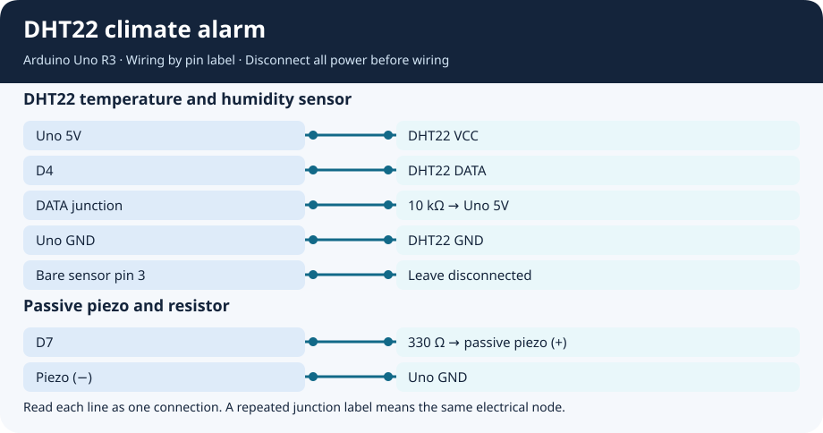

# DHT22 climate alarm notes

[Project lesson](../README.md) · [Open Arduino sketch](dht_alarm.ino) · [Image credits](../../../IMAGE-SOURCES.md)

## What does this program do?

9600 baud. Example 27.00 C, 65.00 %RH. Brief beeps above either threshold.

## Components and their functions

Arduino Uno R3 runs the sketch. A USB data cable supplies logic power and transfers the sketch. Use a breadboard and jumpers for external low-current connections.

### DHT22 temperature and humidity sensor

The sensor measures air temperature and relative humidity and transmits a timed digital message. A bare sensor needs a data pull-up.

[DHT22 and DHT11 package examples](https://learn.adafruit.com/dht/overview) · Use the source to identify the part and then follow the wiring map below.

### Passive piezo and resistor

A high-impedance passive piezo rated for 5 V turns the square wave into sound. The 330 Ω series resistor limits transient current.

[Passive piezo transducer product photos](https://www.adafruit.com/product/160) · Use the source to identify the part and then follow the wiring map below.

## Wiring explanation

Disconnect USB and any external motor supply before changing a wire. Inspect wiring against the labeled module before applying power.

| Start | End | What this connection does |
| --- | --- | --- |
| Uno 5V | DHT22 VCC | Supplies the sensor |
| D4 | DHT22 DATA | Timed digital data line |
| DATA junction | 10 kΩ → Uno 5V | Pull-up for bare sensor; check breakout |
| Uno GND | DHT22 GND | Common reference |
| Bare sensor pin 3 | Leave disconnected | NC; confirm pin order or breakout labels |
| D7 | 330 Ω → passive piezo (+) | The tone or note signal |
| Piezo (−) | Uno GND | Completes the return path |

Connection map for DHT22 climate alarm on the Uno R3. Follow connector labels. A repeated junction label is one shared electrical node. [Open diagram](../../../lesson-visuals/alternate-dht_alarm.svg).

## Complete code walkthrough

setup opens Serial and initializes the DHT22. loop waits 2500 ms, reads both values and exits early on NaN. A logical OR selects a 180 ms alarm tone when temperature reaches 30 °C or humidity reaches 75%.

## Program execution sequence

Reset → setup runs once → loop runs the logic described above → repeat from the top of loop.

## Variables and functions

- `DHT_PIN` (`uint8_t`) starts at `4`. Check the pin map and move the wire only with power off if you change a pin.
- `PIEZO_PIN` (`uint8_t`) starts at `7`. Check the pin map and move the wire only with power off if you change a pin.
- `TEMP_LIMIT_C` (`float`) starts at `30.0`. Predict what changes in the walkthrough before editing this value.
- `HUMIDITY_LIMIT` (`float`) starts at `75.0`. Predict what changes in the walkthrough before editing this value.

- `pinMode(pin, mode)` · Configures a GPIO as output, input or input with an internal pull-up. It does not turn an LED on.
- `delay(milliseconds)` · Pauses the sketch in milliseconds. A value of 500 is half a second.
- `tone(pin, frequency, duration)` · Starts a square wave. The frequency is in hertz. With no duration, use noTone to stop it.
- `noTone(pin)` · Stops the waveform on the buzzer pin.
- `Serial.begin(9600)` · Sets the serial connection rate. Choose 9600 baud in Serial Monitor if this sketch prints.
- `isnan(value)` · Detects an invalid floating-point sensor result before threshold decisions.
- `dht.begin()` · Initializes the selected sensor library before reading. Install the Adafruit DHT and Unified Sensor libraries.

## Expected output

9600 baud. Example 27.00 C, 65.00 %RH. Brief beeps above either threshold.

## Common errors and troubleshooting

- Check the package order or module labels, DATA pin and pull-up. Match DHT11 or DHT22 to the sketch. Allow the sample interval.
- Check that the part is a passive 5 V-compatible piezo. A buzzer with an oscillator will not reproduce the requested pitches.

## Real-world applications

This pattern can help explain environmental trend and threshold indicators. A classroom prototype is useful for learning how the signal is produced and tested.

[See an Arduino wired to a breadboard](https://commons.wikimedia.org/wiki/File:Arduino_Uno_with_breadboard.jpg) for a comparable bench setup.

## Student challenges

1. **Beginner** · Predict the alarm at 30 °C and 50% RH.
2. **Intermediate** · Test around room conditions by adjusting thresholds, then restore them.
3. **Optional advanced** · Add a counter for failed readings and explain when it should reset.

## Think Like an Engineer

Which output should change when a sample is missing? Sketch one timeline with a valid sample, a failed sample and a recovery. Explain what would happen if the code kept trusting the last valid value.

Write down one prediction, the single variable you changed, and the result. If they differ, propose a measurement that would distinguish two possible causes.
