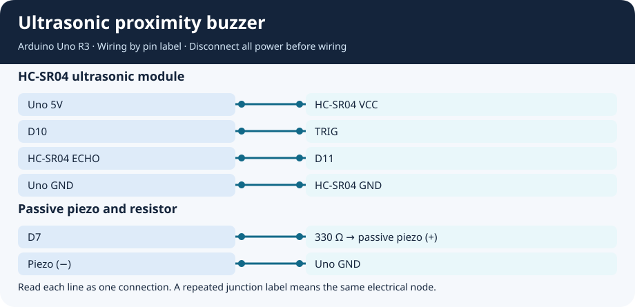

# Ultrasonic distance and proximity buzzer

[School roadmap](../../README.md) · [Class 2](../README.md)

> **Optional hardware variation.** Follow this page with its own sketch and pin map. [Section 00](../../Class-01-Arduino-Fundamentals/00-Introduction/README.md) applies to both kits.

### Learning Objectives

Prerequisite: complete Section 00 and the previous linked lesson. In this lesson, explain and demonstrate near-object alerts.

### Predict

Predict if a 0 cm timeout will sound. Before uploading, record the expected outcome and the reason or line of code for your prediction.

| Condition or input | Prediction | Evidence in code | Observation after Run |
| --- | --- | --- | --- |
| First test | | | |
| Second test | | | |

### See the components and circuit

[Ultrasonic module photos](https://learn.adafruit.com/ultrasonic-sonar-distance-sensors) · Use the source to identify the part and then follow the wiring map below.

Connection map for Ultrasonic proximity buzzer on the Uno R3. Follow connector labels. A repeated junction label is one shared electrical node.

[Wiring diagram](../../lesson-visuals/alternate-proximity_buzzer.svg) · [Arduino sketch](proximity_buzzer/proximity_buzzer.ino) · [Detailed notes and engineering questions](proximity_buzzer/NOTES.md)

### Run

Using the matching sketch above, select **Arduino Uno**, Verify, then Upload. Check for this behavior: 9600 baud. A valid target at ≤20 cm gives short beeps. Invalid echo is silent.

Disconnect USB and any external supply before changing wires. Reconnect power after checking the circuit.

Use a 5 V HC-SR04, a passive piezo with 330 Ω series resistor, and a flat target. Follow the HC-SR04 labels rather than inferring the order from its orientation.

| Module pin | Uno connection |
| --- | --- |
| VCC | 5V |
| TRIG | D10 |
| ECHO | D11 |
| GND | GND |
| Piezo (+) | D7 through 330 Ω |
| Piezo (−) | GND |

The module's ECHO signal is 5 V logic. This connection is for the 5 V Uno R3. A 3.3 V board needs appropriate level shifting or a correctly calculated divider on ECHO.

The Arduino sends a 10 μs trigger. It times the return pulse using `pulseIn()` with a 30 ms timeout, then divides the sound's round-trip distance by two. At **9600 baud**, move a flat target from 40 cm to 15 cm. Expect short 1 kHz beeps at 20 cm or closer within the module's valid range of about 2–400 cm. A timeout or out-of-range reading prints **No valid echo** and stays silent. The sketch pauses 150 ms between readings.

**Try it.** Compare the printed distance at 10, 20, and 40 cm with a ruler. Test an angled surface and explain why echoes may miss the receiver.

**If it fails.** Confirm TRIG and ECHO are on separate, correct pins. Use a broad flat target perpendicular to the sensor. A target inside the blind zone may yield an invalid reading.

[HC-SR04 datasheet](https://cdn.sparkfun.com/datasheets/Sensors/Proximity/HCSR04.pdf)

### Investigate

Trace one input or timing value from the source to an output. Use the [matching code walkthrough](proximity_buzzer/NOTES.md) to check your explanation and the pin map. Write one thing your observation confirms and one thing you still need to measure.

### Modify

Compare readings and beep behavior at 15, 20 and 40 cm.

### Make

Log the fraction of failed echoes for targets of different materials. Define what success will look like and keep the circuit within its original ratings.

### Troubleshoot

Use the symptom-specific checks in the [sketch notes](proximity_buzzer/NOTES.md#common-errors-and-troubleshooting). If the kit differs, check the parts and sketch together before moving any wires. Change one variable at a time.

### Knowledge Check

1. Why divide the travel distance by two?
2. Why should a timeout be handled separately?
3. What happens to the echo from an angled target?

You should be able to explain the signal or timing, identify the line that controls it, and justify a troubleshooting measurement.

### Practical Checkpoint

Demonstrate the expected behavior above. Capture one timed, measured, or serial observation, and explain which line or connection caused it.

### Continue Learning

Previous · [DHT22 temperature and humidity alarm](../../class-2/04-dht-alarm/README.md)

Next · [Brushed DC motor and TB6612FNG driver](../../class-2/06-dc-motor-driver/README.md)
