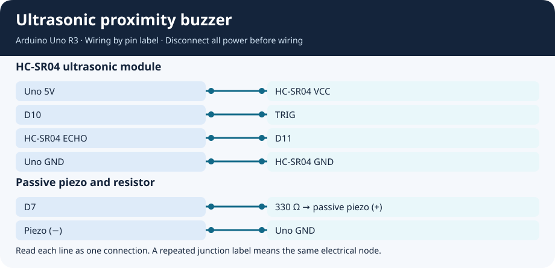

# Ultrasonic proximity buzzer notes

[Project lesson](../README.md) · [Open Arduino sketch](proximity_buzzer.ino) · [Image credits](../../../IMAGE-SOURCES.md)

## What does this program do?

9600 baud. A valid target at ≤20 cm gives short beeps. Invalid echo is silent.

## Components and their functions

Arduino Uno R3 runs the sketch. A USB data cable supplies logic power and transfers the sketch. Use a breadboard and jumpers for external low-current connections.

### HC-SR04 ultrasonic module

The transmitter sends an ultrasonic burst and the module returns an ECHO pulse. The Uno measures how long that pulse lasts.

[Ultrasonic module photos](https://learn.adafruit.com/ultrasonic-sonar-distance-sensors) · Use the source to identify the part and then follow the wiring map below.

### Passive piezo and resistor

A high-impedance passive piezo rated for 5 V turns the square wave into sound. The 330 Ω series resistor limits transient current.

[Passive piezo transducer product photos](https://www.adafruit.com/product/160) · Use the source to identify the part and then follow the wiring map below.

## Wiring explanation

Disconnect USB and any external motor supply before changing a wire. Inspect wiring against the labeled module before applying power.

| Start | End | What this connection does |
| --- | --- | --- |
| Uno 5V | HC-SR04 VCC | Use the 5 V module |
| D10 | TRIG | Uno sends a 10 µs trigger |
| HC-SR04 ECHO | D11 | The Uno times the 5 V logic pulse |
| Uno GND | HC-SR04 GND | Shared reference for trigger and echo |
| D7 | 330 Ω → passive piezo (+) | The tone or note signal |
| Piezo (−) | Uno GND | Completes the return path |

Connection map for Ultrasonic proximity buzzer on the Uno R3. Follow connector labels. A repeated junction label is one shared electrical node. [Open diagram](../../../lesson-visuals/alternate-proximity_buzzer.svg).

## Complete code walkthrough

readDistanceCm issues a 10 µs trigger and times the echo with a 30 ms timeout. It converts round-trip time into distance. loop checks 2–400 cm before comparing against ALERT_CM and waits 150 ms between pings.

## Program execution sequence

Reset → setup runs once → loop runs the logic described above → repeat from the top of loop.

## Variables and functions

- `TRIG_PIN` (`uint8_t`) starts at `10`. Check the pin map and move the wire only with power off if you change a pin.
- `ECHO_PIN` (`uint8_t`) starts at `11`. Check the pin map and move the wire only with power off if you change a pin.
- `PIEZO_PIN` (`uint8_t`) starts at `7`. Check the pin map and move the wire only with power off if you change a pin.
- `ALERT_CM` (`float`) starts at `20.0`. Predict what changes in the walkthrough before editing this value.

- `pinMode(pin, mode)` · Configures a GPIO as output, input or input with an internal pull-up. It does not turn an LED on.
- `digitalWrite(pin, value)` · On an output, HIGH drives near 5 V and LOW near ground. The value is held until changed.
- `delay(milliseconds)` · Pauses the sketch in milliseconds. A value of 500 is half a second.
- `delayMicroseconds(microseconds)` · Waits in millionths of a second to shape the trigger pulse.
- `tone(pin, frequency, duration)` · Starts a square wave. The frequency is in hertz. With no duration, use noTone to stop it.
- `noTone(pin)` · Stops the waveform on the buzzer pin.
- `pulseIn(pin, HIGH, timeout)` · Measures the HIGH pulse in microseconds, or returns zero on timeout.
- `Serial.begin(9600)` · Sets the serial connection rate. Choose 9600 baud in Serial Monitor if this sketch prints.

## Expected output

9600 baud. A valid target at ≤20 cm gives short beeps. Invalid echo is silent.

## Common errors and troubleshooting

- Do not exchange TRIG and ECHO. Use a broad flat target and avoid the blind zone. Check timeout and 5 V supply.
- Check that the part is a passive 5 V-compatible piezo. A buzzer with an oscillator will not reproduce the requested pitches.

## Real-world applications

This pattern can help explain near-object alerts. A classroom prototype is useful for learning how the signal is produced and tested.

[See an Arduino wired to a breadboard](https://commons.wikimedia.org/wiki/File:Arduino_Uno_with_breadboard.jpg) for a comparable bench setup.

## Student challenges

1. **Beginner** · Predict if a 0 cm timeout will sound.
2. **Intermediate** · Compare readings and beep behavior at 15, 20 and 40 cm.
3. **Optional advanced** · Log the fraction of failed echoes for targets of different materials.

## Think Like an Engineer

An echo timeout can look like a numerical zero. Why would treating it as zero distance produce a false alarm? How do sensor range checks and one flat target at a known distance help isolate the fault?

Write down one prediction, the single variable you changed, and the result. If they differ, propose a measurement that would distinguish two possible causes.
