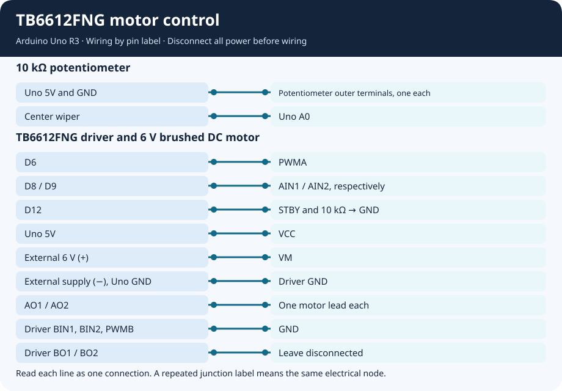

# Brushed DC motor and TB6612FNG driver

[School roadmap](../../README.md) · [Class 2](../README.md)

> **Optional hardware variation.** Follow this page with its own sketch and pin map. [Section 00](../../Class-01-Arduino-Fundamentals/00-Introduction/README.md) applies to both kits.

### Learning Objectives

Prerequisite: complete Section 00 and the previous linked lesson. In this lesson, explain and demonstrate robot drive and actuator feedback.

### Predict

Sketch the signal and power paths in different colors. Before uploading, record the expected outcome and the reason or line of code for your prediction.

| Condition or input | Prediction | Evidence in code | Observation after Run |
| --- | --- | --- | --- |
| First test | | | |
| Second test | | | |

### See the components and circuit

[Three-terminal potentiometer photos](https://www.adafruit.com/product/562) · Use the source to identify the part and then follow the wiring map below.



Connection map for TB6612FNG motor control on the Uno R3. Follow connector labels. A repeated junction label is one shared electrical node.

[Wiring diagram](../../lesson-visuals/alternate-dc_motor_driver.svg) · [Arduino sketch](dc_motor_driver/dc_motor_driver.ino) · [Detailed notes and engineering questions](dc_motor_driver/NOTES.md)

### Run

Using the matching sketch above, select **Arduino Uno**, Verify, then Upload. Check for this behavior: Bare secured shaft coasts at low settings and rotates at higher settings

Disconnect USB and any external supply before changing wires. Reconnect power after checking the circuit.

Use a TB6612FNG **breakout** with its supply bypass capacitors fitted, a small brushed DC motor rated for 6 V with a specified stall current of 500 mA or less at 6 V, a current-limited regulated 6 V motor supply, and a 10 kΩ potentiometer. Use the Uno's USB cable for logic power. A motor draws much more current when it starts or stalls than it does spinning freely. Never wire a motor to an Uno I/O pin or the Uno's 5V rail.

With both sources off, wire by the breakout's labels. Route motor supply and return directly to the driver using short wires suitable for the motor current. Keep motor return current out of the Uno and sensor breadboard rails.

| TB6612FNG breakout | Connection |
| --- | --- |
| VCC | Uno 5V logic |
| VM | External 6 V positive |
| GND | External supply negative and Uno GND |
| PWMA | Uno D6 |
| AIN1 / AIN2 | Uno D8 / D9 respectively |
| STBY | Uno D12, plus 10 kΩ from STBY to GND |
| AO1 / AO2 (may be labeled A01 / A02) | One motor lead each |
| BIN1, BIN2, PWMB | GND |
| BO1, BO2 | Leave open |
| Potentiometer | Outer legs to Uno 5V and GND, wiper to A0 |

```text
USB ── Uno 5V ──────────────── VCC  [TB6612FNG]
Uno D6/D8/D9/D12 ──────────── logic inputs
6 V supply positive ──────── VM
6 V supply negative ──┬────── GND  [TB6612FNG]
                     └────── Uno GND
Motor leads ───────────────── AO1 and AO2
```

Leave the motor shaft bare and secure the motor to the bench. With VM still off, upload the sketch, then set the knob to its minimum reading before switching on VM. Increase the knob until the motor turns. PWM changes the effective drive while the H-bridge supplies current. Low commands place the driver in standby so the motor coasts. The motor may need more duty to start than it needs to keep spinning. Switch off VM before unplugging the Uno or moving wires.

**Try it.** Find the lowest duty that starts the motor from rest. Power off both supplies, swap the motor leads, then compare direction at the same knob position. Never deliberately stall the shaft.

**If it fails.** Check separate VCC/VM supplies, the shared ground, and the STBY connection. If the Uno resets when the motor starts, turn off VM and check supply sizing, return wiring and the driver's local decoupling against its datasheet. If the motor hums without turning, drop the command to zero, check that the shaft is free, and try a higher command briefly.

[Toshiba TB6612FNG datasheet](https://toshiba.semicon-storage.com/info/TB6612FNG_datasheet_en_20141001.pdf?did=10660&prodName=TB6612FNG)


### Investigate

Trace one input or timing value from the source to an output. Use the [matching code walkthrough](dc_motor_driver/NOTES.md) to check your explanation and the pin map. Write one thing your observation confirms and one thing you still need to measure.

### Modify

Find the lowest starting duty with an unloaded secured motor.

### Make

Log startup and running duty and explain why they differ. Define what success will look like and keep the circuit within its original ratings.

### Troubleshoot

Use the symptom-specific checks in the [sketch notes](dc_motor_driver/NOTES.md#common-errors-and-troubleshooting). If the kit differs, check the parts and sketch together before moving any wires. Change one variable at a time.

### Knowledge Check

1. What does the wiper feed?
2. What range does the ADC report?
3. How would you isolate a loose ground?

You should be able to explain the signal or timing, identify the line that controls it, and justify a troubleshooting measurement.

### Practical Checkpoint

Demonstrate the expected behavior above. Capture one timed, measured, or serial observation, and explain which line or connection caused it.

### Continue Learning

Previous · [Ultrasonic distance and proximity buzzer](../../class-2/05-ultrasonic-proximity/README.md)

Next · [Smart home bench project](../../class-2/07-smart-home/README.md)
