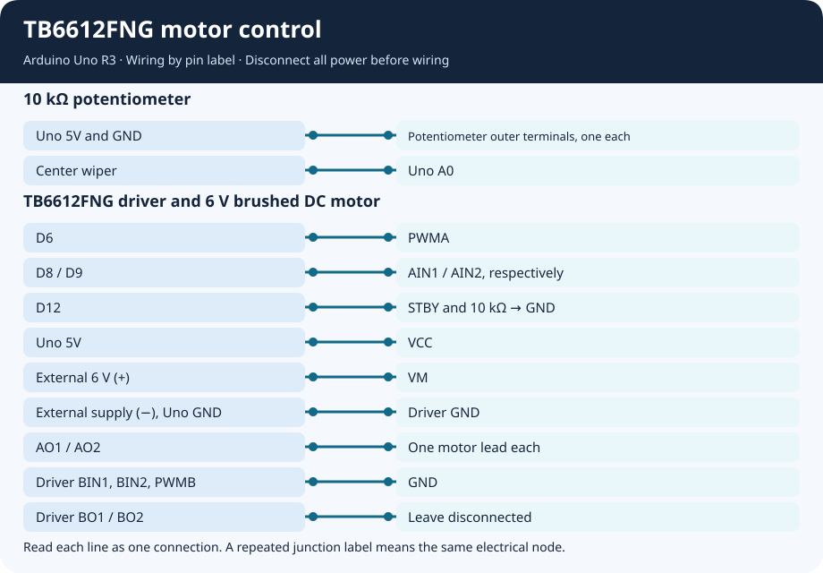

# TB6612FNG motor control notes

[Project lesson](../README.md) · [Open Arduino sketch](dc_motor_driver.ino) · [Image credits](../../../IMAGE-SOURCES.md)

## What does this program do?

Bare secured shaft coasts at low settings and rotates at higher settings

## Components and their functions

Arduino Uno R3 runs the sketch. A USB data cable supplies logic power and transfers the sketch. Use a breadboard and jumpers for external low-current connections.

### 10 kΩ potentiometer

Turning the knob moves an internal contact along a resistive track. Its wiper provides a voltage between ground and 5 V.

[Three-terminal potentiometer photos](https://www.adafruit.com/product/562) · Use the source to identify the part and then follow the wiring map below.

### TB6612FNG driver and 6 V brushed DC motor

The breakout uses separate VCC and VM rails. A 10 kΩ pull-down keeps STBY disabled during reset. Use a 6 V current-limited motor supply and a motor with rated stall current at most 500 mA at 6 V.

[TB6612FNG carrier and pin photographs](https://www.pololu.com/product/713/pictures) · Use the source to identify the part and then follow the wiring map below.

## Wiring explanation

Disconnect USB and any external motor supply before changing a wire. Inspect wiring against the labeled module before applying power.

| Start | End | What this connection does |
| --- | --- | --- |
| Uno 5V and GND | Potentiometer outer terminals, one each | Sets the two end voltages |
| Center wiper | Uno A0 | Feeds the adjustable input voltage |
| D6 | PWMA | PWM for channel A |
| D8 / D9 | AIN1 / AIN2, respectively | Direction inputs |
| D12 | STBY and 10 kΩ → GND | Enables the bridge; pull-down keeps it off at reset |
| Uno 5V | VCC | Logic only |
| External 6 V (+) | VM | Motor power only |
| External supply (−), Uno GND | Driver GND | Common reference; route motor return directly |
| AO1 / AO2 | One motor lead each | Secure motor and leave shaft bare |
| Driver BIN1, BIN2, PWMB | GND | Unused channel inputs |
| Driver BO1 / BO2 | Leave disconnected | Unused channel outputs |

Connection map for TB6612FNG motor control on the Uno R3. Follow connector labels. A repeated junction label is one shared electrical node. [Open diagram](../../../lesson-visuals/alternate-dc_motor_driver.svg).

## Complete code walkthrough

setup holds STBY LOW while it configures direction and zero duty. loop maps A0 to 0–255. At duty below 20 it disables the bridge and sets zero duty; otherwise it applies the duty and enables the driver. The potentiometer controls the signal, not motor current.

## Program execution sequence

Reset → setup runs once → loop runs the logic described above → repeat from the top of loop.

## Variables and functions

- `MOTOR_PWM` (`uint8_t`) starts at `6`. Check the pin map and move the wire only with power off if you change a pin.
- `MOTOR_IN1` (`uint8_t`) starts at `8`. Check the pin map and move the wire only with power off if you change a pin.
- `MOTOR_IN2` (`uint8_t`) starts at `9`. Check the pin map and move the wire only with power off if you change a pin.
- `MOTOR_STBY` (`uint8_t`) starts at `12`. Check the pin map and move the wire only with power off if you change a pin.
- `POT_PIN` (`uint8_t`) starts at `A0`. Check the pin map and move the wire only with power off if you change a pin.

- `pinMode(pin, mode)` · Configures a GPIO as output, input or input with an internal pull-up. It does not turn an LED on.
- `digitalWrite(pin, value)` · On an output, HIGH drives near 5 V and LOW near ground. The value is held until changed.
- `delay(milliseconds)` · Pauses the sketch in milliseconds. A value of 500 is half a second.
- `analogRead(pin)` · Returns 0–1023 on the Uno with its default reference. Record baselines before choosing a threshold.
- `map(value, low, high, outLow, outHigh)` · Rescales integer values. The two pairs are the input and output ranges.
- `analogWrite(pin, duty)` · On an Uno PWM pin, duty 0 is continuously off and 255 is continuously on. Intermediate values vary the on-time.

## Expected output

Bare secured shaft coasts at low settings and rotates at higher settings

## Common errors and troubleshooting

- Confirm the middle wiper goes to A0. Outer terminals go to 5V and GND, so swapping those outer leads with power off reverses direction.
- Switch off VM if the motor hums without turning or the Uno resets. Check STBY, separate VCC and VM, motor rating and return wiring.

## Real-world applications

This pattern can help explain robot drive and actuator feedback. A classroom prototype is useful for learning how the signal is produced and tested.

[See an Arduino wired to a breadboard](https://commons.wikimedia.org/wiki/File:Arduino_Uno_with_breadboard.jpg) for a comparable bench setup.

## Student challenges

1. **Beginner** · Sketch the signal and power paths in different colors.
2. **Intermediate** · Find the lowest starting duty with an unloaded secured motor.
3. **Optional advanced** · Log startup and running duty and explain why they differ.

## Think Like an Engineer

What is the difference between the signal path and the motor current path? If the motor makes the Uno reset, which supply and ground connections would you measure first? Leave the shaft bare and power off before changing any wire.

Write down one prediction, the single variable you changed, and the result. If they differ, propose a measurement that would distinguish two possible causes.
