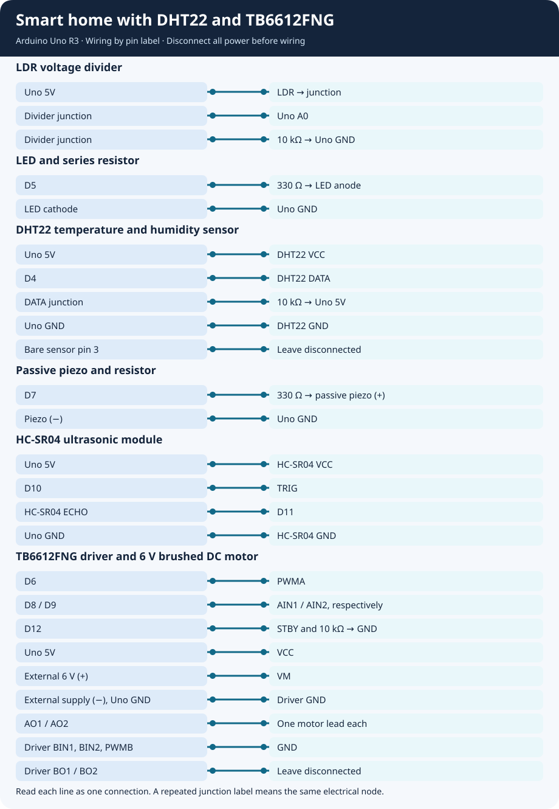

# Smart home bench project

[School roadmap](../../README.md) · [Class 2](../README.md)

### See the components and circuit

<a href="https://commons.wikimedia.org/wiki/File:Electronic-Component-Red-LED.jpg"></a>

*Two-lead through-hole red LED · Evan-Amos · Public domain.*

<a href="https://commons.wikimedia.org/wiki/File:Electronic-Axial-Lead-Resistors-Array.jpg"></a>

*Axial resistors with colored bands · Evan-Amos · Public domain.*

Use the resistance specified in the wiring table. Verify unfamiliar color bands with a multimeter before wiring.



Connection map for Smart home with DHT22 and TB6612FNG on the Uno R3. Follow connector labels. A repeated junction label is one shared electrical node.

[Wiring diagram](../../lesson-visuals/alternate-smart_home.svg) · [Arduino sketch](smart_home/smart_home.ino) · [Detailed notes and engineering questions](smart_home/NOTES.md)

Disconnect USB and any external supply before changing wires. Reconnect power after checking the circuit.

Combine the light sensor, climate sensor, proximity sensor, LED, piezo, and motor driver into a USB-powered controller with a separate 6 V motor supply. The LED represents a lamp, and the bare motor shaft represents a fan. Use low-voltage bench parts only. Keep mains wiring, heating elements, and fan blades out of this project.

## Build in stages

Read the [motor lesson](../06-dc-motor-driver/README.md) for the supply, stall-current, and grounding requirements. With USB and VM disconnected, wire each block below. Remove the motor lesson's potentiometer so A0 can serve only as the LDR midpoint. Use a common ground, with the motor supply return wired directly to the driver as shown in the motor lesson.

| Block | Uno connections | Power and other connections |
| --- | --- | --- |
| LDR divider | A0 at the junction | 5V → LDR → A0 junction → 10 kΩ → GND |
| Lamp LED | D5 → 330 Ω → anode | Cathode → GND |
| DHT22 | D4 → DATA | 5V and GND, 10 kΩ from DATA to 5V for a bare sensor |
| HC-SR04 | D10 → TRIG, D11 ← ECHO | 5V and GND |
| Passive piezo | D7 → 330 Ω → (+) | (−) → GND |
| TB6612FNG | D6 → PWMA, D8 → AIN1, D9 → AIN2, D12 → STBY | 10 kΩ STBY to GND. Uno 5V → VCC. External 6 V → VM. Common ground. AO1/AO2 → motor. BIN1/BIN2/PWMB → GND. |

On the Uno R3, `tone()` uses Timer2 and interferes with PWM on D3 and D11. The motor is on D6, and D11 is used only as a digital echo input.

```text
LDR ──────────── Uno ──────── lamp LED
DHT22 ────────── Uno ──────── driver ── motor (fan model)
HC-SR04 ──────── Uno ──────── piezo
                         6 V ──┘ (motor rail)
```

Upload with VM off. Open Serial Monitor at **9600 baud**. Test the LED, climate log and buzzer before enabling VM. The sketch uses `millis()` to schedule climate updates every 2.5 s and light/range updates about every 150 ms. Echo measurement can still wait up to 30 ms. If both alarms are active, the proximity beep takes priority.

## Acceptance checks

| Stimulus | Expected result |
| --- | --- |
| Cover, then uncover the LDR | Lamp turns on below the dark threshold and off above the bright threshold |
| Move a flat target from 40 cm to 15 cm and back | High-pitch beeps near the sensor and stop when the target moves away, assuming humidity is below its threshold |
| With no near object, temporarily lower the humidity threshold below room humidity | Low-pitch beeps |
| With VM enabled, set the fan-on threshold below ambient and fan-off below that | Bare motor starts on the next valid climate sample |
| Set both fan thresholds above ambient, with fan-off lower than fan-on | Motor stops on the next valid climate sample |
| With power disconnected, remove DHT DATA and restore power | Climate read error, fan stays disabled, light and ranging continue |

Restore your calibrated thresholds after the checks. If a subsystem fails, switch off both supplies and rebuild that block using its standalone lesson. If the controller resets when the motor turns on, switch off VM immediately and check motor power and grounding before retrying.

**Extend it.** Add humidity hysteresis and a separate serial message when a sensor changes state. Record the wiring, thresholds, test results, and one observed limitation so another student can reproduce your build.

Previous · [Brushed DC motor and TB6612FNG driver](../../class-2/06-dc-motor-driver/README.md)

Next · [Class 3 roadmap](../../class-3/README.md)
