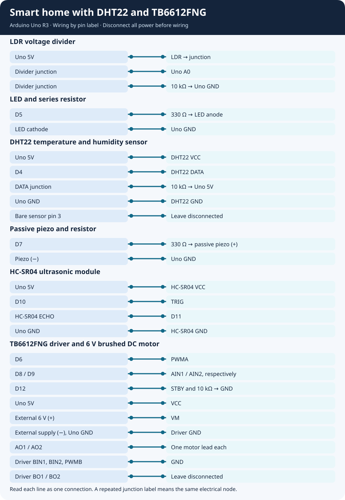

# Smart home with DHT22 and TB6612FNG notes

[Project lesson](../README.md) · [Open Arduino sketch](smart_home.ino) · [Image credits](../../../IMAGE-SOURCES.md)

## What does this program do?

9600 baud. Lamp follows light, valid climate controls fan, near object or humidity sounds a distinct tone.

## Components and their functions

Arduino Uno R3 runs the sketch. A USB data cable supplies logic power and transfers the sketch. Use a breadboard and jumpers for external low-current connections.

### LDR voltage divider

The photoresistor decreases in resistance under brighter light. A 10 kΩ resistor makes a divider so the Uno can measure the changing junction voltage.

[Photoresistor product photos](https://www.adafruit.com/product/161) · Use the source to identify the part and then follow the wiring map below.

### LED and series resistor

The indicator LED emits light when current flows from anode to cathode. The 330 Ω resistor limits current in the same path.

*Two-lead through-hole red LED · Evan-Amos · Public domain.*

*Axial resistors with colored bands · Evan-Amos · Public domain.*

Use the resistance specified in the wiring table. Verify unfamiliar color bands with a multimeter before wiring.

### DHT22 temperature and humidity sensor

The sensor measures air temperature and relative humidity and transmits a timed digital message. A bare sensor needs a data pull-up.

[DHT22 and DHT11 package examples](https://learn.adafruit.com/dht/overview) · Use the source to identify the part and then follow the wiring map below.

### Passive piezo and resistor

A high-impedance passive piezo rated for 5 V turns the square wave into sound. The 330 Ω series resistor limits transient current.

[Passive piezo transducer product photos](https://www.adafruit.com/product/160) · Use the source to identify the part and then follow the wiring map below.

### HC-SR04 ultrasonic module

The transmitter sends an ultrasonic burst and the module returns an ECHO pulse. The Uno measures how long that pulse lasts.

[Ultrasonic module photos](https://learn.adafruit.com/ultrasonic-sonar-distance-sensors) · Use the source to identify the part and then follow the wiring map below.

### TB6612FNG driver and 6 V brushed DC motor

The breakout uses separate VCC and VM rails. A 10 kΩ pull-down keeps STBY disabled during reset. Use a 6 V current-limited motor supply and a motor with rated stall current at most 500 mA at 6 V.

[TB6612FNG carrier and pin photographs](https://www.pololu.com/product/713/pictures) · Use the source to identify the part and then follow the wiring map below.

## Wiring explanation

Disconnect USB and any external motor supply before changing a wire. Inspect wiring against the labeled module before applying power.

| Start | End | What this connection does |
| --- | --- | --- |
| Uno 5V | LDR → junction | Upper leg of voltage divider |
| Divider junction | Uno A0 | Analog input taps the same electrical node |
| Divider junction | 10 kΩ → Uno GND | Lower leg of voltage divider |
| D5 | 330 Ω → LED anode | Output signal or PWM as configured in the sketch |
| LED cathode | Uno GND | Completes the current path |
| Uno 5V | DHT22 VCC | Supplies the sensor |
| D4 | DHT22 DATA | Timed digital data line |
| DATA junction | 10 kΩ → Uno 5V | Pull-up for bare sensor; check breakout |
| Uno GND | DHT22 GND | Common reference |
| Bare sensor pin 3 | Leave disconnected | NC; confirm pin order or breakout labels |
| D7 | 330 Ω → passive piezo (+) | The tone or note signal |
| Piezo (−) | Uno GND | Completes the return path |
| Uno 5V | HC-SR04 VCC | Use the 5 V module |
| D10 | TRIG | Uno sends a 10 µs trigger |
| HC-SR04 ECHO | D11 | The Uno times the 5 V logic pulse |
| Uno GND | HC-SR04 GND | Shared reference for trigger and echo |
| D6 | PWMA | PWM for channel A |
| D8 / D9 | AIN1 / AIN2, respectively | Direction inputs |
| D12 | STBY and 10 kΩ → GND | Enables the bridge; pull-down keeps it off at reset |
| Uno 5V | VCC | Logic only |
| External 6 V (+) | VM | Motor power only |
| External supply (−), Uno GND | Driver GND | Common reference; route motor return directly |
| AO1 / AO2 | One motor lead each | Secure motor and leave shaft bare |
| Driver BIN1, BIN2, PWMB | GND | Unused channel inputs |
| Driver BO1 / BO2 | Leave disconnected | Unused channel outputs |

Connection map for Smart home with DHT22 and TB6612FNG on the Uno R3. Follow connector labels. A repeated junction label is one shared electrical node. [Open diagram](../../../lesson-visuals/alternate-smart_home.svg).

## Complete code walkthrough

setup keeps STBY LOW, sets a fixed direction and initializes sensors and timing.

updateClimate reads the DHT22 every 2500 ms, disables the fan and humidity alarm on invalid data, and uses 30/28 °C thresholds.

setFan sets PWM 255 before enabling STBY or disables STBY before clearing PWM.

updateRoom handles light hysteresis, measures the echo, and prioritizes the 1200 Hz proximity tone over the 600 Hz humidity tone.

loop checks elapsed times without long delays, although a missing echo can block up to 30 ms.

## Program execution sequence

Reset → configure ports and timestamps → check climate timer → check room timer → repeat.

## Variables and functions

- `LDR_PIN` (`uint8_t`) starts at `A0`. Check the pin map and move the wire only with power off if you change a pin.
- `LAMP_PIN` (`uint8_t`) starts at `5`. Check the pin map and move the wire only with power off if you change a pin.
- `DHT_PIN` (`uint8_t`) starts at `4`. Check the pin map and move the wire only with power off if you change a pin.
- `PIEZO_PIN` (`uint8_t`) starts at `7`. Check the pin map and move the wire only with power off if you change a pin.
- `TRIG_PIN` (`uint8_t`) starts at `10`. Check the pin map and move the wire only with power off if you change a pin.
- `ECHO_PIN` (`uint8_t`) starts at `11`. Check the pin map and move the wire only with power off if you change a pin.
- `MOTOR_PWM` (`uint8_t`) starts at `6`. Check the pin map and move the wire only with power off if you change a pin.
- `MOTOR_IN1` (`uint8_t`) starts at `8`. Check the pin map and move the wire only with power off if you change a pin.
- `MOTOR_IN2` (`uint8_t`) starts at `9`. Check the pin map and move the wire only with power off if you change a pin.
- `MOTOR_STBY` (`uint8_t`) starts at `12`. Check the pin map and move the wire only with power off if you change a pin.
- `DARK_ON` (`int`) starts at `350`. Predict what changes in the walkthrough before editing this value.
- `BRIGHT_OFF` (`int`) starts at `450`. Predict what changes in the walkthrough before editing this value.
- `FAN_ON_C` (`float`) starts at `30.0`. Predict what changes in the walkthrough before editing this value.
- `FAN_OFF_C` (`float`) starts at `28.0`. Predict what changes in the walkthrough before editing this value.
- `MAX_HUMIDITY` (`float`) starts at `75.0`. Predict what changes in the walkthrough before editing this value.
- `NEAR_CM` (`float`) starts at `20.0`. Predict what changes in the walkthrough before editing this value.
- `DHT_INTERVAL_MS` (`unsigned long`) starts at `2500`. Predict what changes in the walkthrough before editing this value.
- `ROOM_INTERVAL_MS` (`unsigned long`) starts at `150`. Predict what changes in the walkthrough before editing this value.

- `pinMode(pin, mode)` · Configures a GPIO as output, input or input with an internal pull-up. It does not turn an LED on.
- `digitalWrite(pin, value)` · On an output, HIGH drives near 5 V and LOW near ground. The value is held until changed.
- `delayMicroseconds(microseconds)` · Waits in millionths of a second to shape the trigger pulse.
- `analogRead(pin)` · Returns 0–1023 on the Uno with its default reference. Record baselines before choosing a threshold.
- `analogWrite(pin, duty)` · On an Uno PWM pin, duty 0 is continuously off and 255 is continuously on. Intermediate values vary the on-time.
- `tone(pin, frequency, duration)` · Starts a square wave. The frequency is in hertz. With no duration, use noTone to stop it.
- `noTone(pin)` · Stops the waveform on the buzzer pin.
- `pulseIn(pin, HIGH, timeout)` · Measures the HIGH pulse in microseconds, or returns zero on timeout.
- `millis()` · Returns elapsed milliseconds since startup. Subtract unsigned timestamps to compare elapsed time across rollover.
- `Serial.begin(9600)` · Sets the serial connection rate. Choose 9600 baud in Serial Monitor if this sketch prints.
- `isnan(value)` · Detects an invalid floating-point sensor result before threshold decisions.
- `dht.begin()` · Initializes the selected sensor library before reading. Install the Adafruit DHT and Unified Sensor libraries.

## Expected output

9600 baud. Lamp follows light, valid climate controls fan, near object or humidity sounds a distinct tone.

## Common errors and troubleshooting

- If the readings run backward, check the LDR is on the 5V side of the divider. If readings are fixed, check the A0 junction and both supply rails.
- With power off, check the anode, cathode, series resistor and separate breadboard groups. Verify the Arduino pin in the sketch.
- Check the package order or module labels, DATA pin and pull-up. Match DHT11 or DHT22 to the sketch. Allow the sample interval.
- Check that the part is a passive 5 V-compatible piezo. A buzzer with an oscillator will not reproduce the requested pitches.
- Do not exchange TRIG and ECHO. Use a broad flat target and avoid the blind zone. Check timeout and 5 V supply.
- Switch off VM if the motor hums without turning or the Uno resets. Check STBY, separate VCC and VM, motor rating and return wiring.

## Real-world applications

This pattern can help explain prioritized alerts and fail-off actuator control. A classroom prototype is useful for learning how the signal is produced and tested.

[See an Arduino wired to a breadboard](https://commons.wikimedia.org/wiki/File:Arduino_Uno_with_breadboard.jpg) for a comparable bench setup.

## Student challenges

1. **Beginner** · Predict which tone sounds when both alarms are active.
2. **Intermediate** · Test each subsystem independently, then repeat with all connected.
3. **Optional advanced** · Add humidity hysteresis and log state changes without shifting sensor intervals.

## Think Like an Engineer

Imagine the DHT data wire is disconnected and an object approaches at the same time. Which outputs should react and which should stay independent? Draw that timeline on paper. Then explain why a missing echo and a failed climate sample each need their own fault response.

Write down one prediction, the single variable you changed, and the result. If they differ, propose a measurement that would distinguish two possible causes.
