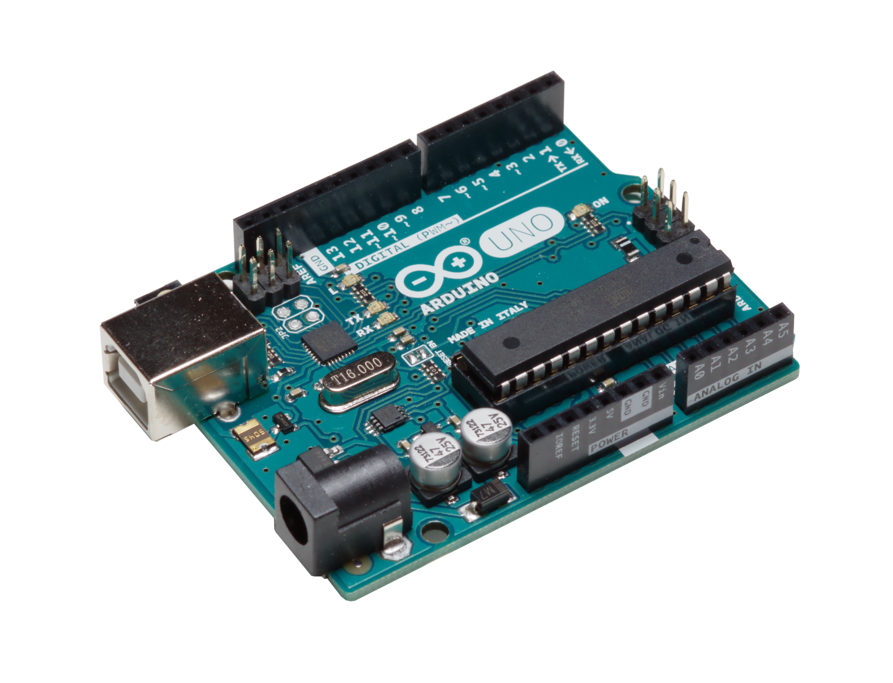

# Get your Arduino ready

[Course map](README.md)

Start with the Uno R3 and a USB data cable. At the end of this page you should be able to find the pins, select the board and port, and explain how a sketch runs.

*Arduino Uno with its long digital and analog headers · Dllu · [CC BY-SA 4.0](https://creativecommons.org/licenses/by-sa/4.0/).*

Use the published pinout to identify D13, 5V, GND, and the analog headers on your own board. [Arduino Uno R3 pinout](https://docs.arduino.cc/hardware/uno-rev3/)

## Learning objectives

Students finish this class able to identify Arduino hardware, install/configure Arduino IDE, understand program flow and the most common code structures, and build working LED/traffic-light/buzzer circuits before solving small assignments without copying a full solution.

## Lesson 01 — Arduino hardware and I/O

### What is Arduino and why use it?

Arduino is an open-source electronics ecosystem centered on programmable microcontroller boards and software tools. It allows an input (such as a sensor reading or push button) to be processed by an algorithm, then translated into a physical output (LED, buzzer, motor driver or display). Use the chain INPUT → PROCESSING → OUTPUT throughout all future classes. Compare a microcontroller with a sensor: the sensor measures, the controller executes logic, and an actuator performs an action.

The Uno R3 uses the ATmega328P. Point to the microcontroller, USB Type-B connector, power jack, reset button, onboard L LED, power LEDs, and digital/analog headers. A computer uploads a sketch through USB; after upload, the microcontroller runs its program when supplied power.

### Pin reference — Uno R3

| Item | Function | Important note |
| --- | --- | --- |
| D0–D13 | General digital inputs/outputs | D0(RX) and D1(TX) also serve Serial; avoid for initial lessons |
| A0–A5 | ADC inputs (10-bit) | ADC readings normally 0–1023 at the default reference |
| D3,D5,D6,D9,D10,D11 | PWM-capable output pins | Pulse-width modulation, not a true built-in analog DAC |
| A4 and A5 | SDA and SCL for I2C | Still usable as analog or general digital pins when not needed for I2C |
| 5V / 3.3V | Regulated logic supplies | The 3.3V output has limited current; check sensor ratings |
| GND | Ground | Shared reference for compatible interconnected low-voltage circuits |
| VIN / DC jack | External input to onboard regulation path | Verify power polarity/voltage/regulator dissipation |
| ICSP | Programming/SPI hardware interface | Covered more deeply in Class 3 |

Digital state HIGH on a 5V Uno output is approximately 5 V; LOW is near 0 V. A digital input distinguishes HIGH from LOW. An analog ADC reads varying voltage. Analog pins can also function as digital I/O. Never assume every sensor uses an analog pin: DHT11 and HC-SR04 are both digital devices.

Board activity: Ask the student to locate D13, D6, A0, 5V and GND on the actual board and explain which one to use for a lamp versus a light sensor.

## Lesson 02 — Arduino IDE, boards, ports and libraries

- Download Arduino IDE from [https://www.arduino.cc/en/software](https://www.arduino.cc/en/software) and install it.

- Connect the Uno with a real USB data cable; power-only cables cannot upload.

- Open Boards Manager and install **Arduino AVR Boards** if it is missing. Choose **Arduino Uno** under Board and select the port that appears when you plug in the Uno.

- Use **Verify** to compile and **Upload** to compile and transfer. The Output panel shows errors. Library Manager installs reusable code. Serial Monitor shows text from a running sketch, and Serial Plotter graphs numeric readings.

- Run the built-in Blink example and compare Verify versus Upload.

Troubleshooting: No port? Check cable and drivers (some clones use CH340). Upload error? Recheck board and port, then close programs using the serial interface. Compile error? Read the first meaningful error and check braces/semicolon/library name.

## Lesson 03 — How Arduino code flows

A beginner Arduino sketch has three areas: global definitions and #include at the top, setup() once after startup, and loop() repeatedly. Describe it as GLOBAL DEFINITIONS → SETUP ONCE → LOOP → LOOP → LOOP. It is a mental learning aid, not literally executing every global declaration on each iteration.

[Open the annotated sketch structure](sketches/sketch_structure/sketch_structure.ino) or [read its detailed notes](sketches/sketch_structure/NOTES.md). `Wire.h` and `SPI.h` come with the AVR board platform. Install additional libraries through Library Manager when a lesson calls for one.

`int` holds whole numbers, `float` can hold fractions, `bool` holds true or false, and `char` holds one character. Use `const` for a value you do not plan to change. A function groups instructions and can take arguments. Braces delimit a block, a semicolon ends a statement, and `//` starts a comment. Use `=` to assign and `==` to compare. A `for` loop repeats a block, and `if` runs a block when its condition is true. Put hardware configuration such as `pinMode()` in `setup()`.

Timing exercise: delay(100)=0.1 s, delay(500)=0.5 s, delay(1000)=1 s. A 500ms ON + 500ms OFF blink cycle is about one second. Discuss why long delays cannot be kept in a more advanced multi-sensor system.

### What you will demonstrate after Class 1

Explain setup() versus loop(), upload Blink without help, build a breadboard LED with a resistor, change a timing pattern, and implement the traffic-light assignment. These skills unlock Class 2.

[Arduino Uno R3 pinout and board specifications](https://docs.arduino.cc/hardware/uno-rev3/) · [Arduino IDE setup](https://docs.arduino.cc/software/ide-v2/tutorials/getting-started/ide-v2-downloading-and-installing/)

**Next** · [Project 01 · Hello World: Built-in LED](02-leds-and-sound.md#builtin_blink). Upload a program and confirm that the board responds.
