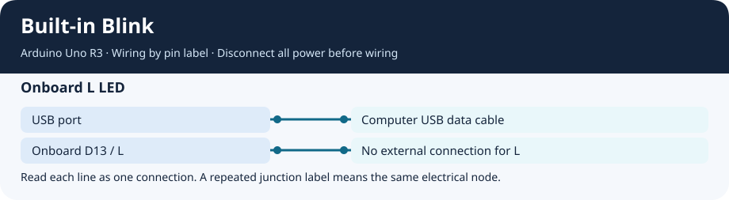
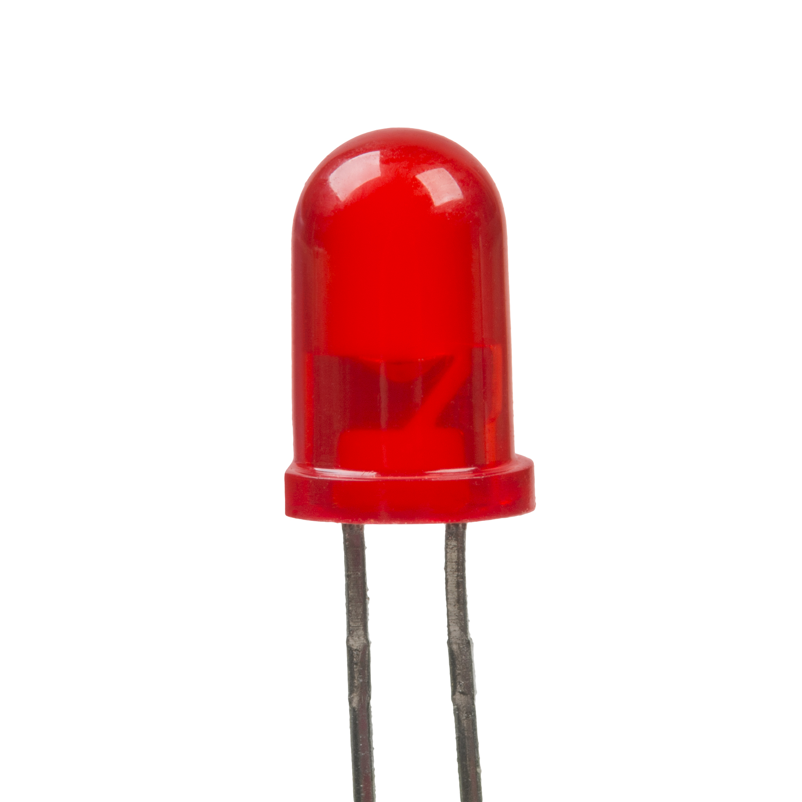
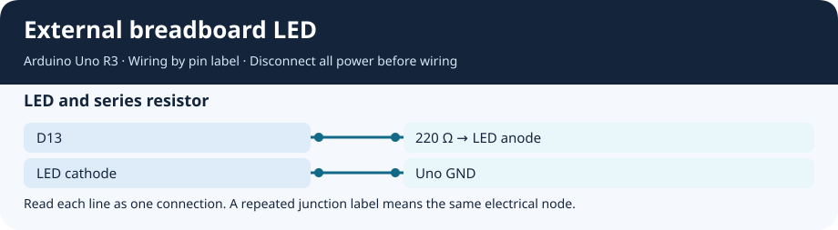
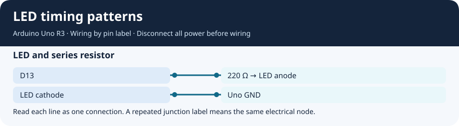
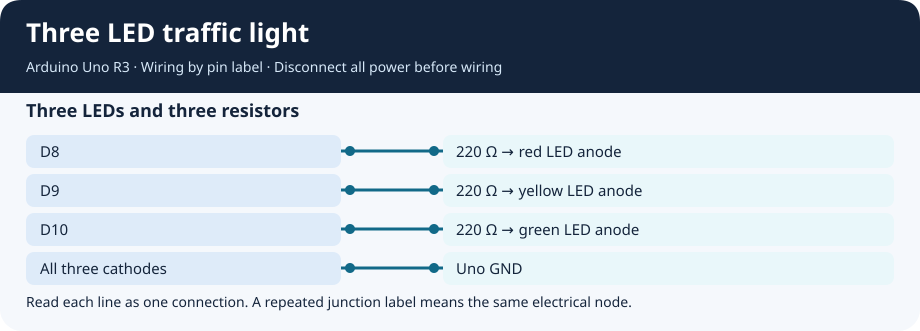
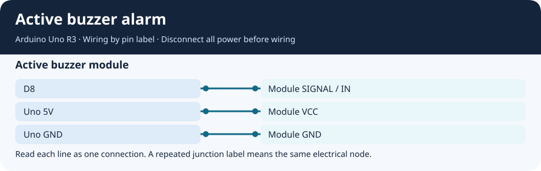
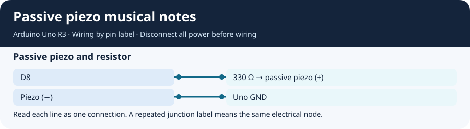
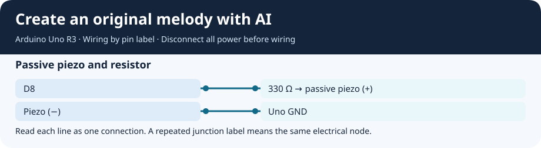

# Build with LEDs and buzzers

[Course map](README.md)

Begin with the light already on the Uno. Move the same output signal onto a breadboard, then use timing to build patterns. The traffic light extends the idea to three outputs. The two buzzer projects show how the same board can switch a sound on and off or generate notes.

- [Project 01 · Hello World: Built-in LED](02-leds-and-sound.md#builtin_blink)
- [Project 02 · External LED and Breadboard](02-leds-and-sound.md#external_led)
- [Project 03 · LED Timing Patterns](02-leds-and-sound.md#led_timing)
- [Project 04 · Three-LED Traffic Light](02-leds-and-sound.md#traffic_light)
- [Project 05A · Active Buzzer Alarm](02-leds-and-sound.md#active_buzzer)
- [Project 05B · Passive Buzzer Tones](02-leds-and-sound.md#passive_tones)
- [Project 06 · AI-Assisted Original Buzzer Melody](02-leds-and-sound.md#original_melody)

## Project 01 · Hello World: Built-in LED

### Learning Objectives

Prerequisite: complete the Section 00 assessment.

Upload your first program and observe digital output.

### Predict

Predict the period if only the first wait changes to 100 ms. Before uploading, record the expected outcome and the reason or line of code for your prediction.

| Condition or input | Prediction | Evidence in code | Observation after Run |
| --- | --- | --- | --- |
| First test | | | |
| Second test | | | |

### Components and module names

Arduino Uno R3; USB data cable; computer with Arduino IDE. No breadboard.

### See the components and circuit

[Uno R3 board and downloadable pinout](https://docs.arduino.cc/hardware/uno-rev3/) · Use the source to identify the part and then follow the wiring map below.

Connection map for Built-in Blink on the Uno R3. Follow connector labels. A repeated junction label is one shared electrical node.

[Wiring diagram](../lesson-visuals/builtin_blink.svg) · [Arduino sketch](sketches/builtin_blink/builtin_blink.ino) · [Detailed notes and engineering questions](sketches/builtin_blink/NOTES.md)

### Exact wiring (power OFF first)

No external wiring. Connect the Uno to the computer by a USB data cable.

### Concepts and module behavior

The built-in LED connects to D13 on the Uno. LED_BUILTIN identifies this pin. Digital HIGH and LOW control the output; 500 milliseconds is half a second.

### Run

1. Open Arduino IDE and select Arduino Uno.
2. Select the correct port.
3. Create a new sketch.
4. Paste the code, Verify, then Upload.
5. Watch the small LED marked L on the Uno.
6. Explain the repetition of loop().

### Complete Arduino sketch

[Open builtin_blink.ino](sketches/builtin_blink/builtin_blink.ino). Open the file in Arduino IDE from its matching folder and select **Arduino Uno**. Click **Verify** before uploading.

### Code explanation

pinMode() configures D13; digitalWrite() changes output state; delay(500) waits 0.5 s; loop() repeats forever while powered.

### Expected result

LED stays ON for 0.5 s, OFF for 0.5 s; about one full cycle per second.

### Investigate

Trace one input or timing value from the source to an output. Use the [matching code walkthrough](sketches/builtin_blink/NOTES.md) to check your explanation and the pin map. Write one thing your observation confirms and one thing you still need to measure.

### Modify

Make a short heartbeat flash once per second.

### Make

Rewrite it with millis() and keep the same measured period. Define what success will look like and keep the circuit within its original ratings.

### Troubleshoot

Use the symptom-specific checks in the [sketch notes](sketches/builtin_blink/NOTES.md#common-errors-and-troubleshooting). If the kit differs, check the parts and sketch together before moving any wires. Change one variable at a time.

### Knowledge Check

1. Which statements run once and which repeat?
2. Which two values determine the blink period?
3. How can you distinguish the L indicator from the power LED?

You should be able to explain the signal or timing, identify the line that controls it, and justify a troubleshooting measurement.

### Practical Checkpoint

Time three full cycles. Record the measured average and compare it with the two programmed waits.

### Additional Challenge

Change the ON duration to 2000 ms and the OFF duration to 1000 ms. Calculate the full cycle length.

### Where this technology is used

Device heartbeat indicators; microcontroller smoke testing; troubleshooting upload and power issues.

### Real build / practical application photo

[Arduino uno led on](https://commons.wikimedia.org/wiki/File:Arduino_uno_led_on.jpg) — Edwiyanto. License: CC BY-SA 4.0. The linked example may use different hardware. Follow the wiring in this lesson.

### Continue Learning

**Previous** · [Section 00 Beginner Assessment](../Class-01-Arduino-Fundamentals/00-Introduction/README.md#assessment)

**Next** · [External breadboard LED](02-leds-and-sound.md#external_led). Apply the breadboard groups you learned in Section 00.

## Project 02 · External LED and Breadboard

### Learning Objectives

Prerequisite: complete the previous project linked below.

Reproduce the blink circuit with a real LED and current-limiting resistor.

### Predict

Predict what removing the resistor would do. Keep it installed. Before uploading, record the expected outcome and the reason or line of code for your prediction.

| Condition or input | Prediction | Evidence in code | Observation after Run |
| --- | --- | --- | --- |
| First test | | | |
| Second test | | | |

### Components and module names

Arduino Uno; breadboard; red LED; one 220–330 Ω resistor; jumper wires; USB cable.

### See the components and circuit

*Two-lead through-hole red LED · Evan-Amos · Public domain.*

*Axial resistors with colored bands · Evan-Amos · Public domain.*

Use the resistance specified in the wiring table. Verify unfamiliar color bands with a multimeter before wiring.

Connection map for External breadboard LED on the Uno R3. Follow connector labels. A repeated junction label is one shared electrical node.

[Wiring diagram](../lesson-visuals/external_led.svg) · [Arduino sketch](sketches/external_led/external_led.ino) · [Detailed notes and engineering questions](sketches/external_led/NOTES.md)

### Exact wiring (power OFF first)

D13 → 220 Ω resistor → LED anode (+, usually long leg); LED cathode (−, flat side) → Arduino GND. Each LED has its own series resistor.

### Concepts and module behavior

A breadboard connects holes internally by strips; an LED is a diode and needs correct polarity and current limiting. Example current: (5 V − 2 V)/220 Ω ≈ 13.6 mA, subject to the actual LED forward voltage.

### Run

1. Unplug USB before moving wires.
2. Insert the LED across electrically separate breadboard rows.
3. Connect the 220 Ω resistor in series with its anode.
4. Connect D13 to the resistor and cathode to Arduino GND.
5. Reconnect USB, upload the code, and verify the LED blinks.
6. Try a 330 Ω resistor and compare brightness.

### Complete Arduino sketch

[Open external_led.ino](sketches/external_led/external_led.ino). Open the file in Arduino IDE from its matching folder and select **Arduino Uno**. Click **Verify** before uploading.

### Code explanation

D13 is an electrical output pin, so one sketch can control the on-board LED and a correctly connected external LED at the same time.

### Expected result

External LED blinks as the board LED blinks.

### Investigate

Trace one input or timing value from the source to an output. Use the [matching code walkthrough](sketches/external_led/NOTES.md) to check your explanation and the pin map. Write one thing your observation confirms and one thing you still need to measure.

### Modify

Move the wire and pin constant to D8 with power disconnected and explain why the onboard LED no longer follows.

### Make

Compare brightness with a 330 Ω resistor and calculate approximate current. Define what success will look like and keep the circuit within its original ratings.

### Troubleshoot

Use the symptom-specific checks in the [sketch notes](sketches/external_led/NOTES.md#common-errors-and-troubleshooting). If the kit differs, check the parts and sketch together before moving any wires. Change one variable at a time.

### Knowledge Check

1. Where does the current enter and leave the LED?
2. What changes when HIGH lasts longer?
3. Why must the resistor remain in series?

You should be able to explain the signal or timing, identify the line that controls it, and justify a troubleshooting measurement.

### Practical Checkpoint

Verify that both LEDs follow the expected timing. Point to the series resistor and the GND return.

### Additional Challenge

Try 100 ms ON and 900 ms OFF. Why does reversing LED polarity stop the normal light emission?

### Where this technology is used

Indicator lamps; machine-state LEDs; visible confirmation of control logic.

### Real build / practical application photo

[20140922 122126 resized](https://commons.wikimedia.org/wiki/File:20140922_122126_resized.jpg) — NathanMinnick58. License: CC BY-SA 4.0. The linked example may use different hardware. Follow the wiring in this lesson.

### Continue Learning

**Previous** · [Project 01 · Hello World: Built-in LED](02-leds-and-sound.md#builtin_blink)

**Next** · [Project 03 · LED Timing Patterns](02-leds-and-sound.md#led_timing). Reuse the same circuit and use a loop to create a repeating pattern.

## Project 03 · LED Timing Patterns

### Learning Objectives

Prerequisite: complete the previous project linked below.

Create a repeating sequence of short and long flashes using a for loop.

### Predict

Count how many HIGH writes each cycle makes. Before uploading, record the expected outcome and the reason or line of code for your prediction.

| Condition or input | Prediction | Evidence in code | Observation after Run |
| --- | --- | --- | --- |
| First test | | | |
| Second test | | | |

### Components and module names

Arduino Uno; external LED; 220 Ω resistor; breadboard and jumpers.

### See the components and circuit

*Two-lead through-hole red LED · Evan-Amos · Public domain.*

*Axial resistors with colored bands · Evan-Amos · Public domain.*

Use the resistance specified in the wiring table. Verify unfamiliar color bands with a multimeter before wiring.

Connection map for LED timing patterns on the Uno R3. Follow connector labels. A repeated junction label is one shared electrical node.

[Wiring diagram](../lesson-visuals/led_timing.svg) · [Arduino sketch](sketches/led_timing/led_timing.ino) · [Detailed notes and engineering questions](sketches/led_timing/NOTES.md)

### Exact wiring (power OFF first)

D13 → 220 Ω → LED anode; LED cathode → GND (same circuit as Project 02).

### Concepts and module behavior

for (initialization; condition; update) repeats a block a fixed number of times; delay() controls timing but blocks other actions.

### Run

1. Retain the LED circuit from Project 02.
2. Upload the new program.
3. Count the three short flashes.
4. Observe the pause, then the longer flash.
5. Modify loop count and delays.
6. Calculate one complete pattern duration before testing.

### Complete Arduino sketch

[Open led_timing.ino](sketches/led_timing/led_timing.ino). Open the file in Arduino IDE from its matching folder and select **Arduino Uno**. Click **Verify** before uploading.

### Code explanation

i++ increases loop counter by one; the loop runs when i is 0, 1 and 2. The timings combine into a deliberate visual pattern.

### Expected result

Three 150 ms flashes followed by a pause and one 1 s flash.

### Investigate

Trace one input or timing value from the source to an output. Use the [matching code walkthrough](sketches/led_timing/NOTES.md) to check your explanation and the pin map. Write one thing your observation confirms and one thing you still need to measure.

### Modify

Change only the loop limit and predict the new pattern.

### Make

Store the pattern as durations and replace the fixed sequence. Define what success will look like and keep the circuit within its original ratings.

### Troubleshoot

Use the symptom-specific checks in the [sketch notes](sketches/led_timing/NOTES.md#common-errors-and-troubleshooting). If the kit differs, check the parts and sketch together before moving any wires. Change one variable at a time.

### Knowledge Check

1. Where does the current enter and leave the LED?
2. What changes when HIGH lasts longer?
3. Why must the resistor remain in series?

You should be able to explain the signal or timing, identify the line that controls it, and justify a troubleshooting measurement.

### Practical Checkpoint

Record the number of short flashes, the long flash, and how their durations compare.

### Additional Challenge

Create an SOS-inspired distinct pattern using short and long flashes; document your own timing rather than copying another sketch.

### Where this technology is used

Warning beacons; machine fault codes; equipment status patterns.

### Real build / practical application photo

[Arduino LED project](https://commons.wikimedia.org/wiki/File:Arduino_LED_project.jpg) — Randy / ConzNL. License: CC BY 2.0. The linked example may use different hardware. Follow the wiring in this lesson.

### Continue Learning

**Previous** · [Project 02 · External LED and Breadboard](02-leds-and-sound.md#external_led)

**Next** · [Project 04 · Three-LED Traffic Light](02-leds-and-sound.md#traffic_light). Use the timing pattern to sequence three separate outputs.

## Project 04 · Three-LED Traffic Light

### Learning Objectives

Prerequisite: complete the previous project linked below.

Control three independent digital outputs through a safe repeating sequence.

### Predict

Increase yellow by one second and predict the full cycle time. Before uploading, record the expected outcome and the reason or line of code for your prediction.

| Condition or input | Prediction | Evidence in code | Observation after Run |
| --- | --- | --- | --- |
| First test | | | |
| Second test | | | |

### Components and module names

Arduino Uno; red, yellow, green LEDs; three 220–330 Ω resistors; breadboard; jumpers.

### See the components and circuit

*Two-lead through-hole red LED · Evan-Amos · Public domain.*

*Axial resistors with colored bands · Evan-Amos · Public domain.*

Use the resistance specified in the wiring table. Verify unfamiliar color bands with a multimeter before wiring.

Connection map for Three LED traffic light on the Uno R3. Follow connector labels. A repeated junction label is one shared electrical node.

[Wiring diagram](../lesson-visuals/traffic_light.svg) · [Arduino sketch](sketches/traffic_light/traffic_light.ino) · [Detailed notes and engineering questions](sketches/traffic_light/NOTES.md)

### Exact wiring (power OFF first)

D8 → resistor → Red anode; D9 → resistor → Yellow anode; D10 → resistor → Green anode; all three LED cathodes → GND.

### Concepts and module behavior

Every LED needs its own resistor. Multiple pins can drive independent outputs, and timed conditions can model a simple traffic controller. This is a classroom simulation, not a road-safety certified controller.

### Run

1. Disconnect power.
2. Insert three LEDs in separate breadboard rows.
3. Add individual series resistors.
4. Wire red to D8, yellow to D9, green to D10; connect all cathodes to ground.
5. Upload and time each stage with a stopwatch.
6. Exchange timing values only in software.

### Complete Arduino sketch

[Open traffic_light.ino](sketches/traffic_light/traffic_light.ino). Open the file in Arduino IDE from its matching folder and select **Arduino Uno**. Click **Verify** before uploading.

### Code explanation

Red means Stop (5 s), green means Go (5 s), yellow means Prepare to stop (2 s). Pins are deliberately independent.

### Expected result

Red 5 s → green 5 s → yellow 2 s → repeat.

### Investigate

Trace one input or timing value from the source to an output. Use the [matching code walkthrough](sketches/traffic_light/NOTES.md) to check your explanation and the pin map. Write one thing your observation confirms and one thing you still need to measure.

### Modify

Add an all-red pause and record all output states.

### Make

Represent the phases with a state variable and millis(). Define what success will look like and keep the circuit within its original ratings.

### Troubleshoot

Use the symptom-specific checks in the [sketch notes](sketches/traffic_light/NOTES.md#common-errors-and-troubleshooting). If the kit differs, check the parts and sketch together before moving any wires. Change one variable at a time.

### Knowledge Check

1. Why does each LED have its own resistor?
2. How would you check that only one lamp is active?
3. Which line controls the phase duration?

You should be able to explain the signal or timing, identify the line that controls it, and justify a troubleshooting measurement.

### Practical Checkpoint

Observe at least one whole cycle and record the order and duration of all three states.

### Additional Challenge

Main assignment: red 4 s; green 6 s; green blink 3 times; yellow 2 s. Extension: add a pedestrian pushbutton and a pedestrian LED.

### Where this technology is used

Intersection-control teaching; sequential machines; factory status light models.

### Real build / practical application photo

[Traffic Lights, Arduino](https://commons.wikimedia.org/wiki/File:Traffic_Lights%2C_Arduino.jpg) — Khaifuture. License: CC BY-SA 3.0. The linked example may use different hardware. Follow the wiring in this lesson.

### Continue Learning

**Previous** · [Project 03 · LED Timing Patterns](02-leds-and-sound.md#led_timing)

**Next** · [Project 05A · Active Buzzer Alarm](02-leds-and-sound.md#active_buzzer). Reuse the idea of switching a pin HIGH and LOW to drive an audible indicator.

## Project 05A · Active Buzzer Alarm

### Learning Objectives

Prerequisite: complete the previous project linked below.

Replace a light output with an audible output to reinforce digital ON/OFF control.

### Predict

Change the cadence without changing the oscillator pitch. Before uploading, record the expected outcome and the reason or line of code for your prediction.

| Condition or input | Prediction | Evidence in code | Observation after Run |
| --- | --- | --- | --- |
| First test | | | |
| Second test | | | |

### Components and module names

Arduino Uno; low-current, 5 V-rated active buzzer or a matching active buzzer module; jumper wires.

### See the components and circuit

[Active buzzer and module photos](https://startingelectronics.org/articles/arduino/connecting-buzzer-arduino-uno/) · Use the source to identify the part and then follow the wiring map below.

Connection map for Active buzzer alarm on the Uno R3. Follow connector labels. A repeated junction label is one shared electrical node.

[Wiring diagram](../lesson-visuals/active_buzzer.svg) · [Arduino sketch](sketches/active_buzzer/active_buzzer.ino) · [Detailed notes and engineering questions](sketches/active_buzzer/NOTES.md)

### Exact wiring (power OFF first)

Use an **active-high 5 V buzzer module with an onboard driver** for the provided sketch. For a bare active buzzer, verify the rated operating current and any startup transient. Use a suitable external driver if the GPIO cannot drive it. The Uno R3 pinout specifies 20 mA max per I/O, and the board also has aggregate current limits. An active-low module needs the HIGH and LOW actions swapped. [Uno R3 pinout](https://docs.arduino.cc/hardware/uno-rev3/)

Bare low-current 2-pin active buzzer: D8 → buzzer +, GND → buzzer − only if datasheet current is within the Uno GPIO limit. For a 3-pin module: connect module VCC to its rated supply, GND to GND, and SIGNAL to D8, respecting active-high/active-low logic. Higher-current buzzers require a transistor driver.

### Concepts and module behavior

An active buzzer has an internal oscillator and makes a fixed tone when powered. It is a digital output example; it usually cannot play musical notes by changing the DC state alone.

### Run

1. Confirm the buzzer is active and its operating voltage/current.
2. Wire it using the package-specific instructions.
3. Set D8 as OUTPUT.
4. Upload the program.
5. Listen for 500 ms ON / 500 ms OFF.
6. Disconnect power before swapping any component.

### Complete Arduino sketch

[Open active_buzzer.ino](sketches/active_buzzer/active_buzzer.ino). Open the file in Arduino IDE from its matching folder and select **Arduino Uno**. Click **Verify** before uploading.

### Code explanation

digitalWrite(HIGH) supplies an active-high module signal; LOW turns it off. Some modules are active-low and invert this behavior.

### Expected result

One beep every second with alternating 0.5-second sound and silence.

### Investigate

Trace one input or timing value from the source to an output. Use the [matching code walkthrough](sketches/active_buzzer/NOTES.md) to check your explanation and the pin map. Write one thing your observation confirms and one thing you still need to measure.

### Modify

Make a two-beep pattern separated by a longer pause.

### Make

Design an enable flag and justify the default state on reset. Define what success will look like and keep the circuit within its original ratings.

### Troubleshoot

Use the symptom-specific checks in the [sketch notes](sketches/active_buzzer/NOTES.md#common-errors-and-troubleshooting). If the kit differs, check the parts and sketch together before moving any wires. Change one variable at a time.

### Knowledge Check

1. Where is the tone produced?
2. Which pins supply power and which pin commands it?
3. What happens when the signal goes LOW?

You should be able to explain the signal or timing, identify the line that controls it, and justify a troubleshooting measurement.

### Practical Checkpoint

Measure one on and off interval and explain where the fixed pitch is generated.

### Additional Challenge

Create a double-beep pattern and explain when an audible alarm might be preferable to an LED.

### Where this technology is used

Access confirmation; notifications; door and equipment alarms.

### Real build / practical application photo

[Arduino Uno buzzer breadboard project](https://startingelectronics.org/articles/arduino/connecting-buzzer-arduino-uno/) — See original project page. License: Not independently verified for republication; link only. The linked example may use different hardware. Follow the wiring in this lesson.

### Continue Learning

**Previous** · [Project 04 · Three-LED Traffic Light](02-leds-and-sound.md#traffic_light)

**Next** · [Project 05B · Passive Buzzer Tones](02-leds-and-sound.md#passive_tones). Compare a buzzer that has an oscillator with a passive piezo that needs a frequency.

## Project 05B · Passive Buzzer Tones

### Learning Objectives

Prerequisite: complete the previous project linked below.

Generate pitches by changing electrical oscillation frequency.

### Predict

Change 262 Hz to 330 Hz and predict the pitch difference. Before uploading, record the expected outcome and the reason or line of code for your prediction.

| Condition or input | Prediction | Evidence in code | Observation after Run |
| --- | --- | --- | --- |
| First test | | | |
| Second test | | | |

### Components and module names

Arduino Uno; small low-current passive piezo element/module; jumper wires; transistor if required by buzzer current.

### See the components and circuit

[Passive piezo transducer product photos](https://www.adafruit.com/product/160) · Use the source to identify the part and then follow the wiring map below.

Connection map for Passive piezo musical notes on the Uno R3. Follow connector labels. A repeated junction label is one shared electrical node.

[Wiring diagram](../lesson-visuals/passive_tones.svg) · [Arduino sketch](sketches/passive_tones/passive_tones.ino) · [Detailed notes and engineering questions](sketches/passive_tones/NOTES.md)

### Exact wiring (power OFF first)

Use a 5 V-compatible high-impedance passive piezo element. Add a 330 Ω series resistor from D8 to the piezo. A magnetic buzzer or a low-impedance speaker needs a separate driver. [Arduino tone reference](https://docs.arduino.cc/language-reference/en/functions/advanced-io/tone/)

D8 → 330 Ω resistor → passive piezo positive lead. Connect its negative lead to GND.

### Concepts and module behavior

An unpowered passive piezo needs an alternating signal. tone(pin, frequency) generates a square wave; noTone(pin) stops it. The units are hertz (Hz).

### Run

1. Disconnect active buzzer and wire the passive type.
2. Check the module signal current.
3. Upload the sequence of four notes.
4. Compare low and high pitch.
5. Adjust frequency without changing wiring.

### Complete Arduino sketch

[Open passive_tones.ino](sketches/passive_tones/passive_tones.ino). Open the file in Arduino IDE from its matching folder and select **Arduino Uno**. Click **Verify** before uploading.

### Code explanation

Approximate pitches: C4=262 Hz, E4=330 Hz, G4=392 Hz, C5=523 Hz. Pitch depends on frequency; rhythm depends on timing.

### Expected result

Four ascending musical notes, followed by silence, repeat.

### Investigate

Trace one input or timing value from the source to an output. Use the [matching code walkthrough](sketches/passive_tones/NOTES.md) to check your explanation and the pin map. Write one thing your observation confirms and one thing you still need to measure.

### Modify

Insert a timed rest using noTone and delay.

### Make

Build a note-and-duration table and loop over it. Define what success will look like and keep the circuit within its original ratings.

### Troubleshoot

Use the symptom-specific checks in the [sketch notes](sketches/passive_tones/NOTES.md#common-errors-and-troubleshooting). If the kit differs, check the parts and sketch together before moving any wires. Change one variable at a time.

### Knowledge Check

1. What unit is frequency specified in?
2. Which argument or wait sets duration?
3. How can you deliberately produce silence?

You should be able to explain the signal or timing, identify the line that controls it, and justify a troubleshooting measurement.

### Practical Checkpoint

Identify the four-tone order and the silent gap. Explain what ends the sound.

### Additional Challenge

Make two different alarm sounds, one slow and low-pitched, one fast and high-pitched.

### Where this technology is used

Timers; games; UI feedback; sound notification design.

### Real build / practical application photo

[Arduino circuit with speaker, LEDs, protoboard and jumpers](https://commons.wikimedia.org/wiki/File:Arduino_circuit_with_speaker%2C_LEDs%2C_protoboard_and_jumpers.jpg) — GlauberSantiagoUFSCar. License: CC BY-SA 4.0. The linked example may use different hardware. Follow the wiring in this lesson.

### Continue Learning

**Previous** · [Project 05A · Active Buzzer Alarm](02-leds-and-sound.md#active_buzzer)

**Next** · [Project 06 · AI-Assisted Original Buzzer Melody](02-leds-and-sound.md#original_melody). Turn separate tone calls into an original sequence of notes.

## Project 06 · AI-Assisted Original Buzzer Melody

### Learning Objectives

Prerequisite: complete the previous project linked below.

Use AI as a programming assistant while understanding and checking every line of code.

### Predict

Change one duration while keeping both arrays the same length. Before uploading, record the expected outcome and the reason or line of code for your prediction.

| Condition or input | Prediction | Evidence in code | Observation after Run |
| --- | --- | --- | --- |
| First test | | | |
| Second test | | | |

### Components and module names

Arduino Uno; passive piezo buzzer; jumper wires. Same wiring as Project 05B.

### See the components and circuit

[Passive piezo transducer product photos](https://www.adafruit.com/product/160) · Use the source to identify the part and then follow the wiring map below.

Connection map for Create an original melody with AI on the Uno R3. Follow connector labels. A repeated junction label is one shared electrical node.

[Wiring diagram](../lesson-visuals/original_melody.svg) · [Arduino sketch](sketches/original_melody/original_melody.ino) · [Detailed notes and engineering questions](sketches/original_melody/NOTES.md)

### Exact wiring (power OFF first)

Reuse the passive piezo from Project 05B with its 330 Ω series resistor. Verify the supplied tune first. Then ask for an original note table, inspect each frequency and duration, and replace only the melody data. Keep the wiring and pin assignments fixed.

D8 → 330 Ω resistor → passive piezo positive lead. Connect its negative lead to GND.

### Concepts and module behavior

An integer array stores note frequencies and a parallel array stores durations. A for loop plays notes in order. Use only original or licensed tunes in publicly shared lesson repositories.

### Run

1. Explain notes[], durations[], and array indices.
2. Ask an AI assistant for an original eight-note melody for Arduino Uno and a passive piezo buzzer on D8.
3. Review output for syntax and pin compatibility.
4. Upload the supplied original example.
5. Ask learners to customize their own notes and durations.
6. Discuss why AI-generated code requires testing.

### Complete Arduino sketch

[Open original_melody.ino](sketches/original_melody/original_melody.ino). Open the file in Arduino IDE from its matching folder and select **Arduino Uno**. Click **Verify** before uploading.

### Code explanation

sizeof(notes)/sizeof(notes[0]) counts notes. Pairing notes and durations produces a melody. The final pattern in this school is original classroom material, not a copy of existing proprietary music.

### Expected result

An eight-note original melody repeated after a short pause.

### Investigate

Trace one input or timing value from the source to an output. Use the [matching code walkthrough](sketches/original_melody/NOTES.md) to check your explanation and the pin map. Write one thing your observation confirms and one thing you still need to measure.

### Modify

Ask AI for eight original frequency and duration pairs. Verify the proposed values and replace only the arrays.

### Make

Store note and duration together in a struct to prevent mismatched lengths. Define what success will look like and keep the circuit within its original ratings.

### Troubleshoot

Use the symptom-specific checks in the [sketch notes](sketches/original_melody/NOTES.md#common-errors-and-troubleshooting). If the kit differs, check the parts and sketch together before moving any wires. Change one variable at a time.

### Knowledge Check

1. What unit is frequency specified in?
2. Which argument or wait sets duration?
3. How can you deliberately produce silence?

You should be able to explain the signal or timing, identify the line that controls it, and justify a troubleshooting measurement.

### Practical Checkpoint

Play your changed phrase and compare its rhythm with your frequency and duration table.

### Additional Challenge

Create an original ten-note tune with at least 3 pitches and 2 durations. Add comments and explain every AI-generated modification.

### Where this technology is used

Interactive doorbells; accessible interfaces; game sounds and feedback.

### Real build / practical application photo

[Arduino buzzer melody project](https://projecthub.arduino.cc/hibit/play-christmas-melody-with-arduino-and-a-buzzer-ef33dc) — See original project page. License: Not independently verified for republication; link only. The linked example may use different hardware. Follow the wiring in this lesson.

### Continue Learning

**Previous** · [Project 05B · Passive Buzzer Tones](02-leds-and-sound.md#passive_tones)

**Next** · [Project 07 · PWM LED Fade](03-inputs-light-and-climate.md#pwm_fade). You can now build and check outputs. Move on to PWM and sensor inputs.
