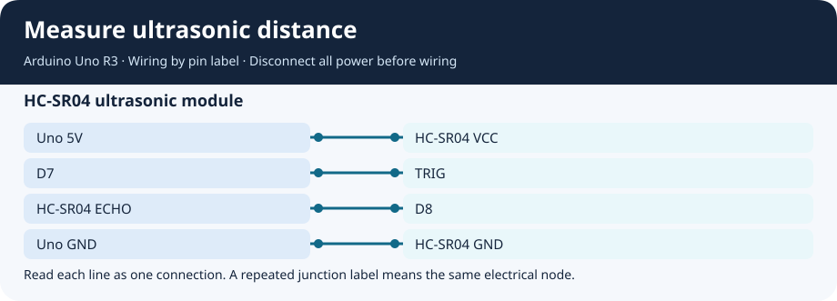
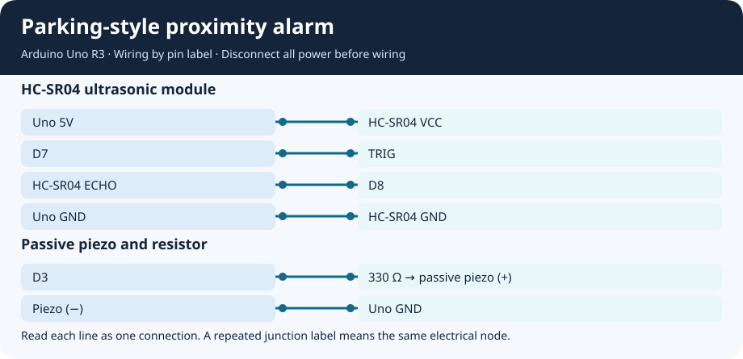
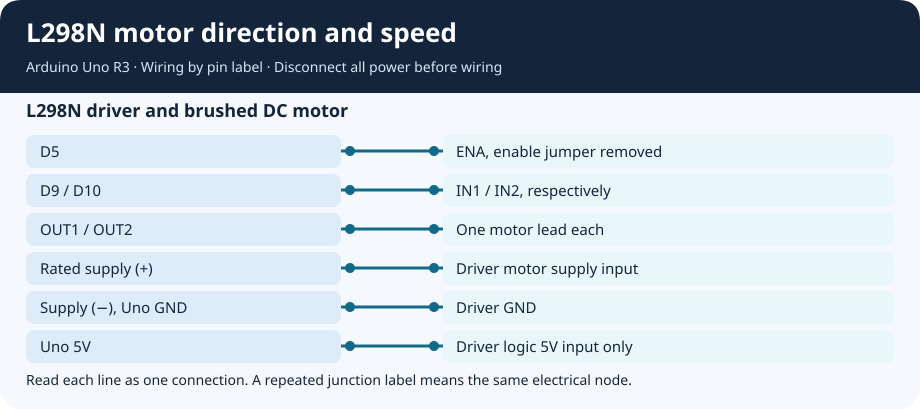
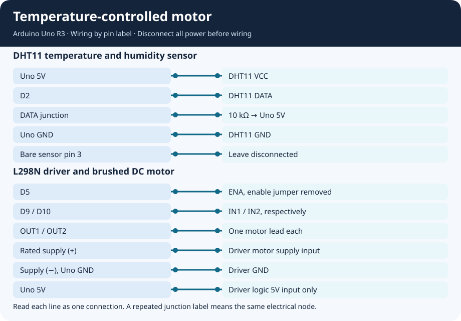

# Measure distance and drive a motor

[Course map](README.md)

The light and climate projects made decisions from slow-changing inputs. Next, time an echo, use distance to choose a buzzer pattern, and drive a motor through a separate supply. Test the motor alone before letting a sensor decide when it runs.

- [Project 13 · HC-SR04 Distance Measurements](04-distance-and-motors.md#ultrasonic_reading)
- [Project 14 · Ultrasonic Parking-Style Alarm](04-distance-and-motors.md#parking_alarm)
- [Project 15 · DC Motor Direction and Speed](04-distance-and-motors.md#l298n_motor_control)
- [Project 16 · Temperature-Controlled Fan](04-distance-and-motors.md#temperature_fan)

## Project 13 · HC-SR04 Distance Measurements

### Learning Objectives

Prerequisite: complete the previous project linked below.

Use trigger/echo timing to calculate object distance mathematically.

### Predict

Predict the distance corresponding to 2000 µs. Before uploading, record the expected outcome and the reason or line of code for your prediction.

| Condition or input | Prediction | Evidence in code | Observation after Run |
| --- | --- | --- | --- |
| First test | | | |
| Second test | | | |

### Components and module names

Arduino Uno; HC-SR04 5 V ultrasonic ranging module; jumper wires.

### See the components and circuit

[Ultrasonic module photos](https://learn.adafruit.com/ultrasonic-sonar-distance-sensors) · Use the source to identify the part and then follow the wiring map below.

Connection map for Measure ultrasonic distance on the Uno R3. Follow connector labels. A repeated junction label is one shared electrical node.

[Wiring diagram](../lesson-visuals/ultrasonic_reading.svg) · [Arduino sketch](sketches/ultrasonic_reading/ultrasonic_reading.ino) · [Detailed notes and engineering questions](sketches/ultrasonic_reading/NOTES.md)

### Exact wiring (power OFF first)

Use a 5 V HC-SR04 and enforce its nominal 2–400 cm range. Its ECHO output is 5 V logic, so a 3.3 V input needs suitable level conversion. Wait more than 60 ms between triggers. A broad, flat target gives a better echo. [HC-SR04 datasheet](https://cdn.sparkfun.com/datasheets/Sensors/Proximity/HCSR04.pdf)

HC-SR04 VCC→5V, TRIG→D7, ECHO→D8, GND→GND. Uno is 5 V logic, so a typical 5 V ECHO is compatible. Do not connect ECHO directly to an ESP32 without level shifting.

### Concepts and module behavior

The transmitter emits ~40 kHz ultrasonic pulses and times the echo. Sound speed near 20°C ≈343 m/s≈0.0343 cm/μs. Because sound travels to the object and back, distance_cm = duration_us × 0.0343 / 2. Timeout/zero pulse means invalid reading, not zero distance. Bats also use echo timing for orientation (simplified analogy).

### Run

1. Wire the 4 sensor pins.
2. Point sensor toward a flat object approximately 20 cm away.
3. Upload sketch, open 9600 baud Serial Monitor.
4. Measure with ruler at 10,20,30,50 cm; record differences.
5. Turn object at an angle and discuss weak echoes.
6. Compute an example: 2000 μs ×0.0343/2=34.3 cm.

### Complete Arduino sketch

[Open ultrasonic_reading.ino](sketches/ultrasonic_reading/ultrasonic_reading.ino). Open the file in Arduino IDE from its matching folder and select **Arduino Uno**. Click **Verify** before uploading.

### Code explanation

delayMicroseconds(10) sends a trigger pulse. pulseIn() measures ECHO high time or returns 0 on timeout. Distance = speed × one-way time; division by two accounts for round trip.

### Expected result

Distances displayed in centimeters when a suitable obstacle is in range.

### Investigate

Trace one input or timing value from the source to an output. Use the [matching code walkthrough](sketches/ultrasonic_reading/NOTES.md) to check your explanation and the pin map. Write one thing your observation confirms and one thing you still need to measure.

### Modify

Record readings from a flat target at 10, 20, and 40 cm.

### Make

Compare straight and angled targets and characterize missing readings. Define what success will look like and keep the circuit within its original ratings.

### Troubleshoot

Use the symptom-specific checks in the [sketch notes](sketches/ultrasonic_reading/NOTES.md#common-errors-and-troubleshooting). If the kit differs, check the parts and sketch together before moving any wires. Change one variable at a time.

### Knowledge Check

1. Why divide the travel distance by two?
2. Why should a timeout be handled separately?
3. What happens to the echo from an angled target?

You should be able to explain the signal or timing, identify the line that controls it, and justify a troubleshooting measurement.

### Practical Checkpoint

Compare three ruler distances with the serial report and record an invalid echo separately.

### Additional Challenge

Measure 4 actual distances and compute absolute error, then explain three sources of measurement error.

### Where this technology is used

Robot collision avoidance; tank-level probes; parking assistance and proximity meters.

### Real build / practical application photo

[Arduino UNO + HC-SR04 + HC 05 + breadboard - bird's eye 00](https://commons.wikimedia.org/wiki/File:Arduino_UNO_%2B_HC-SR04_%2B_HC_05_%2B_breadboard_-_bird%27s_eye_00.jpg) — Pradana Aumars. License: CC BY-SA 4.0. The linked example may use different hardware. Follow the wiring in this lesson.

### Continue Learning

**Previous** · [Project 12 · Combined Light and Climate System](03-inputs-light-and-climate.md#light_and_climate)

**Next** · [Project 14 · Ultrasonic Parking-Style Alarm](04-distance-and-motors.md#parking_alarm). Convert measured distance into a distinct warning pattern.

## Project 14 · Ultrasonic Parking-Style Alarm

### Learning Objectives

Prerequisite: complete the previous project linked below.

Make an audible warning pattern speed up as an object approaches.

### Predict

Predict the branch for 10, 25 and 60 cm. Before uploading, record the expected outcome and the reason or line of code for your prediction.

| Condition or input | Prediction | Evidence in code | Observation after Run |
| --- | --- | --- | --- |
| First test | | | |
| Second test | | | |

### Components and module names

Arduino Uno; HC-SR04; low-current passive piezo buzzer; jumper wires.

### See the components and circuit

[Ultrasonic module photos](https://learn.adafruit.com/ultrasonic-sonar-distance-sensors) · Use the source to identify the part and then follow the wiring map below.

Connection map for Parking-style proximity alarm on the Uno R3. Follow connector labels. A repeated junction label is one shared electrical node.

[Wiring diagram](../lesson-visuals/parking_alarm.svg) · [Arduino sketch](sketches/parking_alarm/parking_alarm.ino) · [Detailed notes and engineering questions](sketches/parking_alarm/NOTES.md)

### Exact wiring (power OFF first)

Keep the range wiring from Project 13. Wire D3 through 330 Ω to the passive piezo positive lead, then connect its other lead to GND. The Uno R3 tone timer affects PWM on D3 and D11, so keep PWM loads off those two pins while using tone.

Connect HC-SR04 VCC to 5V, TRIG to D7, ECHO to D8 and GND to GND. The piezo uses the same D3 and 330 Ω circuit from Project 11.

### Concepts and module behavior

Use distance zones: >60 cm = silent; 25–60 cm = slow beeps; 10–25 cm = faster beeps; ≤10 cm = continuous tone. A timeout is not a valid obstacle distance.

### Run

1. Assemble and test distance sensor separately first.
2. Add buzzer and verify polarity/current requirements.
3. Upload full sketch.
4. Move an object from ~70 cm to 40, 20, then 8 cm.
5. Compare beep repetition rate.
6. Explain if / else if / else range priority.

### Complete Arduino sketch

[Open parking_alarm.ino](sketches/parking_alarm/parking_alarm.ino). Open the file in Arduino IDE from its matching folder and select **Arduino Uno**. Click **Verify** before uploading.

### Code explanation

if/else if gives exactly one warning range. This beginner version uses delays, so it is not suitable unchanged for the final multi-task Smart Home. The final project replaces blocking alarm timing.

### Expected result

Silence far away, slow then faster beeps as the obstacle approaches, continuous sound at 10 cm or nearer.

### Investigate

Trace one input or timing value from the source to an output. Use the [matching code walkthrough](sketches/parking_alarm/NOTES.md) to check your explanation and the pin map. Write one thing your observation confirms and one thing you still need to measure.

### Modify

Change the middle-zone beep rhythm and measure it.

### Make

Use a timestamp for beeping instead of holding up distance sampling. Define what success will look like and keep the circuit within its original ratings.

### Troubleshoot

Use the symptom-specific checks in the [sketch notes](sketches/parking_alarm/NOTES.md#common-errors-and-troubleshooting). If the kit differs, check the parts and sketch together before moving any wires. Change one variable at a time.

### Knowledge Check

1. Why divide the travel distance by two?
2. Why should a timeout be handled separately?
3. What happens to the echo from an angled target?

You should be able to explain the signal or timing, identify the line that controls it, and justify a troubleshooting measurement.

### Practical Checkpoint

Demonstrate quiet, slow, fast and continuous zones with a ruler and a flat target.

### Additional Challenge

Add a green/yellow/red LED indicator. Find why the buzzer stops safely on an invalid echo.

### Where this technology is used

Parking aids; collision warnings; occupancy/proximity signals.

### Real build / practical application photo

[Breadboard parking distance alarm prototype](https://medium.com/nabilarahmi/parking-sensor-microprocessor-project-6f429f5118dc) — See original project page. License: Not independently verified for republication; link only. The linked example may use different hardware. Follow the wiring in this lesson.

### Continue Learning

**Previous** · [Project 13 · HC-SR04 Distance Measurements](04-distance-and-motors.md#ultrasonic_reading)

**Next** · [Project 15 · DC Motor Direction and Speed](04-distance-and-motors.md#l298n_motor_control). Next, control an actuator that needs more current than a GPIO can supply.

## Project 15 · DC Motor Direction and Speed

### Learning Objectives

Prerequisite: complete the previous project linked below.

Learn the H-bridge, shared ground, separate motor supply, direction pins and PWM speed.

### Predict

Trace ENA and both input states on paper for all four phases. Before uploading, record the expected outcome and the reason or line of code for your prediction.

| Condition or input | Prediction | Evidence in code | Observation after Run |
| --- | --- | --- | --- |
| First test | | | |
| Second test | | | |

### Components and module names

Arduino Uno; 1 small brushed DC motor; one L298N red dual H-bridge board; regulated motor power source appropriate for motor; wires.

### See the components and circuit

[L298N breakout and label examples](https://components101.com/modules/l293n-motor-driver-module) · Use the source to identify the part and then follow the wiring map below.

Connection map for L298N motor direction and speed on the Uno R3. Follow connector labels. A repeated junction label is one shared electrical node.

[Wiring diagram](../lesson-visuals/l298n_motor_control.svg) · [Arduino sketch](sketches/l298n_motor_control/l298n_motor_control.ino) · [Detailed notes and engineering questions](sketches/l298n_motor_control/NOTES.md)

### Exact wiring (power OFF first)

Use a documented L298N module with flyback diodes and a heatsink. Confirm the module has a documented external 5 V logic-input mode before using the wiring below. Turn both supplies off. Remove the ENA jumper before wiring D5. In external logic-input mode, disable the onboard regulator as specified by the module maker and use the Uno 5V only for the logic input. Never join two 5 V regulator outputs. Use a separately rated, current-limited motor supply. Tie its negative to the driver ground and connect Uno GND to the same reference. Match motor voltage and stall current to the supply, module and cooling. Never select supply voltage from the chip absolute maximum. Secure the bare motor, keep motor power off for upload, then enable it after the Uno has started. [L298 IC datasheet and protection circuit](https://www.st.com/resource/en/datasheet/l298.pdf)

L298N: ENA→D5 (remove ENA enable jumper), IN1→D9, IN2→D10, OUT1/OUT2→DC motor, external motor supply +→L298N motor input+, supply −→L298N GND, Arduino GND→L298N GND. Logic supply 5V must be configured per the actual board: for boards with 5V-EN regulator jumper, when that jumper is removed the 5V terminal is an INPUT and may be supplied by the Uno regulated 5V. Never connect conflicting 5V sources.

### Concepts and module behavior

DC motors draw more current than GPIO can supply. An H-bridge reverses voltage polarity. L298N is accessible for demonstrations but has a large internal voltage drop and needs thermal consideration; a 6 V motor on a 6 V supply may spin weakly under load. For small, efficient designs, TB6612FNG or DRV8833 can be superior. Low-speed PWM may not overcome static friction.

### Run

1. Disconnect battery and USB. Secure an unloaded motor without fan blade for reversing tests.
2. Check motor rated voltage/stall current vs driver/supply.
3. Remove ENA jumper and configure regulator jumper for external logic per the board data sheet.
4. Wire ENA, IN1, IN2; connect OUT1/OUT2 to motor.
5. Connect motor supply to motor power terminals and common ground to Uno.
6. Power Uno by USB and motor via motor supply.
7. Upload code.
8. Observe forward/stop/backward/stop; if reversed relative to the intended label, swap motor wires while power is off.

### Complete Arduino sketch

[Open l298n_motor_control.ino](sketches/l298n_motor_control/l298n_motor_control.ino). Open the file in Arduino IDE from its matching folder and select **Arduino Uno**. Click **Verify** before uploading.

### Code explanation

D5 sets ENA PWM (~71% duty at value 180); IN1/IN2 decide polarity; motorStop() disables PWM and sets both directions LOW. Real RPM is not equal to PWM percentage.

### Expected result

3 s forward, 2 s stop, 3 s reverse, 2 s stop.

### Investigate

Trace one input or timing value from the source to an output. Use the [matching code walkthrough](sketches/l298n_motor_control/NOTES.md) to check your explanation and the pin map. Write one thing your observation confirms and one thing you still need to measure.

### Modify

Try a second approved duty value with the bare secured motor and compare startup behavior.

### Make

Design a state machine that waits before reversing direction. Define what success will look like and keep the circuit within its original ratings.

### Troubleshoot

Use the symptom-specific checks in the [sketch notes](sketches/l298n_motor_control/NOTES.md#common-errors-and-troubleshooting). If the kit differs, check the parts and sketch together before moving any wires. Change one variable at a time.

### Knowledge Check

1. Which supply powers the motor?
2. What does ENA change?
3. Why stop before reversing?

You should be able to explain the signal or timing, identify the line that controls it, and justify a troubleshooting measurement.

### Practical Checkpoint

Show the four direction and stop phases with the motor secured. Identify the logic and motor supplies.

### Additional Challenge

Compare PWM values 100, 180, 255. Note whether motor stalls at low settings. Explain why a small rectangular PP3 9V battery is usually a bad motor supply.

### Where this technology is used

RC cars; robotic platforms; conveyors; physical fan control.

### Additional engineering note

Motor power is externally supplied. Do not connect a brushed motor directly to Arduino D5, D9 or D10. If driver thermal or current requirements are exceeded, stop the test.

### Real build / practical application photo

[3V DC Motor Connected to an Arduino Uno and Motor Shield](https://commons.wikimedia.org/wiki/File:3V_DC_Motor_Connected_to_an_Arduino_Uno_and_Motor_Shield.jpg) — Dcaldero8983. License: Creative Commons; confirm exact terms on source before reuse. The linked example may use different hardware. Follow the wiring in this lesson.

### Continue Learning

**Previous** · [Project 14 · Ultrasonic Parking-Style Alarm](04-distance-and-motors.md#parking_alarm)

**Next** · [Project 16 · Temperature-Controlled Fan](04-distance-and-motors.md#temperature_fan). Use a temperature reading to decide when the motor can start and stop.

## Project 16 · Temperature-Controlled Fan

### Learning Objectives

Prerequisite: complete the previous project linked below.

Use DHT11 readings to control a ventilating motor with hysteresis.

### Predict

Predict the state at 29 °C given each possible prior state. Before uploading, record the expected outcome and the reason or line of code for your prediction.

| Condition or input | Prediction | Evidence in code | Observation after Run |
| --- | --- | --- | --- |
| First test | | | |
| Second test | | | |

### Components and module names

Arduino Uno, DHT11, L298N, a brushed DC motor, and a separately rated motor supply. Secure the motor to the bench and leave its shaft bare.

### See the components and circuit

[Uno and a DHT11 sensor in a separate demonstration](https://commons.wikimedia.org/wiki/File:Arduino_uno_dht11.jpg)

*Uno and a DHT11 sensor in a separate demonstration · Edwiyanto · [CC BY-SA 4.0](https://creativecommons.org/licenses/by-sa/4.0/).*

Connection map for Temperature-controlled motor on the Uno R3. Follow connector labels. A repeated junction label is one shared electrical node.

[Wiring diagram](../lesson-visuals/temperature_fan.svg) · [Arduino sketch](sketches/temperature_fan/temperature_fan.ino) · [Detailed notes and engineering questions](sketches/temperature_fan/NOTES.md)

### Exact wiring (power OFF first)

For a bare four-pin DHT11 with the grille toward you and pins down, wire left to right as 5V, DATA (D2), unused, GND. Add 10 kΩ between DATA and 5V. For a breakout, use the printed pin labels and verify whether a pull-up is already fitted. Install **DHT sensor library** by Adafruit and **Adafruit Unified Sensor** from Library Manager. Keep the two-second sampling interval used here. [DHT wiring](https://learn.adafruit.com/dht/connecting-to-a-dhtxx-sensor) · [Arduino library setup](https://learn.adafruit.com/dht/using-a-dhtxx-sensor-with-arduino)

Use a documented L298N module with flyback diodes and a heatsink. Confirm the module has a documented external 5 V logic-input mode before using the wiring below. Turn both supplies off. Remove the ENA jumper before wiring D5. In external logic-input mode, disable the onboard regulator as specified by the module maker and use the Uno 5V only for the logic input. Never join two 5 V regulator outputs. Use a separately rated, current-limited motor supply. Tie its negative to the driver ground and connect Uno GND to the same reference. Match motor voltage and stall current to the supply, module and cooling. Never select supply voltage from the chip absolute maximum. Secure the bare motor, keep motor power off for upload, then enable it after the Uno has started. [L298 IC datasheet and protection circuit](https://www.st.com/resource/en/datasheet/l298.pdf)

Keep the shaft bare. First test close to ambient by lowering the thresholds in code while keeping the OFF threshold below the ON threshold.

DHT11 DATA→D2, VCC→5V, GND→GND. L298N ENA→D5 (ENA jumper removed), IN1→D9, IN2→D10, OUT1/2→motor; motor supply +→motor power+; supply−→GND and Uno GND; logic5V per verified regulator configuration.

### Concepts and module behavior

With hysteresis the fan switches ON at ≥30°C, then stays ON until ≤28°C. Two thresholds prevent constant switching around 30°C. A fan circulates or ventilates air; it does not necessarily cool a sealed room. Demo readings are not suitable for fire protection.

### Run

1. Test the DHT11 and motor projects independently.
2. Mount motor safely; avoid open propellers near fingers/wires.
3. Share Arduino-driver ground.
4. Upload fan program.
5. Observe room reading; to test quickly, adjust ON/OFF thresholds close to ambient without introducing high heat.
6. Explain why two thresholds are better than one.

### Complete Arduino sketch

[Open temperature_fan.ino](sketches/temperature_fan/temperature_fan.ino). Open the file in Arduino IDE from its matching folder and select **Arduino Uno**. Click **Verify** before uploading.

### Code explanation

The fanIsOn state remembers the output across loop cycles. The sensor is sampled every 2 seconds. On invalid data, the demo fails safe by turning the fan off.

### Expected result

Motor ON at or above 30°C, OFF at or below 28°C, status printed each two seconds.

### Investigate

Trace one input or timing value from the source to an output. Use the [matching code walkthrough](sketches/temperature_fan/NOTES.md) to check your explanation and the pin map. Write one thing your observation confirms and one thing you still need to measure.

### Modify

Adjust both thresholds near ambient and confirm the on and off behavior.

### Make

Log the event that causes a state change instead of printing only sampled levels. Define what success will look like and keep the circuit within its original ratings.

### Troubleshoot

Use the symptom-specific checks in the [sketch notes](sketches/temperature_fan/NOTES.md#common-errors-and-troubleshooting). If the kit differs, check the parts and sketch together before moving any wires. Change one variable at a time.

### Knowledge Check

1. Which supply powers the motor?
2. What does ENA change?
3. Why stop before reversing?

You should be able to explain the signal or timing, identify the line that controls it, and justify a troubleshooting measurement.

### Practical Checkpoint

Show both state changes by adjusting limits safely near ambient. Record the sensor values and prior motor state.

### Additional Challenge

Build 3 speed steps based on temperature, or add an override switch (requires new input pin and safe wiring).

### Where this technology is used

Greenhouse ventilation; electronics cooling demonstrations; automated air circulation.

### Real build / practical application photo

[Arduino and small propeller motor](https://commons.wikimedia.org/wiki/File:Arduino_and_small_propeller_motor.jpg) — messi / 1messi01. License: CC BY-SA 3.0. The linked example may use different hardware. Follow the wiring in this lesson.

### Continue Learning

**Previous** · [Project 15 · DC Motor Direction and Speed](04-distance-and-motors.md#l298n_motor_control)

**Next** · [Project 17 · Integrated Smart Home](05-smart-home.md#smart_home). Merge the tested light, climate, distance, and motor subsystems.
