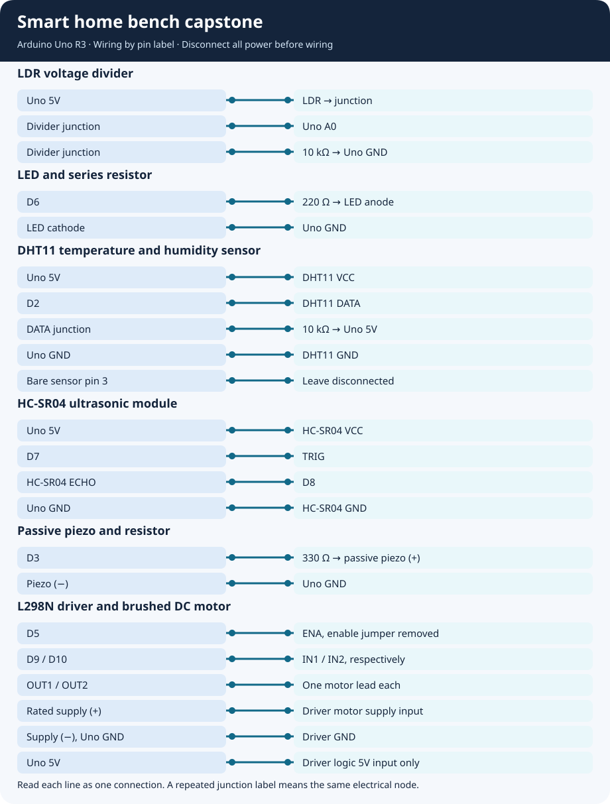

# Build the smart-home capstone

[Course map](README.md)

Use the three working subsystems from the earlier projects. The lamp should respond to light, the fan should respond to temperature, and the proximity buzzer should respond to distance. Keep each subsystem independently testable.

- [Project 17 · Integrated Smart Home](05-smart-home.md#smart_home)

## Project 17 · Integrated Smart Home

### Goal

Combine three complete subsystems in one coordinated Arduino program: lamp, fan and proximity alarm.

### Components and module names

Arduino Uno; breadboard; bare LDR + 10 kΩ divider; LED + 220 Ω resistor; DHT11; HC-SR04; passive piezo buzzer; L298N; brushed DC motor; suitable external motor supply; jumpers.

### See the components and circuit

*Two-lead through-hole red LED · Evan-Amos · Public domain.*

*Axial resistors with colored bands · Evan-Amos · Public domain.*

Use the resistance specified in the wiring table. Verify unfamiliar color bands with a multimeter before wiring.

Connection map for Smart home bench capstone on the Uno R3. Follow connector labels. A repeated junction label is one shared electrical node.

[Wiring diagram](../lesson-visuals/smart_home.svg) · [Arduino sketch](sketches/smart_home/smart_home.ino) · [Detailed notes and engineering questions](sketches/smart_home/NOTES.md)

### Exact wiring (power OFF first)

For a bare four-pin DHT11 with the grille toward you and pins down, wire left to right as 5V, DATA (D2), unused, GND. Add 10 kΩ between DATA and 5V. For a breakout, use the printed pin labels and verify whether a pull-up is already fitted. Install **DHT sensor library** by Adafruit and **Adafruit Unified Sensor** from Library Manager. Keep the two-second sampling interval used here. [DHT wiring](https://learn.adafruit.com/dht/connecting-to-a-dhtxx-sensor) · [Arduino library setup](https://learn.adafruit.com/dht/using-a-dhtxx-sensor-with-arduino)

Use a documented L298N module with flyback diodes and a heatsink. Confirm the module has a documented external 5 V logic-input mode before using the wiring below. Turn both supplies off. Remove the ENA jumper before wiring D5. In external logic-input mode, disable the onboard regulator as specified by the module maker and use the Uno 5V only for the logic input. Never join two 5 V regulator outputs. Use a separately rated, current-limited motor supply. Tie its negative to the driver ground and connect Uno GND to the same reference. Match motor voltage and stall current to the supply, module and cooling. Never select supply voltage from the chip absolute maximum. Secure the bare motor, keep motor power off for upload, then enable it after the Uno has started. [L298 IC datasheet and protection circuit](https://www.st.com/resource/en/datasheet/l298.pdf)

Where the wiring below says buzzer D3, put a 330 Ω resistor in series with a 5 V-compatible high-impedance passive piezo. Set up the lamp first, then verify DHT readings and the ranging alarm before enabling motor power.

| Subsystem | Wiring |
| --- | --- |
| Light sensor | 5V → LDR → A0 junction → 10 kΩ → GND |
| Lamp LED | D6 → 220 Ω → anode. Cathode → GND |
| Climate sensor | DHT11 VCC → 5V, DATA → D2, GND → GND. For a bare part, add the 10 kΩ DATA pull-up |
| Distance sensor | HC-SR04 VCC → 5V, TRIG → D7, ECHO → D8, GND → GND |
| Piezo | D3 → 330 Ω → positive lead. Negative lead → GND |
| Motor driver | L298N ENA → D5 with ENA jumper removed, IN1 → D9, IN2 → D10, OUT1/OUT2 → motor. Route the dedicated supply to the motor power terminals and share its ground with the Uno. Connect logic 5V only in the verified external logic-input mode |

### Concepts and module behavior

Subsystem A: the LDR switches the lamp using two thresholds (400/550) so it does not flicker. Subsystem B: the DHT11 drives motor ON at 30°C and OFF at 28°C. Subsystem C: HC-SR04 produces OFF/slow/fast/continuous buzzer behavior depending on distance. millis() schedules LDR ~100ms, DHT11 ~2000ms, ultrasonic ~80ms, status logging ~2000ms. pulseIn() still waits up to 25ms; this is cooperative scheduling, not true parallelism.

### Build and test — step by step

1. Run and verify each sensor module independently before integration.
2. With power off, construct one clean breadboard layout with common GND.
3. Follow the full pin map exactly; no reused signal pins.
4. Configure and separately power the motor driver safely.
5. Install Adafruit DHT library and Unified Sensor.
6. Upload full sketch and open 9600-baud Serial Monitor.
7. Test LDR with flashlight/hand.
8. Adjust demo temperature thresholds safely near ambient to observe fan control; return threshold to target values.
9. Move a flat object from 70→40→20→8 cm; listen for each pattern.
10. Verify light, fan and distance alarm can respond without stopping one another.
11. Record acceptance-test data.

### Complete Arduino sketch

[Open smart_home.ino](sketches/smart_home/smart_home.ino). Open the file in Arduino IDE from its matching folder and select **Arduino Uno**. Click **Verify** before uploading.

### Code explanation

setFan() drives L298N; updateLighting() uses hysteresis; updateEnvironment() checks isnan() and DHT temperature; measureDistance() uses echo time ×0.0343/2; updateProximityAlarm() uses millis() to create beep rhythms without long delay() calls; printSystemStatus() reports all measured states. Short ultrasonic pulse/echo timing still requires careful scheduling.

### Expected result

LDR dark→lamp ON; hot temperature→fan ON; close object→beeps accelerate. All status values appear in Serial Monitor.

### Hands-on challenge

Final assignment: choose two enhancements: 3-level PWM dimming, extra status LEDs, manual lighting override, temperature-based motor speed, different buzzer warnings, LCD/OLED display, extra ultrasonic sensor, reusable functions, more useful logging, or custom automation scenario. Submit photo, wiring explanation, sketch and one measurement table.

### Where this technology is used

Prototype of room control, environmental sensing, automation logic, data collection and multi-task embedded programming.

### Additional engineering note

This is an educational low-voltage prototype only. No mains wiring, no unattended fire/security applications, and no claim of certified safety. Do not connect motor or other loads directly to the Arduino I/O.

### Real build / practical application photo

[Physical smart-home/sensor integration project reference](https://projecthub.arduino.cc/js-arduino/4fc420da-214a-4597-a8cd-363ce6cbbbf2) — See original project page. License: Not independently verified for republication; link only. The linked example may use different hardware. Follow the wiring in this lesson.

**Previous** · [Project 16 · Temperature-Controlled Fan](04-distance-and-motors.md#temperature_fan)

## Before you move on

| Check | Expected observation |
| --- | --- |
| Cover and uncover the LDR | With calibration, the lamp turns on below the dark threshold and goes off above the bright threshold |
| Move a flat target through 70, 40, 20, and 8 cm | Silence, slow beeps, fast beeps, then a continuous tone |
| Reduce thresholds around ambient temperature with the shaft clear | The motor starts at the upper threshold and coasts to a stop at the lower threshold |
| With power off, disconnect DHT DATA and power back on | The fan stays off after the failed climate read. The lamp and ultrasonic alarm continue |

Keep a pin map, raw readings, threshold settings, and observations so another student can reproduce your project.

**Next** · [Choose a project after Class 3](06-project-paths.md). Use the build record you just made to plan your next project.
