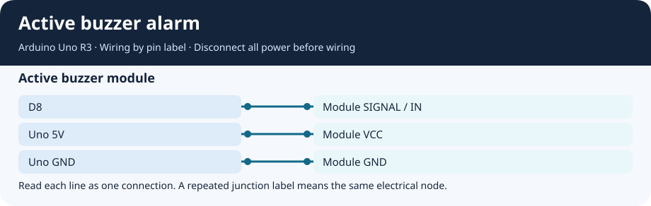

# Active buzzer alarm notes

[Project lesson](../../02-leds-and-sound.md#active_buzzer) · [Open Arduino sketch](active_buzzer.ino) · [Image credits](../../../IMAGE-SOURCES.md)

## What does this program do?

Half a second of sound, then half a second of silence

## Components and their functions

Arduino Uno R3 runs the sketch. A USB data cable supplies logic power and transfers the sketch. Use a breadboard and jumpers for external low-current connections.

### Active buzzer module

The 5 V-compatible active-high module has its own oscillator and input driver. The GPIO switches its signal.

[Active buzzer and module photos](https://startingelectronics.org/articles/arduino/connecting-buzzer-arduino-uno/) · Use the source to identify the part and then follow the wiring map below.

## Wiring explanation

Disconnect USB and any external motor supply before changing a wire. Inspect wiring against the labeled module before applying power.

| Start | End | What this connection does |
| --- | --- | --- |
| D8 | Module SIGNAL / IN | HIGH commands the module to sound |
| Uno 5V | Module VCC | Supplies the rated module |
| Uno GND | Module GND | Common reference |

Connection map for Active buzzer alarm on the Uno R3. Follow connector labels. A repeated junction label is one shared electrical node. [Open diagram](../../../lesson-visuals/active_buzzer.svg).

## Complete code walkthrough

setup makes the signal pin an output. HIGH enables the active-high module and its oscillator makes a fixed pitch. LOW stops it. The delays control cadence, not pitch.

## Program execution sequence

Reset → setup runs once → loop runs the logic described above → repeat from the top of loop.

## Variables and functions

- `buzzerPin` (`int`) starts at `8`. Check the pin map and move the wire only with power off if you change a pin.

- `pinMode(pin, mode)` · Configures a GPIO as output, input or input with an internal pull-up. It does not turn an LED on.
- `digitalWrite(pin, value)` · On an output, HIGH drives near 5 V and LOW near ground. The value is held until changed.
- `delay(milliseconds)` · Pauses the sketch in milliseconds. A value of 500 is half a second.

## Expected output

Half a second of sound, then half a second of silence

## Common errors and troubleshooting

- Check the module power pins and active-high behavior. Confirm that it is an active module before treating it as a simple on/off device.

## Real-world applications

This pattern can help explain door and appliance confirmations. A classroom prototype is useful for learning how the signal is produced and tested.

[Arduino Uno buzzer breadboard project](https://startingelectronics.org/articles/arduino/connecting-buzzer-arduino-uno/) — See original project page. License: Not independently verified for republication; link only.

Use this photograph to see a related build. Wire your project from the map above.

## Student challenges

1. **Beginner** · Change the cadence without changing the oscillator pitch.
2. **Intermediate** · Make a two-beep pattern separated by a longer pause.
3. **Optional advanced** · Design an enable flag and justify the default state on reset.

## Think Like an Engineer

Why can the active module beep with a steady HIGH, whereas the passive piezo needs a repeating waveform? Predict what you would hear if you changed only frequency or only duration.

Write down one prediction, the single variable you changed, and the result. If they differ, propose a measurement that would distinguish two possible causes.
