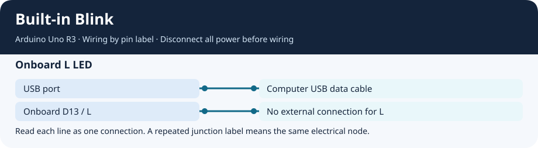

# Built-in Blink notes

[Project lesson](../../02-leds-and-sound.md#builtin_blink) · [Open Arduino sketch](builtin_blink.ino) · [Image credits](../../../IMAGE-SOURCES.md)

## What does this program do?

500 ms on, 500 ms off

## Components and their functions

Arduino Uno R3 runs the sketch. A USB data cable supplies logic power and transfers the sketch. Use a breadboard and jumpers for external low-current connections.

### Onboard L LED

The built-in L indicator is connected to digital pin 13 on the Uno. The board already provides its LED circuit.

[Uno R3 board and downloadable pinout](https://docs.arduino.cc/hardware/uno-rev3/) · Use the source to identify the part and then follow the wiring map below.

## Wiring explanation

Disconnect USB and any external motor supply before changing a wire. Inspect wiring against the labeled module before applying power.

| Start | End | What this connection does |
| --- | --- | --- |
| USB port | Computer USB data cable | Powers and programs the Uno |
| Onboard D13 / L | No external connection for L | The LED and its current limit are built in. |

Connection map for Built-in Blink on the Uno R3. Follow connector labels. A repeated junction label is one shared electrical node. [Open diagram](../../../lesson-visuals/builtin_blink.svg).

## Complete code walkthrough

Use LED_BUILTIN to select the board LED. setup sets its pin as an output. Each loop writes HIGH, waits 500 ms, writes LOW, then waits another 500 ms. The period is the sum of both waits.

## Program execution sequence

Reset → setup runs once → loop runs the logic described above → repeat from the top of loop.

## Variables and functions

- `ledPin` (`int`) starts at `LED_BUILTIN`. Check the pin map and move the wire only with power off if you change a pin.

- `pinMode(pin, mode)` · Configures a GPIO as output, input or input with an internal pull-up. It does not turn an LED on.
- `digitalWrite(pin, value)` · On an output, HIGH drives near 5 V and LOW near ground. The value is held until changed.
- `delay(milliseconds)` · Pauses the sketch in milliseconds. A value of 500 is half a second.

## Expected output

500 ms on, 500 ms off

## Common errors and troubleshooting

- Check the selected Uno board, USB data cable and port. The L indicator is different from the power LED.

## Real-world applications

This pattern can help explain board power and heartbeat indicators. A classroom prototype is useful for learning how the signal is produced and tested.

[Arduino uno led on](https://commons.wikimedia.org/wiki/File:Arduino_uno_led_on.jpg) — Edwiyanto. License: CC BY-SA 4.0.

Use this photograph to see a related build. Wire your project from the map above.

## Student challenges

1. **Beginner** · Predict the period if only the first wait changes to 100 ms.
2. **Intermediate** · Make a short heartbeat flash once per second.
3. **Optional advanced** · Rewrite it with millis() and keep the same measured period.

## Think Like an Engineer

Before changing the code, make a prediction. Predict the period if only the first wait changes to 100 ms. Explain how to tell a timing change from a board or upload problem.

Write down one prediction, the single variable you changed, and the result. If they differ, propose a measurement that would distinguish two possible causes.
