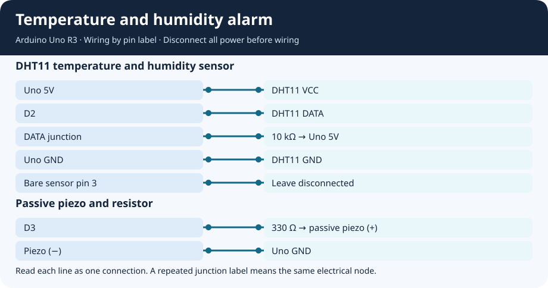

# Temperature and humidity alarm notes

[Project lesson](../../03-inputs-light-and-climate.md#dht11_alarm) · [Open Arduino sketch](dht11_alarm.ino) · [Image credits](../../../IMAGE-SOURCES.md)

## What does this program do?

9600 baud. Tone at or above 30 °C or 75% RH. Invalid samples silence the alarm.

## Components and their functions

Arduino Uno R3 runs the sketch. A USB data cable supplies logic power and transfers the sketch. Use a breadboard and jumpers for external low-current connections.

### DHT11 temperature and humidity sensor

The sensor measures air temperature and relative humidity and transmits a timed digital message. A bare sensor needs a data pull-up.

*Uno and a DHT11 sensor in a separate demonstration · Edwiyanto · [CC BY-SA 4.0](https://creativecommons.org/licenses/by-sa/4.0/).*

### Passive piezo and resistor

A high-impedance passive piezo rated for 5 V turns the square wave into sound. The 330 Ω series resistor limits transient current.

[Passive piezo transducer product photos](https://www.adafruit.com/product/160) · Use the source to identify the part and then follow the wiring map below.

## Wiring explanation

Disconnect USB and any external motor supply before changing a wire. Inspect wiring against the labeled module before applying power.

| Start | End | What this connection does |
| --- | --- | --- |
| Uno 5V | DHT11 VCC | Supplies the sensor |
| D2 | DHT11 DATA | Timed digital data line |
| DATA junction | 10 kΩ → Uno 5V | Pull-up for bare sensor; check breakout |
| Uno GND | DHT11 GND | Common reference |
| Bare sensor pin 3 | Leave disconnected | NC; confirm pin order or breakout labels |
| D3 | 330 Ω → passive piezo (+) | The tone or note signal |
| Piezo (−) | Uno GND | Completes the return path |

Connection map for Temperature and humidity alarm on the Uno R3. Follow connector labels. A repeated junction label is one shared electrical node. [Open diagram](../../../lesson-visuals/dht11_alarm.svg).

## Complete code walkthrough

After starting Serial and the sensor, loop reads temperature and humidity. Return early after silencing the buzzer on invalid data. The logical OR makes either threshold sufficient. tone stays on until noTone. The 2000 ms wait limits sensor polling.

## Program execution sequence

Reset → setup runs once → loop runs the logic described above → repeat from the top of loop.

## Variables and functions

- `dhtPin` (`int`) starts at `2`. Check the pin map and move the wire only with power off if you change a pin.
- `buzzerPin` (`int`) starts at `3`. Check the pin map and move the wire only with power off if you change a pin.
- `maxTemperature` (`float`) starts at `30.0`. Predict what changes in the walkthrough before editing this value.
- `maxHumidity` (`float`) starts at `75.0`. Predict what changes in the walkthrough before editing this value.

- `pinMode(pin, mode)` · Configures a GPIO as output, input or input with an internal pull-up. It does not turn an LED on.
- `delay(milliseconds)` · Pauses the sketch in milliseconds. A value of 500 is half a second.
- `tone(pin, frequency, duration)` · Starts a square wave. The frequency is in hertz. With no duration, use noTone to stop it.
- `noTone(pin)` · Stops the waveform on the buzzer pin.
- `Serial.begin(9600)` · Sets the serial connection rate. Choose 9600 baud in Serial Monitor if this sketch prints.
- `isnan(value)` · Detects an invalid floating-point sensor result before threshold decisions.
- `dht.begin()` · Initializes the selected sensor library before reading. Install the Adafruit DHT and Unified Sensor libraries.

## Expected output

9600 baud. Tone at or above 30 °C or 75% RH. Invalid samples silence the alarm.

## Common errors and troubleshooting

- Check the package order or module labels, DATA pin and pull-up. Match DHT11 or DHT22 to the sketch. Allow the sample interval.
- Check that the part is a passive 5 V-compatible piezo. A buzzer with an oscillator will not reproduce the requested pitches.

## Real-world applications

This pattern can help explain environmental warning indicators. A classroom prototype is useful for learning how the signal is produced and tested.

[DHT11 temperature and humidity buzzer alert](https://projecthub.arduino.cc/arduino_buzz/temperature-and-humidity-monitor-using-dht11-oled-rgb-led-and-buzzer-589f14) — See original project page. License: Not independently verified for republication; link only.

Use this photograph to see a related build. Wire your project from the map above.

## Student challenges

1. **Beginner** · Predict the alarm for 29 °C and 76% RH.
2. **Intermediate** · Test both outcomes by altering one threshold around ambient conditions.
3. **Optional advanced** · Add a difference between the alarm-on and alarm-off thresholds.

## Think Like an Engineer

Which output should change when a sample is missing? Sketch one timeline with a valid sample, a failed sample and a recovery. Explain what would happen if the code kept trusting the last valid value.

Write down one prediction, the single variable you changed, and the result. If they differ, propose a measurement that would distinguish two possible causes.
