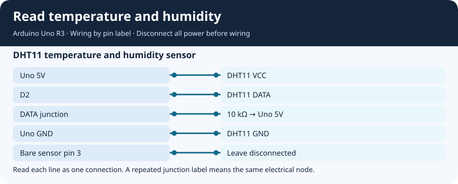

# Read temperature and humidity notes

[Project lesson](../../03-inputs-light-and-climate.md#dht11_reading) · [Open Arduino sketch](dht11_reading.ino) · [Image credits](../../../IMAGE-SOURCES.md)

## What does this program do?

9600 baud. Temperature: 26.00 C and a humidity percentage are representative values.

## Components and their functions

Arduino Uno R3 runs the sketch. A USB data cable supplies logic power and transfers the sketch. Use a breadboard and jumpers for external low-current connections.

### DHT11 temperature and humidity sensor

The sensor measures air temperature and relative humidity and transmits a timed digital message. A bare sensor needs a data pull-up.

*Uno and a DHT11 sensor in a separate demonstration · Edwiyanto · [CC BY-SA 4.0](https://creativecommons.org/licenses/by-sa/4.0/).*

## Wiring explanation

Disconnect USB and any external motor supply before changing a wire. Inspect wiring against the labeled module before applying power.

| Start | End | What this connection does |
| --- | --- | --- |
| Uno 5V | DHT11 VCC | Supplies the sensor |
| D2 | DHT11 DATA | Timed digital data line |
| DATA junction | 10 kΩ → Uno 5V | Pull-up for bare sensor; check breakout |
| Uno GND | DHT11 GND | Common reference |
| Bare sensor pin 3 | Leave disconnected | NC; confirm pin order or breakout labels |

Connection map for Read temperature and humidity on the Uno R3. Follow connector labels. A repeated junction label is one shared electrical node. [Open diagram](../../../lesson-visuals/dht11_reading.svg).

## Complete code walkthrough

The DHT object records the pin and sensor type. begin initializes the library. readTemperature and readHumidity get the latest sample. isnan filters failed readings. The delay gives the sensor time between samples.

## Program execution sequence

Reset → setup runs once → loop runs the logic described above → repeat from the top of loop.

## Variables and functions

- `dhtPin` (`int`) starts at `2`. Check the pin map and move the wire only with power off if you change a pin.

- `delay(milliseconds)` · Pauses the sketch in milliseconds. A value of 500 is half a second.
- `Serial.begin(9600)` · Sets the serial connection rate. Choose 9600 baud in Serial Monitor if this sketch prints.
- `isnan(value)` · Detects an invalid floating-point sensor result before threshold decisions.
- `dht.begin()` · Initializes the selected sensor library before reading. Install the Adafruit DHT and Unified Sensor libraries.

## Expected output

9600 baud. Temperature: 26.00 C and a humidity percentage are representative values.

## Common errors and troubleshooting

- Check the package order or module labels, DATA pin and pull-up. Match DHT11 or DHT22 to the sketch. Allow the sample interval.

## Real-world applications

This pattern can help explain greenhouse monitoring. A classroom prototype is useful for learning how the signal is produced and tested.

[Arduino uno dht11](https://commons.wikimedia.org/wiki/File:Arduino_uno_dht11.jpg) — Edwiyanto. License: CC BY-SA 4.0.

Use this photograph to see a related build. Wire your project from the map above.

## Student challenges

1. **Beginner** · Identify the temperature and relative humidity fields in the monitor.
2. **Intermediate** · Log five readings at different times without touching or wetting the sensor.
3. **Optional advanced** · Count consecutive invalid samples and report once when readings recover.

## Think Like an Engineer

Which output should change when a sample is missing? Sketch one timeline with a valid sample, a failed sample and a recovery. Explain what would happen if the code kept trusting the last valid value.

Write down one prediction, the single variable you changed, and the result. If they differ, propose a measurement that would distinguish two possible causes.
