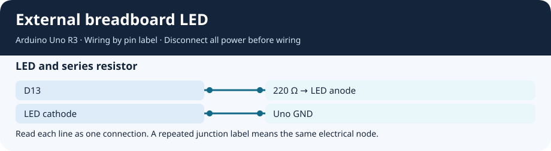
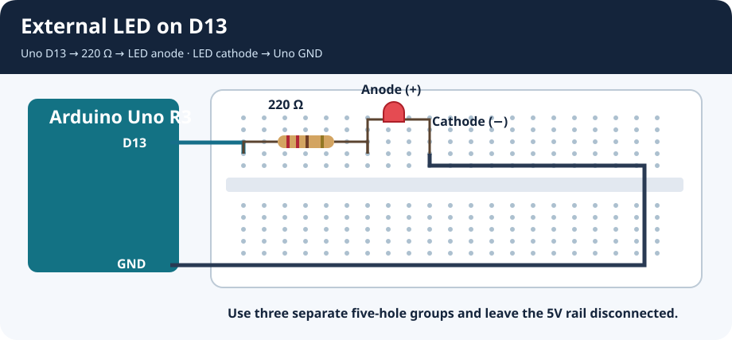

# External breadboard LED notes

[Project lesson](../../02-leds-and-sound.md#external_led) · [Open Arduino sketch](external_led.ino) · [Image credits](../../../IMAGE-SOURCES.md)

## What does this program do?

Onboard L and external LED blink 500 ms on and 500 ms off.

## Components and their functions

Arduino Uno R3 runs the sketch. A USB data cable supplies logic power and transfers the sketch. Use a breadboard and jumpers for external low-current connections.

### LED and series resistor

The indicator LED emits light when current flows from anode to cathode. The 220 Ω resistor limits current in the same path.

*Two-lead through-hole red LED · Evan-Amos · Public domain.*

*Axial resistors with colored bands · Evan-Amos · Public domain.*

Use the resistance specified in the wiring table. Verify unfamiliar color bands with a multimeter before wiring.

## Wiring explanation

Disconnect USB and any external motor supply before changing a wire. Inspect wiring against the labeled module before applying power.

| Start | End | What this connection does |
| --- | --- | --- |
| D13 | 220 Ω → LED anode | Output signal or PWM as configured in the sketch |
| LED cathode | Uno GND | Completes the current path |

Connection map for External breadboard LED on the Uno R3. Follow connector labels. A repeated junction label is one shared electrical node. [Open diagram](../../../lesson-visuals/external_led.svg).

The resistor and LED share one junction. Their other connections go to D13 and GND through separate terminal groups.

## Complete code walkthrough

The sketch selects D13, configures it once as an output, and alternates HIGH and LOW with equal waits. Current flows only through the series LED path when the pin is HIGH and the anode faces the pin.

## Program execution sequence

Reset → setup runs once → loop runs the logic described above → repeat from the top of loop.

## Variables and functions

- `ledPin` (`int`) starts at `13`. Check the pin map and move the wire only with power off if you change a pin.

- `pinMode(pin, mode)` · Configures a GPIO as output, input or input with an internal pull-up. It does not turn an LED on.
- `digitalWrite(pin, value)` · On an output, HIGH drives near 5 V and LOW near ground. The value is held until changed.
- `delay(milliseconds)` · Pauses the sketch in milliseconds. A value of 500 is half a second.

## Expected output

Onboard L and external LED blink 500 ms on and 500 ms off.

## Common errors and troubleshooting

- With power off, check the anode, cathode, series resistor and separate breadboard groups. Verify the Arduino pin in the sketch.

## Real-world applications

This pattern can help explain panel status lights. A classroom prototype is useful for learning how the signal is produced and tested.

[20140922 122126 resized](https://commons.wikimedia.org/wiki/File:20140922_122126_resized.jpg) — NathanMinnick58. License: CC BY-SA 4.0.

Use this photograph to see a related build. Wire your project from the map above.

## Student challenges

1. **Beginner** · Predict what removing the resistor would do. Keep it installed.
2. **Intermediate** · Move the wire and pin constant to D8 with power disconnected and explain why the onboard LED no longer follows.
3. **Optional advanced** · Compare brightness with a 330 Ω resistor and calculate approximate current.

## Think Like an Engineer

The pin drives a series current path. What would happen if the resistor were omitted, the wire moved to a different pin without changing the code, or the LED reversed? Explain each outcome from current, pin selection and polarity. Draw the unsafe case on paper and never power an LED without its resistor.

Write down one prediction, the single variable you changed, and the result. If they differ, propose a measurement that would distinguish two possible causes.
