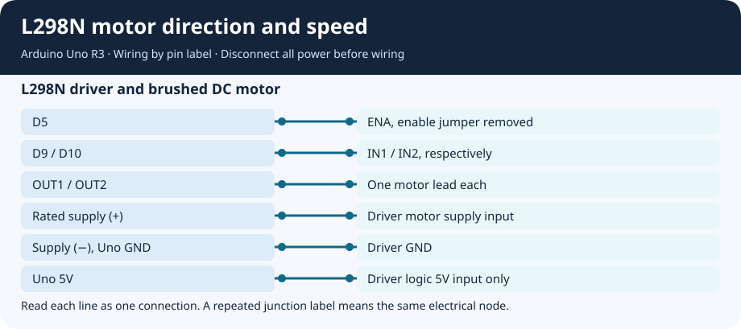

# L298N motor direction and speed notes

[Project lesson](../../04-distance-and-motors.md#l298n_motor_control) · [Open Arduino sketch](l298n_motor_control.ino) · [Image credits](../../../IMAGE-SOURCES.md)

## What does this program do?

Forward 3 s, coast 2 s, reverse 3 s, coast 2 s

## Components and their functions

Arduino Uno R3 runs the sketch. A USB data cable supplies logic power and transfers the sketch. Use a breadboard and jumpers for external low-current connections.

### L298N driver and brushed DC motor

A documented breakout with flyback diodes and heatsink switches the motor current. The Uno supplies control logic; a separate current-limited supply powers the secured bare motor.

[L298N breakout and label examples](https://components101.com/modules/l293n-motor-driver-module) · Use the source to identify the part and then follow the wiring map below.

## Wiring explanation

Disconnect USB and any external motor supply before changing a wire. Inspect wiring against the labeled module before applying power.

| Start | End | What this connection does |
| --- | --- | --- |
| D5 | ENA, enable jumper removed | PWM control of channel A |
| D9 / D10 | IN1 / IN2, respectively | Direction controls |
| OUT1 / OUT2 | One motor lead each | Motor output pair |
| Rated supply (+) | Driver motor supply input | Dedicated source matched to motor and module |
| Supply (−), Uno GND | Driver GND | Common reference; route motor return directly |
| Uno 5V | Driver logic 5V input only | Use verified external-logic configuration |

Connection map for L298N motor direction and speed on the Uno R3. Follow connector labels. A repeated junction label is one shared electrical node. [Open diagram](../../../lesson-visuals/l298n_motor_control.svg).

## Complete code walkthrough

setup configures ENA and direction pins, then calls motorStop. The two direction functions set IN1 and IN2 oppositely and write a PWM value of 180 to ENA. motorStop writes zero duty before clearing both inputs. The stop intervals give the shaft time to coast before reversal.

## Program execution sequence

Reset → setup runs once → loop runs the logic described above → repeat from the top of loop.

## Variables and functions

- `enA` (`int`) starts at `5`. Predict what changes in the walkthrough before editing this value.
- `in1` (`int`) starts at `9`. Predict what changes in the walkthrough before editing this value.
- `in2` (`int`) starts at `10`. Predict what changes in the walkthrough before editing this value.

- `pinMode(pin, mode)` · Configures a GPIO as output, input or input with an internal pull-up. It does not turn an LED on.
- `digitalWrite(pin, value)` · On an output, HIGH drives near 5 V and LOW near ground. The value is held until changed.
- `delay(milliseconds)` · Pauses the sketch in milliseconds. A value of 500 is half a second.
- `analogWrite(pin, duty)` · On an Uno PWM pin, duty 0 is continuously off and 255 is continuously on. Intermediate values vary the on-time.

## Expected output

Forward 3 s, coast 2 s, reverse 3 s, coast 2 s

## Common errors and troubleshooting

- Switch off the motor supply if the driver heats excessively, the shaft stalls or the Uno resets. Check ENA jumper, logic input configuration and shared ground.

## Real-world applications

This pattern can help explain bidirectional robot drive. A classroom prototype is useful for learning how the signal is produced and tested.

[3V DC Motor Connected to an Arduino Uno and Motor Shield](https://commons.wikimedia.org/wiki/File:3V_DC_Motor_Connected_to_an_Arduino_Uno_and_Motor_Shield.jpg) — Dcaldero8983. License: Creative Commons; confirm exact terms on source before reuse.

Use this photograph to see a related build. Wire your project from the map above.

## Student challenges

1. **Beginner** · Trace ENA and both input states on paper for all four phases.
2. **Intermediate** · Try a second approved duty value with the bare secured motor and compare startup behavior.
3. **Optional advanced** · Design a state machine that waits before reversing direction.

## Think Like an Engineer

What is the difference between the signal path and the motor current path? If the motor makes the Uno reset, which supply and ground connections would you measure first? Leave the shaft bare and power off before changing any wire.

Write down one prediction, the single variable you changed, and the result. If they differ, propose a measurement that would distinguish two possible causes.
