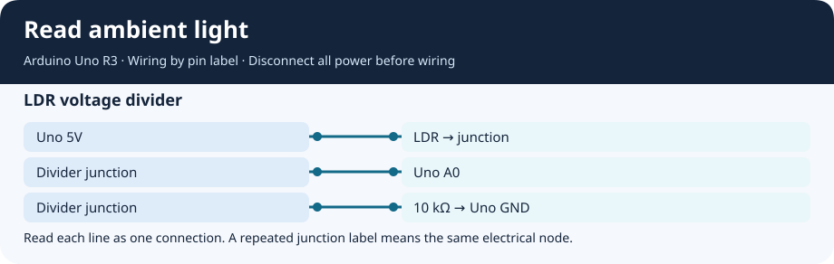

# Read ambient light notes

[Project lesson](../../03-inputs-light-and-climate.md#ldr_reading) · [Open Arduino sketch](ldr_reading.ino) · [Image credits](../../../IMAGE-SOURCES.md)

## What does this program do?

9600 baud. LDR ADC: 620 is an example. Your value changes with light.

## Components and their functions

Arduino Uno R3 runs the sketch. A USB data cable supplies logic power and transfers the sketch. Use a breadboard and jumpers for external low-current connections.

### LDR voltage divider

The photoresistor decreases in resistance under brighter light. A 10 kΩ resistor makes a divider so the Uno can measure the changing junction voltage.

[Photoresistor product photos](https://www.adafruit.com/product/161) · Use the source to identify the part and then follow the wiring map below.

## Wiring explanation

Disconnect USB and any external motor supply before changing a wire. Inspect wiring against the labeled module before applying power.

| Start | End | What this connection does |
| --- | --- | --- |
| Uno 5V | LDR → junction | Upper leg of voltage divider |
| Divider junction | Uno A0 | Analog input taps the same electrical node |
| Divider junction | 10 kΩ → Uno GND | Lower leg of voltage divider |

Connection map for Read ambient light on the Uno R3. Follow connector labels. A repeated junction label is one shared electrical node. [Open diagram](../../../lesson-visuals/ldr_reading.svg).

## Complete code walkthrough

The voltage divider converts resistance into a voltage the Uno can sample. analogRead returns an integer from 0 to 1023. Serial prints the value about twice a second. The ADC value is a relative reading, not calibrated lux.

## Program execution sequence

Reset → setup runs once → loop runs the logic described above → repeat from the top of loop.

## Variables and functions

- `ldrPin` (`int`) starts at `A0`. Check the pin map and move the wire only with power off if you change a pin.

- `delay(milliseconds)` · Pauses the sketch in milliseconds. A value of 500 is half a second.
- `analogRead(pin)` · Returns 0–1023 on the Uno with its default reference. Record baselines before choosing a threshold.
- `Serial.begin(9600)` · Sets the serial connection rate. Choose 9600 baud in Serial Monitor if this sketch prints.

## Expected output

9600 baud. LDR ADC: 620 is an example. Your value changes with light.

## Common errors and troubleshooting

- If the readings run backward, check the LDR is on the 5V side of the divider. If readings are fixed, check the A0 junction and both supply rails.

## Real-world applications

This pattern can help explain light-triggered outdoor equipment. A classroom prototype is useful for learning how the signal is produced and tested.

[Sensore crepuscolare con arduino](https://commons.wikimedia.org/wiki/File:Sensore_crepuscolare_con_arduino.jpg) — Magi2774. License: CC BY-SA 4.0.

Use this photograph to see a related build. Wire your project from the map above.

## Student challenges

1. **Beginner** · Record three readings with the same lighting.
2. **Intermediate** · Cover the sensor and compare the readings to a bright condition.
3. **Optional advanced** · Change the fixed divider resistor with power off and compare sensitivity across the intended range.

## Think Like an Engineer

Which resistor sits above the A0 junction? Predict what swapping the top and bottom elements would do to the reading when the same light shines.

Write down one prediction, the single variable you changed, and the result. If they differ, propose a measurement that would distinguish two possible causes.
