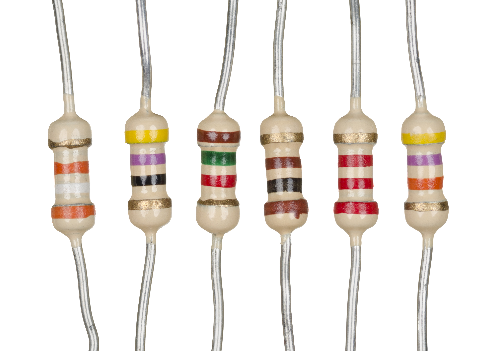
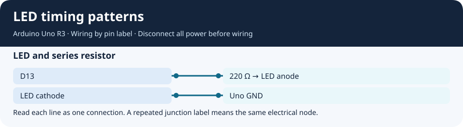

# LED timing patterns notes

[Project lesson](../../02-leds-and-sound.md#led_timing) · [Open Arduino sketch](led_timing.ino) · [Image credits](../../../IMAGE-SOURCES.md)

## What does this program do?

Three short flashes, a pause, then one long flash

## Components and their functions

Arduino Uno R3 runs the sketch. A USB data cable supplies logic power and transfers the sketch. Use a breadboard and jumpers for external low-current connections.

### LED and series resistor

The indicator LED emits light when current flows from anode to cathode. The 220 Ω resistor limits current in the same path.

*Two-lead through-hole red LED · Evan-Amos · Public domain.*

*Axial resistors with colored bands · Evan-Amos · Public domain.*

Use the resistance specified in the wiring table. Verify unfamiliar color bands with a multimeter before wiring.

## Wiring explanation

Disconnect USB and any external motor supply before changing a wire. Inspect wiring against the labeled module before applying power.

| Start | End | What this connection does |
| --- | --- | --- |
| D13 | 220 Ω → LED anode | Output signal or PWM as configured in the sketch |
| LED cathode | Uno GND | Completes the current path |

Connection map for LED timing patterns on the Uno R3. Follow connector labels. A repeated junction label is one shared electrical node. [Open diagram](../../../lesson-visuals/led_timing.svg).

## Complete code walkthrough

The for loop starts its counter at zero and repeats while it is less than three. Each short flash uses 150 ms on and off. A 1000 ms pause separates the short group from the long 1000 ms on and off pattern.

## Program execution sequence

Reset → setup runs once → loop runs the logic described above → repeat from the top of loop.

## Variables and functions

- `ledPin` (`int`) starts at `13`. Check the pin map and move the wire only with power off if you change a pin.

- `pinMode(pin, mode)` · Configures a GPIO as output, input or input with an internal pull-up. It does not turn an LED on.
- `digitalWrite(pin, value)` · On an output, HIGH drives near 5 V and LOW near ground. The value is held until changed.
- `delay(milliseconds)` · Pauses the sketch in milliseconds. A value of 500 is half a second.

## Expected output

Three short flashes, a pause, then one long flash

## Common errors and troubleshooting

- With power off, check the anode, cathode, series resistor and separate breadboard groups. Verify the Arduino pin in the sketch.

## Real-world applications

This pattern can help explain equipment fault codes shown with a status LED. A classroom prototype is useful for learning how the signal is produced and tested.

[Arduino LED project](https://commons.wikimedia.org/wiki/File:Arduino_LED_project.jpg) — Randy / ConzNL. License: CC BY 2.0.

Use this photograph to see a related build. Wire your project from the map above.

## Student challenges

1. **Beginner** · Count how many HIGH writes each cycle makes.
2. **Intermediate** · Change only the loop limit and predict the new pattern.
3. **Optional advanced** · Store the pattern as durations and replace the fixed sequence.

## Think Like an Engineer

The pin drives a series current path. What would happen if the resistor were omitted, the wire moved to a different pin without changing the code, or the LED reversed? Explain each outcome from current, pin selection and polarity. Draw the unsafe case on paper and never power an LED without its resistor.

Write down one prediction, the single variable you changed, and the result. If they differ, propose a measurement that would distinguish two possible causes.
