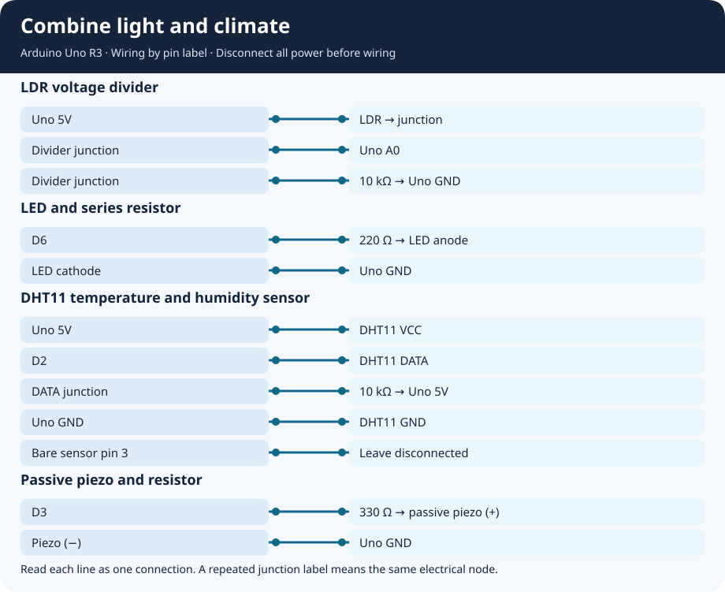

# Combine light and climate notes

[Project lesson](../../03-inputs-light-and-climate.md#light_and_climate) · [Open Arduino sketch](light_and_climate.ino) · [Image credits](../../../IMAGE-SOURCES.md)

## What does this program do?

9600 baud. Lamp reacts to darkness while the buzzer reports a climate threshold independently.

## Components and their functions

Arduino Uno R3 runs the sketch. A USB data cable supplies logic power and transfers the sketch. Use a breadboard and jumpers for external low-current connections.

### LDR voltage divider

The photoresistor decreases in resistance under brighter light. A 10 kΩ resistor makes a divider so the Uno can measure the changing junction voltage.

[Photoresistor product photos](https://www.adafruit.com/product/161) · Use the source to identify the part and then follow the wiring map below.

### LED and series resistor

The indicator LED emits light when current flows from anode to cathode. The 220 Ω resistor limits current in the same path.

*Two-lead through-hole red LED · Evan-Amos · Public domain.*

*Axial resistors with colored bands · Evan-Amos · Public domain.*

Use the resistance specified in the wiring table. Verify unfamiliar color bands with a multimeter before wiring.

### DHT11 temperature and humidity sensor

The sensor measures air temperature and relative humidity and transmits a timed digital message. A bare sensor needs a data pull-up.

*Uno and a DHT11 sensor in a separate demonstration · Edwiyanto · [CC BY-SA 4.0](https://creativecommons.org/licenses/by-sa/4.0/).*

### Passive piezo and resistor

A high-impedance passive piezo rated for 5 V turns the square wave into sound. The 330 Ω series resistor limits transient current.

[Passive piezo transducer product photos](https://www.adafruit.com/product/160) · Use the source to identify the part and then follow the wiring map below.

## Wiring explanation

Disconnect USB and any external motor supply before changing a wire. Inspect wiring against the labeled module before applying power.

| Start | End | What this connection does |
| --- | --- | --- |
| Uno 5V | LDR → junction | Upper leg of voltage divider |
| Divider junction | Uno A0 | Analog input taps the same electrical node |
| Divider junction | 10 kΩ → Uno GND | Lower leg of voltage divider |
| D6 | 220 Ω → LED anode | Output signal or PWM as configured in the sketch |
| LED cathode | Uno GND | Completes the current path |
| Uno 5V | DHT11 VCC | Supplies the sensor |
| D2 | DHT11 DATA | Timed digital data line |
| DATA junction | 10 kΩ → Uno 5V | Pull-up for bare sensor; check breakout |
| Uno GND | DHT11 GND | Common reference |
| Bare sensor pin 3 | Leave disconnected | NC; confirm pin order or breakout labels |
| D3 | 330 Ω → passive piezo (+) | The tone or note signal |
| Piezo (−) | Uno GND | Completes the return path |

Connection map for Combine light and climate on the Uno R3. Follow connector labels. A repeated junction label is one shared electrical node. [Open diagram](../../../lesson-visuals/light_and_climate.svg).

## Complete code walkthrough

The sketch samples A0 and uses a ternary expression to select HIGH or LOW for D6. The DHT logic checks both readings before evaluating the two climate thresholds. If the sample fails, the buzzer is silenced while the lamp decision still runs. The 2 s wait serves the sensor but slows lamp response.

## Program execution sequence

Reset → setup runs once → loop runs the logic described above → repeat from the top of loop.

## Variables and functions

- `ldrPin` (`int`) starts at `A0`. Check the pin map and move the wire only with power off if you change a pin.
- `ledPin` (`int`) starts at `6`. Check the pin map and move the wire only with power off if you change a pin.
- `dhtPin` (`int`) starts at `2`. Check the pin map and move the wire only with power off if you change a pin.
- `buzzerPin` (`int`) starts at `3`. Check the pin map and move the wire only with power off if you change a pin.
- `lightThreshold` (`int`) starts at `500`. Predict what changes in the walkthrough before editing this value.
- `maxTemperature` (`float`) starts at `30.0`. Predict what changes in the walkthrough before editing this value.
- `maxHumidity` (`float`) starts at `75.0`. Predict what changes in the walkthrough before editing this value.

- `pinMode(pin, mode)` · Configures a GPIO as output, input or input with an internal pull-up. It does not turn an LED on.
- `digitalWrite(pin, value)` · On an output, HIGH drives near 5 V and LOW near ground. The value is held until changed.
- `delay(milliseconds)` · Pauses the sketch in milliseconds. A value of 500 is half a second.
- `analogRead(pin)` · Returns 0–1023 on the Uno with its default reference. Record baselines before choosing a threshold.
- `tone(pin, frequency, duration)` · Starts a square wave. The frequency is in hertz. With no duration, use noTone to stop it.
- `noTone(pin)` · Stops the waveform on the buzzer pin.
- `Serial.begin(9600)` · Sets the serial connection rate. Choose 9600 baud in Serial Monitor if this sketch prints.
- `isnan(value)` · Detects an invalid floating-point sensor result before threshold decisions.
- `dht.begin()` · Initializes the selected sensor library before reading. Install the Adafruit DHT and Unified Sensor libraries.

## Expected output

9600 baud. Lamp reacts to darkness while the buzzer reports a climate threshold independently.

## Common errors and troubleshooting

- If the readings run backward, check the LDR is on the 5V side of the divider. If readings are fixed, check the A0 junction and both supply rails.
- With power off, check the anode, cathode, series resistor and separate breadboard groups. Verify the Arduino pin in the sketch.
- Check the package order or module labels, DATA pin and pull-up. Match DHT11 or DHT22 to the sketch. Allow the sample interval.
- Check that the part is a passive 5 V-compatible piezo. A buzzer with an oscillator will not reproduce the requested pitches.

## Real-world applications

This pattern can help explain multisensor room controllers. A classroom prototype is useful for learning how the signal is produced and tested.

[Light and temperature sensor integration example](https://docs.sunfounder.com/projects/breadvolt/en/latest/projects/r4_project.html) — See original project page. License: Not independently verified for republication; link only.

Use this photograph to see a related build. Wire your project from the map above.

## Student challenges

1. **Beginner** · Cover the LDR without changing the climate thresholds.
2. **Intermediate** · Find the slowest change you notice in the lamp when room light changes.
3. **Optional advanced** · Use millis() to sample the lamp faster while preserving the DHT interval.

## Think Like an Engineer

The pin drives a series current path. What would happen if the resistor were omitted, the wire moved to a different pin without changing the code, or the LED reversed? Explain each outcome from current, pin selection and polarity. Draw the unsafe case on paper and never power an LED without its resistor.

Write down one prediction, the single variable you changed, and the result. If they differ, propose a measurement that would distinguish two possible causes.
