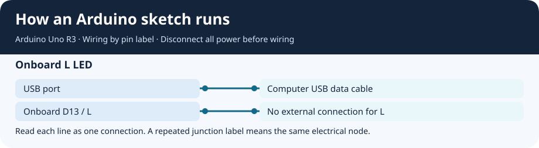

# How an Arduino sketch runs notes

[Project lesson](../../01-board-and-ide.md) · [Open Arduino sketch](sketch_structure.ino) · [Image credits](../../../IMAGE-SOURCES.md)

## What does this program do?

Onboard L LED blinks every second. Serial is configured but the sketch prints nothing.

## Components and their functions

Arduino Uno R3 runs the sketch. A USB data cable supplies logic power and transfers the sketch. Use a breadboard and jumpers for external low-current connections.

### Onboard L LED

The built-in L indicator is connected to digital pin 13 on the Uno. The board already provides its LED circuit.

[Uno R3 board and downloadable pinout](https://docs.arduino.cc/hardware/uno-rev3/) · Use the source to identify the part and then follow the wiring map below.

## Wiring explanation

Disconnect USB and any external motor supply before changing a wire. Inspect wiring against the labeled module before applying power.

| Start | End | What this connection does |
| --- | --- | --- |
| USB port | Computer USB data cable | Powers and programs the Uno |
| Onboard D13 / L | No external connection for L | The LED and its current limit are built in. |

Connection map for How an Arduino sketch runs on the Uno R3. Follow connector labels. A repeated junction label is one shared electrical node. [Open diagram](../../../lesson-visuals/sketch_structure.svg).

## Complete code walkthrough

Arduino.h makes core functions available. The global pin constant selects D13 and count starts at zero. setup configures the pin and opens Serial once. loop writes the states, pauses 500 ms each time, and increments count after a full cycle.

## Program execution sequence

Reset → setup runs once → loop runs the logic described above → repeat from the top of loop.

## Variables and functions

- `ledPin` (`int`) starts at `13`. Check the pin map and move the wire only with power off if you change a pin.

- `pinMode(pin, mode)` · Configures a GPIO as output, input or input with an internal pull-up. It does not turn an LED on.
- `digitalWrite(pin, value)` · On an output, HIGH drives near 5 V and LOW near ground. The value is held until changed.
- `delay(milliseconds)` · Pauses the sketch in milliseconds. A value of 500 is half a second.
- `Serial.begin(9600)` · Sets the serial connection rate. Choose 9600 baud in Serial Monitor if this sketch prints.

## Expected output

Onboard L LED blinks every second. Serial is configured but the sketch prints nothing.

## Common errors and troubleshooting

- Check the selected Uno board, USB data cable and port. The L indicator is different from the power LED.

## Real-world applications

This pattern can help explain firmware counters and startup setup. A classroom prototype is useful for learning how the signal is produced and tested.

[See an Arduino wired to a breadboard](https://commons.wikimedia.org/wiki/File:Arduino_Uno_with_breadboard.jpg) for a comparable bench setup.

## Student challenges

1. **Beginner** · Explain why count would restart on every iteration if you declared it inside loop.
2. **Intermediate** · Print count after each completed cycle at 9600 baud.
3. **Optional advanced** · Use an unsigned timer to blink and report at different rates.

## Think Like an Engineer

Before changing the code, make a prediction. Explain why count would restart on every iteration if you declared it inside loop. Explain how to tell a timing change from a board or upload problem.

Write down one prediction, the single variable you changed, and the result. If they differ, propose a measurement that would distinguish two possible causes.
