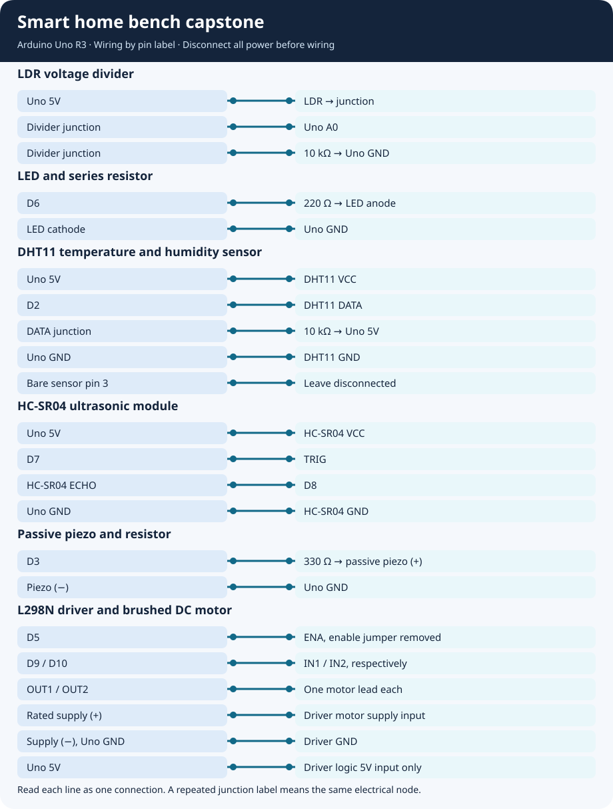

# Smart home bench capstone notes

[Project lesson](../../05-smart-home.md#smart_home) · [Open Arduino sketch](smart_home.ino) · [Image credits](../../../IMAGE-SOURCES.md)

## What does this program do?

9600 baud. Lamp, fan, and proximity alarm respond independently. The status report gives sensor readings and actuator states.

## Components and their functions

Arduino Uno R3 runs the sketch. A USB data cable supplies logic power and transfers the sketch. Use a breadboard and jumpers for external low-current connections.

### LDR voltage divider

The photoresistor decreases in resistance under brighter light. A 10 kΩ resistor makes a divider so the Uno can measure the changing junction voltage.

[Photoresistor product photos](https://www.adafruit.com/product/161) · Use the source to identify the part and then follow the wiring map below.

### LED and series resistor

The indicator LED emits light when current flows from anode to cathode. The 220 Ω resistor limits current in the same path.

*Two-lead through-hole red LED · Evan-Amos · Public domain.*

*Axial resistors with colored bands · Evan-Amos · Public domain.*

Use the resistance specified in the wiring table. Verify unfamiliar color bands with a multimeter before wiring.

### DHT11 temperature and humidity sensor

The sensor measures air temperature and relative humidity and transmits a timed digital message. A bare sensor needs a data pull-up.

[Uno and a DHT11 sensor in a separate demonstration](https://commons.wikimedia.org/wiki/File:Arduino_uno_dht11.jpg)

*Uno and a DHT11 sensor in a separate demonstration · Edwiyanto · [CC BY-SA 4.0](https://creativecommons.org/licenses/by-sa/4.0/).*

### HC-SR04 ultrasonic module

The transmitter sends an ultrasonic burst and the module returns an ECHO pulse. The Uno measures how long that pulse lasts.

[Ultrasonic module photos](https://learn.adafruit.com/ultrasonic-sonar-distance-sensors) · Use the source to identify the part and then follow the wiring map below.

### Passive piezo and resistor

A high-impedance passive piezo rated for 5 V turns the square wave into sound. The 330 Ω series resistor limits transient current.

[Passive piezo transducer product photos](https://www.adafruit.com/product/160) · Use the source to identify the part and then follow the wiring map below.

### L298N driver and brushed DC motor

A documented breakout with flyback diodes and heatsink switches the motor current. The Uno supplies control logic; a separate current-limited supply powers the secured bare motor.

[L298N breakout and label examples](https://components101.com/modules/l293n-motor-driver-module) · Use the source to identify the part and then follow the wiring map below.

## Wiring explanation

Disconnect USB and any external motor supply before changing a wire. Inspect wiring against the labeled module before applying power.

| Start | End | What this connection does |
| --- | --- | --- |
| Uno 5V | LDR → junction | Upper leg of voltage divider |
| Divider junction | Uno A0 | Analog input taps the same electrical node |
| Divider junction | 10 kΩ → Uno GND | Lower leg of voltage divider |
| D6 | 220 Ω → LED anode | Output signal or PWM as configured in the sketch |
| LED cathode | Uno GND | Completes the current path |
| Uno 5V | DHT11 VCC | Supplies the sensor |
| D2 | DHT11 DATA | Timed digital data line |
| DATA junction | 10 kΩ → Uno 5V | Pull-up for bare sensor; check breakout |
| Uno GND | DHT11 GND | Common reference |
| Bare sensor pin 3 | Leave disconnected | NC; confirm pin order or breakout labels |
| Uno 5V | HC-SR04 VCC | Use the 5 V module |
| D7 | TRIG | Uno sends a 10 µs trigger |
| HC-SR04 ECHO | D8 | The Uno times the 5 V logic pulse |
| Uno GND | HC-SR04 GND | Shared reference for trigger and echo |
| D3 | 330 Ω → passive piezo (+) | The tone or note signal |
| Piezo (−) | Uno GND | Completes the return path |
| D5 | ENA, enable jumper removed | PWM control of channel A |
| D9 / D10 | IN1 / IN2, respectively | Direction controls |
| OUT1 / OUT2 | One motor lead each | Motor output pair |
| Rated supply (+) | Driver motor supply input | Dedicated source matched to motor and module |
| Supply (−), Uno GND | Driver GND | Common reference; route motor return directly |
| Uno 5V | Driver logic 5V input only | Use verified external-logic configuration |

Connection map for Smart home bench capstone on the Uno R3. Follow connector labels. A repeated junction label is one shared electrical node. [Open diagram](../../../lesson-visuals/smart_home.svg).

## Complete code walkthrough

setup initializes the pins, lamp, buzzer, motor and DHT with outputs off.

updateLighting reads A0 and retains state between 400 and 550.

updateEnvironment validates both DHT11 readings, switches the fan at 30 and 28 °C and disables it on failure.

setFan commands ENA at 200 with one direction or disables the bridge.

measureDistance returns −1 on a timeout or invalid range.

updateProximityAlarm selects silent, pulsed or continuous tone from the last distance and only changes tone when its state changes.

printSystemStatus reports last readings or N/A.

loop compares unsigned elapsed times to 100 ms for light, 2 s for climate and logs, and 80 ms for echoes; pulseIn may still block up to 25 ms.

## Program execution sequence

Reset → initialize safe outputs → check light, climate and echo timers → update alarm → report status when due → repeat.

## Variables and functions

- `LDR_PIN` (`int`) starts at `A0`. Check the pin map and move the wire only with power off if you change a pin.
- `DHT_PIN` (`int`) starts at `2`. Check the pin map and move the wire only with power off if you change a pin.
- `BUZZER_PIN` (`int`) starts at `3`. Check the pin map and move the wire only with power off if you change a pin.
- `MOTOR_EN` (`int`) starts at `5`. Check the pin map and move the wire only with power off if you change a pin.
- `LED_PIN` (`int`) starts at `6`. Check the pin map and move the wire only with power off if you change a pin.
- `TRIG_PIN` (`int`) starts at `7`. Check the pin map and move the wire only with power off if you change a pin.
- `ECHO_PIN` (`int`) starts at `8`. Check the pin map and move the wire only with power off if you change a pin.
- `MOTOR_IN1` (`int`) starts at `9`. Check the pin map and move the wire only with power off if you change a pin.
- `MOTOR_IN2` (`int`) starts at `10`. Check the pin map and move the wire only with power off if you change a pin.
- `DARK_THRESHOLD` (`int`) starts at `400`. Predict what changes in the walkthrough before editing this value.
- `BRIGHT_THRESHOLD` (`int`) starts at `550`. Predict what changes in the walkthrough before editing this value.
- `FAN_ON_TEMP` (`float`) starts at `30.0`. Predict what changes in the walkthrough before editing this value.
- `FAN_OFF_TEMP` (`float`) starts at `28.0`. Predict what changes in the walkthrough before editing this value.
- `MOTOR_SPEED` (`int`) starts at `200`. Predict what changes in the walkthrough before editing this value.

- `pinMode(pin, mode)` · Configures a GPIO as output, input or input with an internal pull-up. It does not turn an LED on.
- `digitalWrite(pin, value)` · On an output, HIGH drives near 5 V and LOW near ground. The value is held until changed.
- `delayMicroseconds(microseconds)` · Waits in millionths of a second to shape the trigger pulse.
- `analogRead(pin)` · Returns 0–1023 on the Uno with its default reference. Record baselines before choosing a threshold.
- `analogWrite(pin, duty)` · On an Uno PWM pin, duty 0 is continuously off and 255 is continuously on. Intermediate values vary the on-time.
- `tone(pin, frequency, duration)` · Starts a square wave. The frequency is in hertz. With no duration, use noTone to stop it.
- `noTone(pin)` · Stops the waveform on the buzzer pin.
- `pulseIn(pin, HIGH, timeout)` · Measures the HIGH pulse in microseconds, or returns zero on timeout.
- `millis()` · Returns elapsed milliseconds since startup. Subtract unsigned timestamps to compare elapsed time across rollover.
- `Serial.begin(9600)` · Sets the serial connection rate. Choose 9600 baud in Serial Monitor if this sketch prints.
- `isnan(value)` · Detects an invalid floating-point sensor result before threshold decisions.
- `dht.begin()` · Initializes the selected sensor library before reading. Install the Adafruit DHT and Unified Sensor libraries.

## Expected output

9600 baud. Lamp, fan, and proximity alarm respond independently. The status report gives sensor readings and actuator states.

## Common errors and troubleshooting

- If the readings run backward, check the LDR is on the 5V side of the divider. If readings are fixed, check the A0 junction and both supply rails.
- With power off, check the anode, cathode, series resistor and separate breadboard groups. Verify the Arduino pin in the sketch.
- Check the package order or module labels, DATA pin and pull-up. Match DHT11 or DHT22 to the sketch. Allow the sample interval.
- Do not exchange TRIG and ECHO. Use a broad flat target and avoid the blind zone. Check timeout and 5 V supply.
- Check that the part is a passive 5 V-compatible piezo. A buzzer with an oscillator will not reproduce the requested pitches.
- Switch off the motor supply if the driver heats excessively, the shaft stalls or the Uno resets. Check ENA jumper, logic input configuration and shared ground.

## Real-world applications

This pattern can help explain multisensor automation and fault handling. A classroom prototype is useful for learning how the signal is produced and tested.

[Physical smart-home/sensor integration project reference](https://projecthub.arduino.cc/js-arduino/4fc420da-214a-4597-a8cd-363ce6cbbbf2) — See original project page. License: Not independently verified for republication; link only.

Use this photograph to see a related build. Wire your project from the map above.

## Student challenges

1. **Beginner** · Draw the three inputs and three outputs before wiring.
2. **Intermediate** · Run all three capstone acceptance checks and record the time of each change.
3. **Optional advanced** · Change the alarm cadence without changing the sensor sampling cadence and explain the separation.

## Think Like an Engineer

Imagine the DHT data wire is disconnected and an object approaches at the same time. Which outputs should react and which should stay independent? Draw that timeline on paper. Then explain why a missing echo and a failed climate sample each need their own fault response.

Write down one prediction, the single variable you changed, and the result. If they differ, propose a measurement that would distinguish two possible causes.
