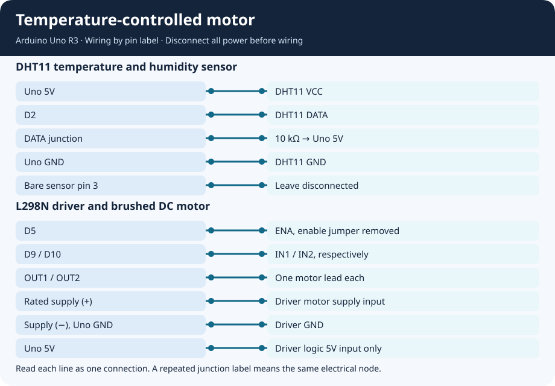

# Temperature-controlled motor notes

[Project lesson](../../04-distance-and-motors.md#temperature_fan) · [Open Arduino sketch](temperature_fan.ino) · [Image credits](../../../IMAGE-SOURCES.md)

## What does this program do?

9600 baud. Motor starts at 30 °C, stops at 28 °C, and switches off when the DHT fails.

## Components and their functions

Arduino Uno R3 runs the sketch. A USB data cable supplies logic power and transfers the sketch. Use a breadboard and jumpers for external low-current connections.

### DHT11 temperature and humidity sensor

The sensor measures air temperature and relative humidity and transmits a timed digital message. A bare sensor needs a data pull-up.

*Uno and a DHT11 sensor in a separate demonstration · Edwiyanto · [CC BY-SA 4.0](https://creativecommons.org/licenses/by-sa/4.0/).*

### L298N driver and brushed DC motor

A documented breakout with flyback diodes and heatsink switches the motor current. The Uno supplies control logic; a separate current-limited supply powers the secured bare motor.

[L298N breakout and label examples](https://components101.com/modules/l293n-motor-driver-module) · Use the source to identify the part and then follow the wiring map below.

## Wiring explanation

Disconnect USB and any external motor supply before changing a wire. Inspect wiring against the labeled module before applying power.

| Start | End | What this connection does |
| --- | --- | --- |
| Uno 5V | DHT11 VCC | Supplies the sensor |
| D2 | DHT11 DATA | Timed digital data line |
| DATA junction | 10 kΩ → Uno 5V | Pull-up for bare sensor; check breakout |
| Uno GND | DHT11 GND | Common reference |
| Bare sensor pin 3 | Leave disconnected | NC; confirm pin order or breakout labels |
| D5 | ENA, enable jumper removed | PWM control of channel A |
| D9 / D10 | IN1 / IN2, respectively | Direction controls |
| OUT1 / OUT2 | One motor lead each | Motor output pair |
| Rated supply (+) | Driver motor supply input | Dedicated source matched to motor and module |
| Supply (−), Uno GND | Driver GND | Common reference; route motor return directly |
| Uno 5V | Driver logic 5V input only | Use verified external-logic configuration |

Connection map for Temperature-controlled motor on the Uno R3. Follow connector labels. A repeated junction label is one shared electrical node. [Open diagram](../../../lesson-visuals/temperature_fan.svg).

## Complete code walkthrough

setFan updates fanIsOn, sets one driver direction, and commands duty 200 when enabled. loop reads and validates both measurements. On a fault it disables the motor and returns. When valid, two temperatures control state with a dead band. Serial reports the readings before the two-second wait.

## Program execution sequence

Reset → setup runs once → loop runs the logic described above → repeat from the top of loop.

## Variables and functions

- `dhtPin` (`int`) starts at `2`. Check the pin map and move the wire only with power off if you change a pin.
- `enA` (`int`) starts at `5`. Predict what changes in the walkthrough before editing this value.
- `in1` (`int`) starts at `9`. Predict what changes in the walkthrough before editing this value.
- `in2` (`int`) starts at `10`. Predict what changes in the walkthrough before editing this value.
- `fanOnTemperature` (`float`) starts at `30.0`. Predict what changes in the walkthrough before editing this value.
- `fanOffTemperature` (`float`) starts at `28.0`. Predict what changes in the walkthrough before editing this value.

- `pinMode(pin, mode)` · Configures a GPIO as output, input or input with an internal pull-up. It does not turn an LED on.
- `digitalWrite(pin, value)` · On an output, HIGH drives near 5 V and LOW near ground. The value is held until changed.
- `delay(milliseconds)` · Pauses the sketch in milliseconds. A value of 500 is half a second.
- `analogWrite(pin, duty)` · On an Uno PWM pin, duty 0 is continuously off and 255 is continuously on. Intermediate values vary the on-time.
- `Serial.begin(9600)` · Sets the serial connection rate. Choose 9600 baud in Serial Monitor if this sketch prints.
- `isnan(value)` · Detects an invalid floating-point sensor result before threshold decisions.
- `dht.begin()` · Initializes the selected sensor library before reading. Install the Adafruit DHT and Unified Sensor libraries.

## Expected output

9600 baud. Motor starts at 30 °C, stops at 28 °C, and switches off when the DHT fails.

## Common errors and troubleshooting

- Check the package order or module labels, DATA pin and pull-up. Match DHT11 or DHT22 to the sketch. Allow the sample interval.
- Switch off the motor supply if the driver heats excessively, the shaft stalls or the Uno resets. Check ENA jumper, logic input configuration and shared ground.

## Real-world applications

This pattern can help explain ventilation control. A classroom prototype is useful for learning how the signal is produced and tested.

[Arduino and small propeller motor](https://commons.wikimedia.org/wiki/File:Arduino_and_small_propeller_motor.jpg) — messi / 1messi01. License: CC BY-SA 3.0.

Use this photograph to see a related build. Wire your project from the map above.

## Student challenges

1. **Beginner** · Predict the state at 29 °C given each possible prior state.
2. **Intermediate** · Adjust both thresholds near ambient and confirm the on and off behavior.
3. **Optional advanced** · Log the event that causes a state change instead of printing only sampled levels.

## Think Like an Engineer

Which output should change when a sample is missing? Sketch one timeline with a valid sample, a failed sample and a recovery. Explain what would happen if the code kept trusting the last valid value.

Write down one prediction, the single variable you changed, and the result. If they differ, propose a measurement that would distinguish two possible causes.
