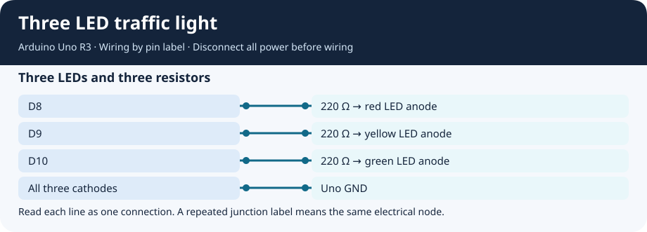

# Three LED traffic light notes

[Project lesson](../../02-leds-and-sound.md#traffic_light) · [Open Arduino sketch](traffic_light.ino) · [Image credits](../../../IMAGE-SOURCES.md)

## What does this program do?

Red 5 s, green 5 s, yellow 2 s, repeat

## Components and their functions

Arduino Uno R3 runs the sketch. A USB data cable supplies logic power and transfers the sketch. Use a breadboard and jumpers for external low-current connections.

### Three LEDs and three resistors

Each red, yellow and green LED has its own 220 Ω series resistor. Each cathode returns to the same ground.

*Two-lead through-hole red LED · Evan-Amos · Public domain.*

*Axial resistors with colored bands · Evan-Amos · Public domain.*

Use the resistance specified in the wiring table. Verify unfamiliar color bands with a multimeter before wiring.

## Wiring explanation

Disconnect USB and any external motor supply before changing a wire. Inspect wiring against the labeled module before applying power.

| Start | End | What this connection does |
| --- | --- | --- |
| D8 | 220 Ω → red LED anode | Red phase |
| D9 | 220 Ω → yellow LED anode | Yellow phase |
| D10 | 220 Ω → green LED anode | Green phase |
| All three cathodes | Uno GND | One shared return, no shared resistor |

Connection map for Three LED traffic light on the Uno R3. Follow connector labels. A repeated junction label is one shared electrical node. [Open diagram](../../../lesson-visuals/traffic_light.svg).

## Complete code walkthrough

setup configures three outputs. Each phase sets one lamp HIGH, sets the rest LOW, and waits for its assigned time. The last phase returns to the start of loop automatically.

## Program execution sequence

Reset → setup runs once → loop runs the logic described above → repeat from the top of loop.

## Variables and functions

- `redLED` (`int`) starts at `8`. Check the pin map and move the wire only with power off if you change a pin.
- `yellowLED` (`int`) starts at `9`. Check the pin map and move the wire only with power off if you change a pin.
- `greenLED` (`int`) starts at `10`. Check the pin map and move the wire only with power off if you change a pin.

- `pinMode(pin, mode)` · Configures a GPIO as output, input or input with an internal pull-up. It does not turn an LED on.
- `digitalWrite(pin, value)` · On an output, HIGH drives near 5 V and LOW near ground. The value is held until changed.
- `delay(milliseconds)` · Pauses the sketch in milliseconds. A value of 500 is half a second.

## Expected output

Red 5 s, green 5 s, yellow 2 s, repeat

## Common errors and troubleshooting

- Check one LED and resistor at a time. If the order is wrong, compare D8/D9/D10 with the sketch and each LED color.

## Real-world applications

This pattern can help explain sequenced signals at intersections. A classroom prototype is useful for learning how the signal is produced and tested.

[Traffic Lights, Arduino](https://commons.wikimedia.org/wiki/File:Traffic_Lights%2C_Arduino.jpg) — Khaifuture. License: CC BY-SA 3.0.

Use this photograph to see a related build. Wire your project from the map above.

## Student challenges

1. **Beginner** · Increase yellow by one second and predict the full cycle time.
2. **Intermediate** · Add an all-red pause and record all output states.
3. **Optional advanced** · Represent the phases with a state variable and millis().

## Think Like an Engineer

The pin drives a series current path. What would happen if the resistor were omitted, the wire moved to a different pin without changing the code, or the LED reversed? Explain each outcome from current, pin selection and polarity. Draw the unsafe case on paper and never power an LED without its resistor.

Write down one prediction, the single variable you changed, and the result. If they differ, propose a measurement that would distinguish two possible causes.
