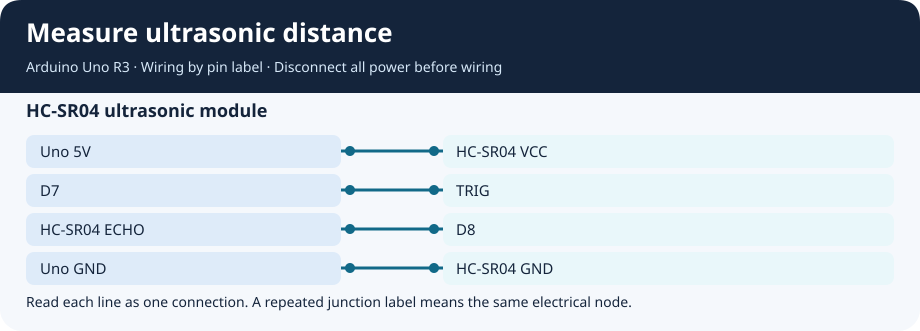

# Measure ultrasonic distance notes

[Project lesson](../../04-distance-and-motors.md#ultrasonic_reading) · [Open Arduino sketch](ultrasonic_reading.ino) · [Image credits](../../../IMAGE-SOURCES.md)

## What does this program do?

9600 baud. Distance: 20.00 cm is an example; invalid echoes report No valid echo.

## Components and their functions

Arduino Uno R3 runs the sketch. A USB data cable supplies logic power and transfers the sketch. Use a breadboard and jumpers for external low-current connections.

### HC-SR04 ultrasonic module

The transmitter sends an ultrasonic burst and the module returns an ECHO pulse. The Uno measures how long that pulse lasts.

[Ultrasonic module photos](https://learn.adafruit.com/ultrasonic-sonar-distance-sensors) · Use the source to identify the part and then follow the wiring map below.

## Wiring explanation

Disconnect USB and any external motor supply before changing a wire. Inspect wiring against the labeled module before applying power.

| Start | End | What this connection does |
| --- | --- | --- |
| Uno 5V | HC-SR04 VCC | Use the 5 V module |
| D7 | TRIG | Uno sends a 10 µs trigger |
| HC-SR04 ECHO | D8 | The Uno times the 5 V logic pulse |
| Uno GND | HC-SR04 GND | Shared reference for trigger and echo |

Connection map for Measure ultrasonic distance on the Uno R3. Follow connector labels. A repeated junction label is one shared electrical node. [Open diagram](../../../lesson-visuals/ultrasonic_reading.svg).

## Complete code walkthrough

A clean LOW–HIGH–LOW trigger includes 10 µs HIGH. pulseIn times the ECHO HIGH pulse with a 30 ms timeout. Multiply by 0.0343 cm/µs and divide by two for the return trip. The code rejects distances outside 2–400 cm and waits 100 ms.

## Program execution sequence

Reset → setup runs once → loop runs the logic described above → repeat from the top of loop.

## Variables and functions

- `trigPin` (`int`) starts at `7`. Check the pin map and move the wire only with power off if you change a pin.
- `echoPin` (`int`) starts at `8`. Check the pin map and move the wire only with power off if you change a pin.

- `pinMode(pin, mode)` · Configures a GPIO as output, input or input with an internal pull-up. It does not turn an LED on.
- `digitalWrite(pin, value)` · On an output, HIGH drives near 5 V and LOW near ground. The value is held until changed.
- `delay(milliseconds)` · Pauses the sketch in milliseconds. A value of 500 is half a second.
- `delayMicroseconds(microseconds)` · Waits in millionths of a second to shape the trigger pulse.
- `pulseIn(pin, HIGH, timeout)` · Measures the HIGH pulse in microseconds, or returns zero on timeout.
- `Serial.begin(9600)` · Sets the serial connection rate. Choose 9600 baud in Serial Monitor if this sketch prints.

## Expected output

9600 baud. Distance: 20.00 cm is an example; invalid echoes report No valid echo.

## Common errors and troubleshooting

- Do not exchange TRIG and ECHO. Use a broad flat target and avoid the blind zone. Check timeout and 5 V supply.

## Real-world applications

This pattern can help explain distance estimation in mobile robots. A classroom prototype is useful for learning how the signal is produced and tested.

[Arduino UNO + HC-SR04 + HC 05 + breadboard - bird's eye 00](https://commons.wikimedia.org/wiki/File:Arduino_UNO_%2B_HC-SR04_%2B_HC_05_%2B_breadboard_-_bird%27s_eye_00.jpg) — Pradana Aumars. License: CC BY-SA 4.0.

Use this photograph to see a related build. Wire your project from the map above.

## Student challenges

1. **Beginner** · Predict the distance corresponding to 2000 µs.
2. **Intermediate** · Record readings from a flat target at 10, 20, and 40 cm.
3. **Optional advanced** · Compare straight and angled targets and characterize missing readings.

## Think Like an Engineer

An echo timeout can look like a numerical zero. Why would treating it as zero distance produce a false alarm? How do sensor range checks and one flat target at a known distance help isolate the fault?

Write down one prediction, the single variable you changed, and the result. If they differ, propose a measurement that would distinguish two possible causes.
